# Game design : Fluffy Racers

**Référence de gameplay : Mario Kart 8 Deluxe (MK8DX).** L'objectif est de retrouver ses sensations : drift et mini-turbos, départ fusée, figures, aspiration, pièces, objets dosés selon la distance au leader, 12 coureurs.

En plus de ces mécaniques, Fluffy Racers a les siennes : les **interactions entre karts** (coup de patte, attrape, § 15).

Ce document est **la source de vérité** pour le gameplay. En cas de doute, il l'emporte sur le texte d'une issue.

> **Propriété intellectuelle.** Les *mécaniques* de jeu ne sont pas protégées : on peut les reprendre. Tout le reste doit être **original** : noms des objets et des personnages, visuels, circuits, musiques, sons, interface. N'utilise jamais un nom, un personnage, un objet, un logo ou un tracé de circuit de Nintendo. Le tableau des objets plus bas donne nos équivalents.

Les valeurs marquées **(MK8DX)** viennent de sources publiques sur le jeu. Celles marquées **(à régler)** sont nos propres points de départ : elles vont dans les Resources de réglage et seront ajustées en jouant.

---

## 1. Format de course

| Élément | Valeur |
|---|---|
| Coureurs | **12** : joueurs + bots (MK8DX) |
| Tours | **3** (MK8DX, la plupart des circuits) |
| Championnat (Grand Prix) | 4 courses pour une coupe (de 2 au nombre de circuits pour un championnat personnalisé, #99) ; points du 1er au 12e : **15, 12, 10, 9, 8, 7, 6, 5, 4, 3, 2, 1** (MK8) |
| Vitesse | **Une seule**, celle des réglages du jeu (§ 2) : pas de classes de vitesse (décision de Max du 2026-10-17, #118). Plus un mode miroir |
| Départ | Grille en quinconce, compte à rebours « 3, 2, 1, GO » d'une seconde par étape |
| Modes | **Jouer solo** (#99) : Championnat (une coupe ou un championnat personnalisé), Contre-la-montre (3 piments, fantôme ; voir plus bas), Circuit seul (l'ancienne course libre). En ligne (jusqu'à 12) : l'hôte choisit Circuit seul ou Championnat (#122 ; pas de contre-la-montre en ligne). **Pas de mode Bataille** (décision de Max du 2026-10-16, #21) |
| Réglages de partie (#99) | Le **miroir**, **Bots : Facile / Normal / Difficile / Non** (#153 ; Normal par défaut) et **Objets : oui / non**, en solo comme en ligne. Pas de classe de vitesse (#118) |

### Jouer solo et réglages de partie (#99)

Demande de Max (2026-10-17) : « Dans solo on a le choix de championnat, contre la montre, circuit seul. Le championnat peut être une coupe déjà définie ou un championnat custom avec un certain nombre de circuits définis ou aléatoire. Je veux qu'on ait la possibilité en solo et en multi de faire aussi ces choix sur le championnat, ainsi que la possibilité d'activer ou désactiver les bots et les objets. »

- **Trois modes**, dans cet ordre : **Championnat** (ci-dessous), **Contre-la-montre** (le circuit et le miroir), **Circuit seul** (un circuit, une course).
- **Le championnat** est :
  - **une coupe** : quatre circuits de `assets/tracks/index.ron`, dans son ordre (la 1re coupe court les quatre premiers, la 2e les quatre suivants…), chacune avec un nom original et son icône (le manifeste : « Coupe Doudou », « Coupe Nuage »…). **Une coupe qui n'a pas encore ses quatre circuits n'est pas proposée** (notre choix : une coupe a quatre courses ; ses circuits se courent seuls ou dans un championnat personnalisé). Avec 6 circuits aujourd'hui, il y en a une ; avec 24 à terme, six ;
  - **ou un championnat personnalisé** : un **nombre de courses** (de 2 au nombre de circuits), puis ses circuits **au choix** (un par un, courus dans l'ordre choisi ; un circuit peut revenir) ou **au hasard** : tirés de la graine de la course (`RaceGrid::seed`) et du numéro du tirage, **toujours les mêmes pour la même graine et le même tirage, et jamais deux fois le même circuit tant qu'il en reste** ; l'écran montre le tirage avant le départ, et chaque nouveau nombre de courses, chaque retour à « Au hasard » et chaque championnat lancé fait un nouveau tirage.
  - Les points, les égalités, la grille inversée, les mêmes adversaires et le podium sont ceux de la suite (« Grand Prix (#19) »), quelles que soient ses courses. Ses écrans disent son nom : celui de la coupe (« Coupe Doudou 2/4 · Anneau Guimauve »), ou « Championnat » (#100 : avec les accents, en Fredoka).
- **Bots : Facile, Normal ou Difficile** (#153, Max : « rajoute des options dans le dropdown bot avec les modes de difficulté et non ») : ils complètent la grille jusqu'à 12, **à ce niveau** (§ 12), pour un circuit seul comme pour tout un championnat ; **Normal par défaut** (le niveau des bots d'avant). **Bots : Non** : seuls les joueurs courent ; en solo, une course seul, sans fantôme, avec les objets si on les veut (un championnat aussi : le podium n'a que le joueur). Le nombre de bots du joueur est gardé et revient avec un niveau. Le contre-la-montre n'a pas de bots. **Le choix est gardé dans le navigateur** : le jeu suivant repart avec. Pas de grille « mélangée » (des bots de plusieurs niveaux) : elle reste celle des tests des bots. Le panneau d'admin change le même niveau (à côté du nombre de bots).
- **Objets : non** : **aucune boîte à objets sur la piste** (donc aucun objet tiré au hasard) ; les croquettes restent. Le contre-la-montre n'en a jamais et garde ses 3 piments.
- **Le nombre de tours** reste 3 (`RaceTuning::laps`). Les **circuits « ouverts »** (une longue course sans tours, une par coupe : #119, plus tard) prendront place dans le manifeste et dans les coupes comme les autres.
- **En ligne** : l'hôte choisit, dans le salon, le **mode** (Circuit seul ou Championnat, #122), le circuit ou le championnat, le **miroir**, les **bots** (#153 : la même ligne, Facile, Normal, Difficile ou Non) et les **objets** ; chaque joueur voit ses choix et court avec eux (les mêmes bots, au même niveau ; sans bots : seuls les joueurs sur la grille). Le championnat en ligne : ci-dessous, « Championnat en ligne (#122) ».
- Apparence et navigation : `docs/UI_CHARTE.md` § « L'écran Jouer solo (#99) ».

### Grand Prix (#19)

Le championnat de #99 (« Championnat » dans les écrans) ; ses règles :

- **La coupe** : les quatre premiers circuits de `assets/tracks/index.ron`, dans cet ordre (Prairie Pompon, Anneau Guimauve, Crique Câline, Col des Moufles), dans le mode miroir choisi pour tout le Grand Prix. Depuis #99, une coupe du manifeste, ou les courses d'un championnat personnalisé.
- **Points** : ceux du tableau ci-dessus, d'après le classement final de chaque course (le tableau clos de #70 : un coureur encore en piste prend sa place estimée).
- **Égalités** (non tranché par MK8DX dans nos sources ; notre règle) : à points égaux, le mieux classé de la **dernière course** passe devant, puis celui de la course d'avant, et ainsi de suite. Tous les coureurs ont une place à chaque course : il n'y a donc jamais d'égalité au bout du compte.
- **Grille de la course suivante** (comme MK8DX) : l'ordre inverse du classement général, le leader en dernière position. La première course part comme une course libre : les bots devant, le joueur derrière.
- **Les mêmes adversaires** : chaque bot garde son animal, ses pièces, sa couleur et son nom d'une course à l'autre, quelle que soit sa place sur la grille.
- **Entre les courses** : le classement de la course, puis le classement général (points de la course et total) ; son bouton « Course suivante » la lance (#136 ; « Abandonner » arrête le championnat : retour à l'accueil).
- **Podium** : après la dernière course, les trois premiers sur leurs marches, qui dansent, caméra fixe ; « Rejouer le championnat » relance le même championnat, « Accueil » y ramène (#136).
- **Refaire une course** (un nouveau kart choisi avec G, « Relancer » du panneau d'admin) : la course du Grand Prix repart, ses points sont repris.
- **En ligne** depuis #122 : voir la suite.

### Championnat en ligne (#122)

- **Le choix** : dans le salon, l'hôte choisit le mode, **Circuit seul** ou **Championnat**, puis le championnat comme dans « Jouer solo » : une coupe, ou un championnat personnalisé (le nombre de courses, les circuits au choix ou au hasard). Pas de contre-la-montre en ligne. Au hasard, **c'est l'hôte qui tire** les circuits (la graine de sa partie et le numéro du tirage) : tout le monde voit son tirage, avant le départ, dans le salon (« Au programme »). Le miroir, les bots et les objets valent pour tout le championnat.
- **Les règles sont celles du solo** (« Grand Prix (#19) ») : les points de chaque course d'après le tableau clos de l'hôte, les égalités (le mieux classé de la dernière course passe devant), la grille de la course suivante dans l'ordre inverse du classement général (le leader en dernier ; la première course part comme une course seule : les bots devant, les joueurs derrière), **les mêmes bots d'une course à l'autre** (animal, pièces, couleur, nom), quelle que soit leur place sur la grille.
- **Les participants** : les bots qui complètent la grille au départ du championnat (jusqu'à 12, s'il y a des bots), puis les joueurs assis à ce moment-là. **L'hôte porte le championnat** : il note chaque course, calcule le classement général et la grille de la suivante, et les annonce à tous ; chaque joueur voit les mêmes classements et le même podium.
- **Entre les courses** : le classement de la course, puis le classement général (environ 8 s, à régler), puis la course suivante, **lancée par l'hôte** : automatiquement après ce délai, ou tout de suite avec son bouton « Course suivante » (#136 : le compte à rebours est dessous ; chez les autres, ce bouton est grisé : « Dans 5 s : l'hôte décide. »). Après la dernière course : le classement général (« Le podium »), puis **le podium** (environ 12 s, à régler ; « Retour au salon » de l'hôte pour aller plus vite ; celui d'un autre joueur l'y ramène seul, avant les autres), puis **tout le monde revient au salon**. L'hôte peut aussi arrêter le championnat pour tous, à tout moment entre les courses : « Retour au salon » (#136). Un championnat au hasard est retiré au sort pour le suivant.
- **Un joueur qui part** en cours de championnat garde ses points ; il ne court plus (la grille se resserre) et ne marque plus rien : dernier de chaque course, sans points (celle qu'il a quittée en route aussi : il a abandonné). Le championnat continue pour les autres. Le départ de l'hôte, lui, termine la partie (#63).
- **Un joueur qui arrive** pendant un championnat le regarde (comme une course en cours) et sera du suivant.

### Miroir (#19)

- **Pas de classes de vitesse** (décision de Max du 2026-10-17, #118 : « seule la 150cc m'intéresse ») : le jeu se joue à une seule vitesse, celle de ses réglages (§ 2), qui était le 150cc de #19. Les classes 50cc, 100cc et 200cc et le frein en drift du 200cc ont été retirés.
- **Miroir** : le circuit est inversé gauche-droite (tracé, dévers, bonus sur la route, sable, décor, grille : la pole passe de l'autre côté). Les modèles du décor ne sont pas retournés.
- **En ligne** (#99) : l'hôte choisit le miroir dans le salon ; il vaut pour la course et pour le roulage libre en attendant.

### Contre-la-montre (#76)

- **Les mêmes choix que le circuit seul** : le circuit et le miroir (« Jouer solo », N). Pas de bots ni d'objets à choisir : il est seul, avec ses 3 piments. Pas en ligne : entrer dans une partie termine le contre-la-montre.
- **Seul** : aucun bot, aucune boîte à objets (donc aucun objet tiré au hasard) et, sans personne, aucune interaction. Les croquettes restent (comme MK8DX).
- **3 piments** (à régler) : un « x3 » en main au départ de chaque course, un piment par appui, et rien d'autre.
- **Le chrono** : le temps total et le temps de chaque tour. Le **record** est gardé par circuit et selon le miroir, dans le navigateur ; il s'affiche au départ et à l'arrivée, avec « RECORD ! » quand il est battu. Un temps égal ne bat pas le record.
- **Un circuit qui change repart de zéro** (#157, décision de Max : « Ils doivent être reset CHAQUE fois que la map change, même si le changement est du décor ») : chaque record est gardé avec **l'empreinte** de son circuit, un nombre calculé au chargement à partir de tout ce qui fait le circuit (son fichier `.track.ron` en entier, et les données de son biome dans `biomes.ron` : couleurs, lumière, pièces du décor ; pas la musique ni le manifeste). Si l'empreinte a changé, même pour une seule pièce de décor, le record et le fantôme ne sont plus lus : pas de record, sans message ; le premier record suivant remplace l'ancien dans le navigateur. Un circuit remis exactement comme avant retrouve son record. **Quand une issue change un circuit, il n'y a rien à faire pour les records** (plus de liste de circuits refaits ni de « format » de plus, comme #108 et #109 le faisaient). Les records gardés avant #157 (sans empreinte) sont ignorés.
- **Le fantôme** : la course du record, rejouée par un kart translucide, avec l'animal, les pièces et la couleur de cette course. Il **ne touche rien** : pas de collision, pas de cible pour les objets, et **pas d'aspiration** derrière lui (notre choix, comme les fantômes du contre-la-montre de MK8DX). Il disparaît une fois la ligne passée. Le fantôme rejoue les positions enregistrées, pas les commandes : il reste juste quand le jeu change de version.

## 2. Conduite de base

C'est de l'arcade : le kart est piloté par une **machine à états** (au sol, saut, drift, boost, en l'air, figure, touché, dépannage) et des **courbes de réglage**. La physique Rapier gère les collisions et le contact avec le sol, mais **ne décide pas du ressenti**.

- **Vitesse max** : 26 m/s, soit environ 94 km/h, pour un kart de 2 m (à régler). Accélération de 0 à la vitesse max en environ 2,5 s pour un kart moyen (à régler, dépend de la stat Accélération).
- **Frein / marche arrière** : un seul bouton. Il freine ; à l'arrêt, il recule.
- **Hors-piste** (herbe, sable) : la vitesse max est très réduite, environ 55 % (à régler). Un boost l'ignore pendant sa durée (MK8DX : traverser un raccourci avec un champignon).
- **Murs** : on rebondit et on perd de la vitesse, mais on ne s'arrête jamais net. On évite tout blocage.
- **Panneaux d'accélération** au sol : boost court, environ 1 s (à régler).
- **Chute hors du circuit** : un **pélican dépanneur** ramasse le kart et le repose au dernier point sûr. Perte d'environ 2,5 s (à régler). MK8DX dit seulement qu'on « perd beaucoup de temps ». Depuis #107, un circuit a des **bords sans muret** (§ 16) : un kart qui en tombe est déposé avant le tronçon.
- **Regarder derrière** : un bouton dédié (MK8DX), pour voir arriver les objets.

### Boosts : un seul système

Mini-turbos, piments, départ fusée, figures, aspiration, panneaux : tous passent par un composant `Boost { strength, remaining }`. Pendant un boost, la vitesse max est augmentée (par exemple +30 % pour un piment, à régler) et l'accélération est forte. Quand deux boosts se cumulent, on garde la plus forte intensité et la plus longue durée restante.

## 3. Drift et mini-turbos (le cœur du jeu)

D'après MK8DX :

1. **Bouton Saut/Drift** (le même bouton sert aussi aux figures) : petit **saut**. Si on braque pendant le saut et qu'on garde le bouton enfoncé à l'atterrissage, on entre en **drift** du côté du braquage. Il faut une vitesse minimale.
2. **En drift**, le kart garde un angle de glisse. La direction **resserre ou élargit** la courbe, mais on ne peut pas changer de côté.
3. **Charge du mini-turbo**, comptée à chaque tick (60 Hz) :
   - en braquant **vers l'intérieur** (≥ 0,5) : **+5 unités/tick** ; sinon **+2 unités/tick** (MK8DX) ;
   - en direction assistée (« auto-drift ») : 2 et 0,8 unités/tick (MK8DX). Les aides ne sont pas prévues pour l'instant (§ 11) : ces valeurs restent dans les réglages, inutilisées en jeu.
4. **Paliers et étincelles** (MK8DX) :

| Palier | Seuil (à régler, modulé par la stat MT) | Durée au plus vite | Étincelles | Durée du boost (MK8DX) |
|---|---|---|---|---|
| Mini-turbo | 270 | ≈ 0,9 s | **bleues** | **0,62 s** |
| Super mini-turbo | 570 | ≈ 1,9 s | **orange** | **1,67 s** |
| Ultra mini-turbo | 870 | ≈ 2,9 s | **violettes** | **2,63 s** |

   Les seuils 270 et 570 sont ceux de MK8 sur Wii U. Dans MK8DX, ils dépendent de la stat MT ; 870 est notre extrapolation pour le 3e palier.
5. **Relâcher le bouton** déclenche le boost du palier atteint. Relâcher avant le premier palier ne donne rien.
6. L'ultra mini-turbo est **désactivé quand la direction assistée est active** (MK8DX). Sans objet tant que les aides ne sont pas prévues (§ 11).
7. **Freiner pendant un drift** le casse : le kart passe sous la vitesse minimale du drift (#118 : le frein du 200cc de #19, qui le resserrait sans le casser, est parti avec les classes de vitesse).

## 4. Départ fusée

- MK8DX : il faut accélérer **juste après l'apparition du « 2 »**. Plus on est précis, plus le boost dure. Trop tôt, on **cale**.
- Notre implémentation (à régler) :
  - on mesure `t` = temps entre l'apparition du « 2 » et le premier appui sur l'accélérateur ;
  - appui avant le « 2 » : **calage** de 1 s (moteur qui crache, kart immobile) ;
  - `t ∈ [0 ; 0,25 s]` : boost **maximal de 2,5 s** ;
  - ensuite, la durée baisse linéairement jusqu'à 0,5 s à `t = 1 s` ;
  - appui après le « 1 » : pas de boost.
- Retour visuel : des flammes d'échappement dont la taille dépend de la qualité du départ.

## 5. Figures sur tremplin (jump boost)

- Appuyer sur Saut/Drift au moment où le kart quitte un tremplin ou une arête marquée (fenêtre d'environ 0,2 s, à régler) déclenche une **figure** (animation : le kart fait un tonneau, et depuis #130 son pilote saute de son siège pour un salto arrière, la fois suivante une pirouette, § 14). On obtient un **boost court à l'atterrissage**, d'environ 0,5 à 0,8 s selon la stat MT (MK8DX : « short boost on landing »).
- Les tremplins sont marqués dans les données du circuit.

## 6. Aspiration (slipstream)

- MK8DX : l'effet démarre **à environ deux longueurs** derrière un kart. Rester dans son sillage donne un boost.
- Notre implémentation (à régler) : un kart à moins de 5 m derrière un autre, dans un cône de ±12°, au-dessus de 60 % de sa vitesse max, charge une jauge. Après **1,2 s** de charge, il reçoit un boost de **1 s**.
- Retour visuel : des lignes de vent autour du kart pendant la charge.

## 7. Croquettes (l'équivalent des pièces)

- MK8DX : chaque pièce augmente la **vitesse max**, **jusqu'à 10 pièces**.
- Chez nous : 10 croquettes maximum, chacune donne **+1 % de vitesse max** (à régler). Ramasser une croquette donne un mini-boost de 0,3 s.
- On **perd 3 croquettes** quand on est touché par un objet, et 1 quand on se fait percuter ou qu'on reçoit un coup de patte (§ 15) (à régler). Les croquettes perdues s'éparpillent au sol.
- Les croquettes du circuit réapparaissent après environ 10 s.

## 8. Objets

### Règles (MK8DX)
- **Boîtes à objets** sur la piste. On roule dessus → roulette d'environ 1,5 s (à régler) → objet. La boîte réapparaît après environ 2 s.
- **Doubles boîtes** : elles donnent deux objets. On les place à des endroits plus risqués.
- **Deux emplacements** : un objet en main et un en réserve.
- **Traîner un objet derrière soi** : maintenir le bouton Objet garde un Cac's ou une pelote derrière le kart, comme bouclier.
- **La distribution dépend de la distance au leader, pas de la position** (MK8DX). Plus on est loin du 1er, plus les objets sont puissants. MK8 utilise 10 tranches de distance.
- **Touché** : **tête-à-queue** (≈ 1 s, objets légers) ou **culbute** (≈ 1,6 s, explosions et gros objets). Ensuite, une **invincibilité** de 1 à 2 s, qui dépend de la stat Invincibilité (MK8DX : 1,5 s environ, mesuré dans son mode bataille).

### Notre implémentation (phase 1, #16)

Toutes les valeurs sont dans la Resource `ItemTuning` (panneau d'admin), la table de distribution dans `assets/data/items.ron`.

- **Boîtes** : un kart qui touche une boîte la casse et tire un objet par emplacement libre (deux pour une double boîte). Les deux emplacements pris, la boîte casse sans rien donner (MK8DX). Elle revient 2 s plus tard. Un kart transporté par le pélican ou arrivé ne prend rien.
- **Roulette** : chaque objet d'une boîte tourne 1,5 s (`roulette_time`, 90 ticks) dans son emplacement avant de servir, partout : la main ou la réserve, une double boîte, une boîte prise en traînant un Cac's ou avec un « x3 » sorti, et en ligne chez l'hôte comme chez un invité (le kart prend la boîte tout de suite chez lui, le verdict de l'hôte arrive pendant la roulette, qui continue ; un oreiller géant refusé devient l'autre tirage, sa roulette continue). Vérifié par des tests pour chaque cas (#102). Seuls arrivent prêts ce qui ne sort pas d'une boîte : l'objet volé par la pie voleuse (plus bas), les 3 piments du contre-la-montre (§ 1) et la touche de debug I.
- **Tirage** : décidé au moment de la boîte, selon la distance au leader à cet instant ; déterministe (graine de course, place de grille, nombre de tirages du kart).
- **Utiliser** (bouton Objet) : à l'appui. Un **Cac's** ou une **pelote** seul sort derrière le kart tant qu'on maintient le bouton, et part au relâchement. Une fois sorti, il libère son emplacement : la réserve passe en main et on peut prendre une boîte en le traînant (MK8DX). Un **« x3 »** de Cac's, de pelotes ou d'abeilles sort au premier appui : les Cac's en file derrière le kart, les pelotes et les abeilles en tournant autour. Il reste en main, et chaque appui suivant en lâche ou en lance une. Un **piment x3**, c'est trois appuis, trois boosts.
- **Lancer derrière** : Objet avec la direction arrière, Bas/S (le frein) ou C (regarder derrière). À la manette, B ou X/Y. Un Cac's est toujours posé derrière : le clavier n'a pas de touche « vers l'avant » libre, puisque Haut accélère.
- **Cac's** (#137 ; la « pelure » de #16, `ItemKind::Pelure` dans le code) : posé au sol derrière le kart. Celui qui roule dessus fait un tête-à-queue. Il disparaît après 90 s.
- **Pelote** : roule tout droit à 42 m/s, plus vite qu'un kart en boost. Elle rebondit 5 fois sur les murets, casse au suivant et disparaît après 8 s.
- **Abeille** : elle vise le kart **juste devant** son lanceur au classement. Elle suit la ligne centrale de la piste au-dessus des karts, à 50 m/s, puis plonge sur sa cible à moins de 12 m. Le leader n'a pas de cible : son abeille plonge sur le premier kart qu'elle approche. Lancée derrière, elle roule tout droit et casse sur le premier muret.
- **Abeille = tête-à-queue** : c'est un objet léger (piqûre). La culbute reste pour la pelote, objet lourd.
- **Bouclier** : deux objets de karts différents qui se touchent cassent tous les deux. Un Cac's ou une pelote traînés (ou un « x3 » sorti) arrêtent donc le premier objet qui les atteint : projectile, ou Cac's au sol. Les objets d'un même kart ne se touchent jamais. Sa propre pelote ou son propre Cac's peut toucher son lanceur 0,5 s après son départ ; sa propre abeille, jamais.
- **Touché** : la victime décide (voir `docs/ARCHITECTURE.md`). Elle ne prend rien pendant un tête-à-queue ou une culbute, avec le pélican, après l'arrivée, ni pendant son invincibilité. Sinon :
  - le kart freine fort sans écouter le pilote ;
  - son drift, son boost et ce qu'il tenait dehors sont perdus ;
  - il perd 3 croquettes (§ 7).

  L'invincibilité (1 à 2 s selon la stat) commence à la fin du tête-à-queue ou de la culbute ; le kart clignote. Un objet qui touche un kart immunisé casse quand même.
- **Piment** : boost de 1,2 s, +30 %. **Croquette dorée** : +2 croquettes (10 au plus), avec le mini-boost d'une croquette.
- **Bots** : ils font un léger écart vers une boîte proche sur les lignes droites quand un emplacement est libre. Ils utilisent leurs objets avec un délai qui dépend de leur niveau (`BotSkill::item_delay`) :
  - le piment en ligne droite ;
  - la croquette dorée dès qu'elle sert ;
  - le Cac's ou la pelote traînés en bouclier, puis lâchés ;
  - la pelote sur un kart en ligne de mire, ou derrière sur un kart qui suit de près ;
  - l'abeille dès qu'un kart est devant au classement.
- **Sans objets** : `ItemTuning::enabled` les retire de la course (ni boîtes, ni objets). Les tests de conduite des bots tournent ainsi.

### Notre implémentation (phase 2, #18)

Toutes les valeurs sont dans `ItemTuning` (panneau d'admin) ; celles des bots dans `BotTuning`. Toute la table est en jeu : chaque objet a la part que lui donne le tableau ci-dessous.

- **Piment doré** : le premier appui ouvre une fenêtre de 7 s ; chaque appui pendant ce temps est le boost d'un piment (+30 %, 1,2 s). Il reste en main jusqu'à la fin de la fenêtre (la réserve attend), puis il est épuisé.
- **Bombe à confettis** : lancée devant, elle part en cloche (20 m/s de plus que le kart, 7 m/s vers le haut) et explose là où elle retombe, environ 17 m devant son lanceur : hors de sa propre explosion. Lancée derrière (Bas/S ou C), elle est posée au sol et explose au bout de 3 s. Dans les deux cas, elle explose aussi sur le premier kart ou objet qu'elle touche. **Explosion** : tout kart à moins de 6 m fait une culbute ; ce qu'il traîne ne le protège pas.
- **Chantilly** : les coureurs devant son lanceur au classement (hors course : devant lui) ont de la crème sur l'écran pendant 4 s ; elle s'efface pendant la dernière seconde. Un bot crémé conduit moins précisément : l'amplitude de son flottement autour de sa ligne grandit de 2,5 m (`BotTuning::creamed_wobble`).
- **Super câlin** : 7 s d'invincibilité (le kart ne clignote pas : un halo rose), +15 % de vitesse max ; tout kart qu'il touche fait une culbute.
- **Fusée à confettis** : pendant 6 s, un pilote automatique conduit le kart à 42 m/s le long de la ligne de course des bots, sans écouter son pilote ; le kart est invincible et renverse (culbute) ceux qu'il touche. Il ne s'envole pas sur les tremplins. À l'arrivée, il s'arrête.
- **Dégonflage** : tous les autres karts rapetissent (taille × 0,6) et roulent moins vite (vitesse max × 0,8) ; leurs objets tombent (les deux emplacements, la roulette, ce qu'ils tiennent dehors). Durée : 7 s pour le leader, 3 s pour le dernier, entre les deux selon le rang.
- **Oreiller géant** : il vole à 60 m/s, 4 m au-dessus de la piste, vers le **leader du moment** (même si le leader change en route, et même si c'est son lanceur), plane 0,8 s au-dessus de lui, puis tombe : culbute pour tout kart à moins de 3,5 m. Seul le klaxon-canard l'arrête (les objets traînés, non). **Règles** : une boîte ne le donne pas avant 20 s de course, ni tant qu'un autre existe (dans un emplacement, une roulette ou en vol), ni moins de 30 s après le tirage du précédent ; son poids va alors aux autres objets de la ligne.
- **Klaxon-canard** : tous les objets à moins de 9 m de son lanceur, sauf les siens, sont détruits : posés, lancés, traînés ou tournant autour d'un autre kart, l'oreiller géant compris. Il ne touche pas les karts.
- **Réactions** : la bombe, l'oreiller géant, le super câlin et la fusée font une **culbute** ; la victime décide, comme pour tout objet.
- **Invincibilité et immunités** :
  - ce qui touche ou explose (bombe, oreiller géant, karts en super câlin ou en fusée) épargne un kart déjà touché, invincible (après un objet, en super câlin, en fusée ; depuis #21, invisible après une pie voleuse), avec le pélican ou arrivé ; l'objet casse quand même (sauf sur un kart invisible : il le traverse) ;
  - la chantilly et le dégonflage épargnent un kart invincible, avec le pélican ou arrivé, mais pas un kart en tête-à-queue ou en culbute ;
  - le super câlin et la fusée rendent invincible : ni objet, ni coup de patte, ni attrape (§ 15) ;
  - le piment doré ne protège de rien (un boost) ;
  - le klaxon-canard ne s'occupe que des objets.
- **Bots** (`BotSkill::item_delay` avant tout objet) : le piment doré en ligne droite, puis un boost après l'autre ; la bombe sur un kart devant entre 7 et 24 m, ou posée devant un kart qui suit ; la chantilly, le dégonflage et l'oreiller géant dès qu'un kart est devant au classement (le leader garde son oreiller) ; le super câlin avec un kart à moins de 12 m ou en ligne droite ; la fusée dès qu'elle est prête ; le klaxon-canard quand l'objet d'un autre arrive à moins de 9 m.
- **En ligne** (#18 puis #61) : tous les objets, avec la table solo. La victime décide toujours pour son kart. La chantilly et le dégonflage suivent le classement de leur lanceur au moment où il les utilise (le même rang pour un kart sur tous les écrans). Les règles de l'oreiller géant (pas avant 20 s, un seul à la fois, 30 s entre deux) sont celles de l'hôte, sur l'horloge commune : un oreiller refusé devient le même tirage sans lui, comme en solo ; l'oreiller vise le leader du classement de son lanceur.
- **Debug** : la touche **I** met dans la main du joueur l'objet suivant de la liste (tous les objets, « x3 » compris), prêt à servir ; le panneau d'admin (P) a un menu « Donner un objet ». En ligne, seulement dans une version de développement (`cargo run`, `trunk serve`), et seulement les objets qui marchent en ligne (tous depuis #61).

### La roulette à l'écran (#102)

« Quand on prend une case cadeau il doit y avoir un petit temps où ça passe tous les cadeaux avant d'en choisir un » (Max). La roulette des règles ne change pas (1,5 s, le tirage déterministe de la graine de course) ; la case du HUD la montre **comme une machine à sous** :

- **les cadeaux défilent** dans la case, en glissant de haut en bas, environ **12 par seconde** (`ItemTuning::roulette_scroll_speed`, à régler) ;
- **puis le défilement ralentit** pendant les **0,7 dernière seconde** (`roulette_slowdown`, à régler) et **s'arrête sur l'objet tiré** au tick où il devient utilisable (la vitesse est ajustée pour tomber pile dessus : 14 cadeaux passent avec les valeurs par défaut, le dernier entre en un tiers de seconde) ;
- **le « ding »** : à l'arrêt, la case s'écrase puis rebondit comme de la gelée (moins d'une demi-seconde, l'animation molle de la charte), un anneau Mangue en jaillit et sa fenêtre s'éclaire ; pendant la roulette, sa fenêtre est plus sombre et son bord s'allume en Mangue un cadeau sur deux ;
- **les sons** : un tic par cadeau qui passe, un « ding » à l'arrêt, seulement pour son propre kart (depuis #103 : deux sons de l'Interface Sounds de Kenney, voir § 14) ;
- **ce qui défile ne dit rien de l'objet tiré** : c'est une bande des 16 objets, toujours dans le même ordre (deux voisins ne se ressemblent jamais), qui part d'un endroit tiré du tick où la roulette a commencé ; seule sa fin est l'objet tiré. La réserve d'une double boîte tourne avec la main, une demi-bande plus loin ;
- **des cases plus grandes** pour lire en défilant : la main 92 px (au lieu de 76), la réserve 60 (au lieu de 50), les icônes 20 % plus grandes dans la main. Depuis #106, chaque case montre la vraie icône de l'objet (son modèle 3D rendu, plus bas « Les objets à l'écran »).

### Notre implémentation (phase 3, #21)

Toutes les valeurs sont dans `ItemTuning` (panneau d'admin) ; la table de distribution dans `assets/data/items.ron` (voir plus bas : leurs parts sont les nôtres, le game design n'en donnait pas).

- **Pie voleuse** : invisible pendant 3 s. Son joueur voit à la place de son kart un fantôme blanc translucide, avec deux yeux ; les autres n'en voient presque rien (le même fantôme, à peine visible). Pendant ce temps :
  - les objets la **traversent** (aucun contact), rien ne la vise (l'abeille, l'oreiller géant, les bots), aucune patte ne l'atteint ;
  - elle est invincible (sans clignoter) : explosions, chantilly, dégonflage et karts qui renversent l'épargnent aussi ;
  - elle peut toujours prendre des boîtes et utiliser ses objets.

  Au moment où elle sert, elle **vole l'objet** d'un kart **tiré au hasard** parmi ceux qui en ont un à prendre, devant ou derrière elle, **avec une probabilité d'autant plus forte qu'il est devant au classement** (décision de Max, #88) : le poids d'un kart est `(N − rang + 1)^k` (N coureurs, le leader au rang 1), avec **k = 2** (à régler, `pie_rank_power`). Le leader est donc le plus probable : avec 12 karts, 144 pour le 1er, 121 pour le 2e, 100 pour le 3e… 1 pour le dernier (k = 1 : 12, 11… 1 ; k = 0 : tous pareils). Le tirage est déterministe (graine de course, place de grille de la voleuse, nombre d'objets qu'elle a utilisés), comme la roulette. Hors course, le kart le plus proche qui en a un. On prend l'objet prêt dans sa main (un « x3 » ou une piñata sortis restent autour de lui, comme un piment doré dont la fenêtre est ouverte), sinon celui de sa réserve ; jamais une roulette qui tourne. L'objet volé arrive prêt dans un emplacement libre de la voleuse. Si personne n'a rien, elle ne vole rien (elle reste invisible).
- **Piñata** : au premier appui, ses **8 objets** sortent et tournent autour du kart, plus loin et plus lentement qu'un « x3 » (2,4 m, 2,5 rad/s) : Cac's, pelote, abeille, bombe, piment, chantilly, super câlin et croquette dorée. Ils protègent comme un « x3 » (un objet qui les touche casse avec l'un d'eux) ; tant qu'elle tourne, sa bombe n'explose pas (elle casse comme un bouclier, ou renverse le kart qu'elle touche), sinon elle renverserait son propre kart. Chaque appui suivant utilise **celui qui est devant** le kart, comme s'il était seul : le Cac's posé là où il tournait, la pelote lancée, l'abeille, la bombe, le boost du piment, la chantilly, le super câlin, les deux croquettes. Touché, le kart perd ceux qui restent.
- **Boomerang-os** : **3 lancers**, un par appui. Lancé devant (ou derrière, avec Bas/S ou C), il file au ras du sol à 42 m/s **en tournant du côté où son lanceur braque au moment du lancer** (décision de Max, #88 : « il tourne avec le kart ») : à fond, 1,5 rad/s (à régler : un rayon de 28 m, environ 60° sur ses 30 m), moins avec moins de braquage ; **tout droit** (braquage sous 0,15 sur 1, à régler), vers sa gauche à 0,6 rad/s (notre choix, à régler : la courbe de #21). Lancé derrière, braquer à gauche le fait tourner vers sa gauche à lui (la gauche de l'image avec la caméra arrière). La courbe est figée au lancer. Il file ainsi sur 30 m, puis **revient** vers son lanceur (en virant au plus de 6 rad/s, droit sur lui à moins de 8 m), qui le rattrape à 2 m : le lancer suivant est prêt à ce moment-là, pas avant. Le premier muret à l'aller le renvoie ; au retour, il rebondit sur 2 murets et casse au troisième. Il casse sur le premier kart qu'il touche (**tête-à-queue**, un objet léger) et le lancer suivant est prêt aussitôt ; il ne touche jamais son lanceur. Il disparaît au bout de 5 s s'il n'est pas revenu.
- **Bots** : la pie voleuse dès qu'un kart est devant au classement (le leader au bout d'un moment : il vole derrière lui) ; la piñata tout de suite, puis un appui par seconde environ ; le boomerang-os comme une pelote : sur un kart dans leur ligne de mire, derrière sur un kart qui suit de près, devant au bout d'un moment ; lancé devant sur un kart, **ils braquent vers lui au moment du lancer** (#88) : la courbe qui le rejoint là où il sera, s'il roule à leur vitesse. Ils ne visent pas un kart invisible.
- **En ligne** (#21) : les trois, avec la table solo.
  - Le **boomerang-os** part comme les autres objets : son lanceur fait autorité sur sa trajectoire, sa courbe comprise (#88 : elle part avec l'objet lancé, la même trajectoire sur tous les écrans). Au retour, chaque écran l'envoie vers le kart du lanceur tel qu'il le montre, et c'est le lanceur qui dit quand il l'a rattrapé : il disparaît alors partout. La victime décide toujours si elle est touchée.
  - La **piñata** sortie voyage avec l'état du kart (les objets qui restent) : tout le monde la voit tourner.
  - La **pie voleuse** : « invisible » voyage avec l'état du kart (son fantôme pâle chez les autres, son invincibilité). Le vol est une demande au pair de la victime : **le pair de la voleuse la tire** (#88), sur son classement, parmi les karts dont l'état dit « il a un objet à prendre », et l'annonce ; le pair de la victime donne ce que son kart tient à ce moment-là, s'il tient encore quelque chose, et le dit à tous : le pair de la voleuse le met dans son emplacement.

### Nos objets (originaux)

Chaque objet reprend la *fonction* d'un objet classique de jeu de kart, avec un nom et un visuel à nous. **Aucun ne reprend le visuel d'un objet d'un jeu de référence** (#132) : le piège au sol est le **Cac's** (#137, le nom choisi par Max), une crotte en tortillon sans visage, ni la peau de banane d'un jeu de référence (#106), ni la peau de clémentine qui l'avait remplacée (#132) (plus bas, « Les objets à l'écran »).

| Notre objet | Fonction | Phase |
|---|---|---|
| **Cac's** (x1, x3) | Piège au sol : tête-à-queue. Peut se traîner derrière soi. | 1 |
| **Pelote de laine** (x1, x3) | Projectile en ligne droite qui rebondit sur les murs : culbute. Peut se traîner ; le x3 tourne autour du kart. | 1 |
| **Abeille** (x1, x3) | Projectile à tête chercheuse vers le kart juste devant. | 1 |
| **Piment** (x1, x3) | Boost d'environ 1,2 s. | 1 |
| **Croquette dorée** | Ajoute 2 croquettes. | 1 |
| **Piment doré** | Boosts illimités pendant environ 7 s. | 2 |
| **Bombe à confettis** | Lancée devant ou derrière, explose en zone : culbute. | 2 |
| **Chantilly** | Projette de la crème sur l'écran des coureurs devant soi. Pour les bots, la trajectoire devient moins précise. | 2 |
| **Super câlin** | Environ 7 s d'invincibilité, avec une vitesse augmentée et les karts percutés renversés. | 2 |
| **Fusée à confettis** | Pilote automatique très rapide qui suit la ligne de course pendant environ 6 s et renverse ceux qu'il touche. | 2 |
| **Dégonflage** | Tous les adversaires rapetissent et ralentissent ; leurs objets tombent. Les premiers restent petits plus longtemps. | 2 |
| **Oreiller géant** | Vole vers le **leader** et l'écrase (culbute, petite zone). **Un seul à la fois** sur la piste, temps de recharge de 30 s, aucun avant 20 s de course. | 2 |
| **Klaxon-canard** | Onde de choc autour du kart qui détruit les objets et projectiles proches, **oreiller géant compris**. | 2 |
| **Pie voleuse** | Rend invisible environ 3 s et vole l'objet d'un adversaire. | 3 |
| **Piñata** | Fait apparaître 8 objets autour du kart, à utiliser un par un. | 3 |
| **Boomerang-os** | Boomerang qui revient, utilisable 3 fois. | 3 |

### Les objets à l'écran (#106)

« Améliorer les assets des objets aussi » (Max). Chaque objet a **son modèle 3D**, rond et mou, dans le style des personnages : des formes douces (boules, coussins, boudins, anneaux) fusionnées en **un seul maillage par objet**, coloré par sommet, partagé par toutes ses instances et dessiné avec **un seul matériau** (quelques-uns de plus : l'or qui brille, les ailes translucides, l'étincelle, le clignotement de la bombe). Les modèles sont construits par le jeu (`src/items/models.rs`), donc originaux ; la boîte cadeau vient du Holiday Kit de Kenney (CC0), recolorée. Les autres candidats CC0 regardés (le piment et la chantilly du Food Kit, la bombe et le cœur du Platformer Kit) se lisaient moins bien que les nôtres en petit.

| Objet | Son modèle | Ce qui bouge |
|---|---|---|
| **Cac's** (#137) | une **crotte en tortillon** comme une glace à l'italienne, ronde et molle, **sans yeux ni bouche** (Max : « du style de l'emoji 💩 sans les yeux et la bouche ») : trois étages de plus en plus petits sur un fond rond, la pointe qui s'enroule et retombe en haut ; un **brun chocolat chaud**, plus sombre dans les creux sous chaque étage, un **reflet caramel brillant** sur le dessus de chaque étage et un petit éclat crème du côté du soleil (de #106 à #132 : une peau de banane jaune, l'objet le plus reconnaissable du jeu de référence ; de #132 à #137 : une peau de clémentine) | il tremble comme de la gelée, puis un peu ; posé, il tombe le dernier bout, étiré, **s'écrase en touchant le sol** (28 %) et rebondit |
| **Pelote de laine** | une boule rose, ses brins enroulés dans tous les sens, le bout qui pend | elle roule |
| **Abeille** | une boule jaune à deux rayures noires, deux gros yeux, deux antennes, le dard | ses ailes battent, elle flotte en volant, elle regarde où elle va |
| **Piment** | un piment rouge courbé, sa coiffe de cinq feuilles vertes rabattues et sa queue (#132) | — |
| **Piment doré** | le même, en or qui brille, plus orangé au bout, avec la même coiffe verte et trois petites étoiles qui scintillent autour (#132 : sans elles, une courbe dorée au bout sombre se lisait comme une banane) | — |
| **Bombe à confettis** | une boule bleu roi couverte de confettis, son capuchon, sa mèche et son étincelle | elle **clignote en rouge**, de plus en plus vite jusqu'à la fin de sa mèche ; l'étincelle crépite |
| **Chantilly** | une chantilly en spirale dans sa coupe rose, une cerise dessus | elle tremblote |
| **Super câlin** | un cœur rose en peluche, ses yeux et ses joues roses | son cœur bat |
| **Fusée à confettis** | une fusée orange, son nez blanc, une bande de confettis, son hublot, trois ailerons rouges | attachée au dos du kart pendant son effet |
| **Dégonflage** | un ballon bleu pâle froissé, l'air qui s'échappe du nœud | — |
| **Oreiller géant** | un gros coussin lilas liseré de violet (pas blanc : il tranche sur la neige), endormi (yeux fermés, joues roses), une houppe à chaque coin | il flotte et tangue en volant |
| **Klaxon-canard** | un canard en caoutchouc jaune dont le bec est le pavillon orange d'un klaxon | — |
| **Pie voleuse** | une pie noire et blanche, sa longue queue, un anneau d'or dans le bec | — |
| **Piñata** | une piñata étoile bleu ciel, ses sept cônes de couleurs bonbon, un pompon à chaque pointe | — |
| **Boomerang-os** | un os en caoutchouc orange (un jouet pour chien) plié en V comme un boomerang, deux boules à chaque bout ; orange et pas blanc os, pour trancher sur la neige, le sable et le sol guimauve | il tourne à plat |
| **Croquette** (§ 7) | une croquette dodue, dorée, plus grillée au bord, quelques miettes | elle tourne |
| **Croquette dorée** | deux croquettes en or qui brillent (elle en donne deux) | elle tourne |

- **La boîte cadeau** : un vrai cadeau rond avec son ruban et son nœud, bleu ciel au ruban rose (la double boîte : dorée, ruban rouge). Elle **tourne doucement et rebondit**, s'écrase un peu en touchant le sol, son couvercle tremblote comme de la gelée. Prise, elle **éclate** : elle enfle, son couvercle saute, puis elle disparaît dans une gerbe de **confettis** (28 par défaut, `VfxTuning`, emportés en partie par le kart qui l'a prise). Elle revient en sautant (comme avant).
- **Un objet utilisé qui agit tout de suite** (piment, piment doré, croquette dorée, chantilly, super câlin, fusée, dégonflage, klaxon-canard, pie voleuse, piñata) **jaillit au-dessus de son kart** : son modèle grandit, tourne et monte, puis disparaît (0,75 s).
- **Les icônes** du HUD et de la roulette sont **les modèles eux-mêmes**, vus de 3/4, rendus une seule fois au lancement par le jeu (sur le processeur, en 128 px) avec un **épais contour Myrtille** : on les lit en petit et en défilant, sur le ciel comme sur la route. Deux voisins de la roulette restent de couleurs éloignées (un test le vérifie sur les icônes rendues).
- **Lisibilité** (§ 14), vérifiée par des tests : deux objets n'ont jamais la même silhouette et la même couleur ; ce qui est posé ou vole sur la piste (le Cac's, la pelote, l'abeille, la bombe, l'oreiller géant, le boomerang-os, les croquettes, les boîtes) a des couleurs loin de celles de la route, de l'herbe, des bas-côtés et du sable de chaque biome. Depuis #132, un test vérifie aussi que le piège au sol n'est pas une banane et que les deux piments montrent leur coiffe verte ; depuis #137, qu'il se voit brun (ni le jaune d'une banane, ni l'orange vif de la clémentine, ni le gris d'une route), avec son tortillon (un tas aussi haut que large, sa pointe étroite, ses étages l'un sur l'autre), sans visage. **Son brun ne se perd pas dans le décor** : un brun chocolat chaud, rouge et saturé (loin du gris des routes, du sable pâle, et du brun terne des sols et des troncs), et son reflet brillant sur le dessus, que les sols et les troncs mats n'ont pas ; au plus près, la route de la Guimauve, à 0,26 (il faut plus de 0,2).
- **La fluidité** : de 220 à 1 900 triangles par objet (depuis #137 : le Cac's 1 892 ; depuis #132 : le piment 582, le piment doré 960 ; la boîte du fichier : 238 ; sa forme construite, quand le fichier manque : 2 450), un maillage par modèle (l'abeille : trois, avec ses ailes ; la bombe : deux, avec son étincelle ; la boîte : deux, avec son couvercle), les mêmes maillages et matériaux pour toutes les instances : des dizaines d'objets à l'écran ne coûtent que quelques appels de dessin.
- **Purement visuel** : les colliders et la simulation ne changent pas. Le panneau d'admin (P) a une **vitrine** (la case « Vitrine » de la section « Donner un objet ») : tous les modèles côte à côte devant la caméra.

### Distribution (première proposition, à régler)

La distance est mesurée le long de la ligne de course, en mètres, jusqu'au leader. Le leader lui-même utilise la première ligne.

Les objets de phase 3 (#21) n'avaient pas de part : la pie voleuse et le boomerang-os sont au milieu du peloton, la piñata loin derrière, comme leurs équivalents dans MK8DX. Leur part est prise sur les objets les plus fréquents de la même ligne (abeilles, piments, Cac's), et chaque ligne fait toujours 100 %.

| Distance au leader | Objets probables |
|---|---|
| leader / < 15 m | Cac's 30 %, Pelote 25 %, Croquette dorée 20 %, Cac's x3 10 %, Klaxon-canard 10 %, Bombe 5 % |
| 15 – 50 m | Pelote 20 %, Abeille 20 %, Cac's 10 %, Piment 15 %, Bombe 10 %, Pelote x3 10 %, Chantilly 5 %, Boomerang-os 5 %, Pie voleuse 5 % |
| 50 – 120 m | Abeille 20 %, Abeille x3 15 %, Piment 15 %, Piment x3 10 %, Chantilly 5 %, Oreiller géant 5 %, Pelote x3 10 %, Boomerang-os 10 %, Pie voleuse 5 %, Piñata 5 % |
| 120 – 250 m | Piment x3 20 %, Abeille x3 15 %, Super câlin 15 %, Piment doré 15 %, Oreiller géant 5 %, Fusée 10 %, Dégonflage 5 %, Piñata 10 %, Pie voleuse 5 % |
| > 250 m | Super câlin 20 %, Fusée 25 %, Piment doré 20 %, Piment x3 10 %, Dégonflage 10 %, Oreiller géant 5 %, Piñata 10 % |

La table est une donnée de configuration (RON), pas du code. Tant qu'un objet n'est pas implémenté, on le retire de la table et on redistribue son poids proportionnellement sur les autres lignes.

## 9. Statistiques des personnages et karts

Modèle MK8DX :

- **Stats** : Vitesse, Accélération, Poids, Maniabilité, Adhérence (hors-piste et surfaces glissantes), **Mini-turbo** et **Invincibilité** (stats cachées). La vitesse et la maniabilité existent en 4 variantes de terrain (sol, eau, air, anti-gravité) : chaque pièce donne ses points sur chaque terrain (#20 ; une valeur omise reprend celle du sol), le kart prend les niveaux du terrain où il est (sous l'eau : « eau » ; planeur ouvert : « air » ; l'anti-gravité viendra avec #78). Les bornes de leurs effets sont celles du sol par défaut (`StatsTuning::water`, `air`, `anti_gravity`), exactement 1 au niveau 10. La combinaison par défaut fait 10 sur chaque terrain. Quelques pièces ont un terrain de prédilection : la baignoire et le pingouin nagent, l'éléphant aussi (sa trompe) ; la plume et le perroquet planent ; le panier en osier prend l'eau.
- **Somme de 4 éléments** : personnage + kart + roues + aile. Chaque élément vaut de 0 à 10 points par stat. Le total est borné à un **niveau de 0 à 20**. Le menu affiche `(niveau + 3) / 4`, soit de 0,75 à 5,75.
- **L'écran « Pilote »** (#98, § 13) montre ces stats en barres, à côté du kart vu de 3/4 face avec son pilote dedans : les sept stats (les deux cachées de MK8DX comprises), puis la Vitesse et la Maniabilité sur chaque terrain (sol, eau, air, anti-gravité). Tout suit le choix à l'instant où il change.
- **Effets** : chaque niveau est converti en paramètres par interpolation linéaire. Exemple : vitesse max = base × lerp(0,92 ; 1,08 ; niveau / 20) (à régler).
  - **Poids** : qui pousse qui dans les collisions, et la force des interactions entre karts (§ 15) : un lourd frappe et jette plus fort, et freine davantage le kart qu'il attrape ; un léger se fait remorquer sans presque freiner sa cible.
  - **Maniabilité** : vivacité de la direction et rayon de drift.
  - **Mini-turbo** : seuils de charge, puis durée et force des boosts de drift et de figure.
  - **Invincibilité** : durée de la protection après avoir été touché par un objet (§ 8).
- **Trois gabarits**, avec le compromis classique (MK8DX) : les légers ont plus d'accélération et de maniabilité, les lourds plus de vitesse et de poids.

Roster de départ (original, 3 par gabarit ; validé par Max le 2026-10-15, #69 : les animaux du pack CC0 Cube Pets de Kenney) :

| Gabarit | Animaux |
|---|---|
| Léger | poussin, pingouin, perroquet |
| Moyen | chat, lapin, renard |
| Lourd | cochon, vache, éléphant |

Dans chaque gabarit, le compromis reste celui du dessus ; l'éléphant est le plus lourd de tous, le poussin le plus léger. Un pilote est animé (#69) : il s'agite doucement en course et sur la grille, secoue la tête quand il est touché (objet, coup de patte), danse à l'arrivée s'il est sur le podium et hoche la tête de contentement sinon.

Pièces de départ (#15, données dans `assets/data/`) : 3 karts (panier en osier, caisse à savon, baignoire), 3 jeux de roues (bobines de fil, pneus guimauve, pneus de tracteur) et 2 ailes (taie d'oreiller, plume). Chaque pièce se voit sur le kart (#73) : une baignoire est une baignoire, des bobines de fil sont des bobines, l'aile s'ouvre en taie d'oreiller ou en plume. Le personnage moyen « chat » avec la caisse à savon, les pneus guimauve et la taie d'oreiller fait exactement le niveau du milieu (10) partout.

## 10. Environnements spéciaux (phase 3)

- **Anti-gravité** : zones marquées où les roues pivotent et où l'on roule sur les murs et les plafonds. **Se percuter donne un boost aux deux karts** (spin boost, MK8DX). Des plots dédiés donnent aussi un boost.
- **Planeur** : un tremplin spécial ouvre une aile ; on dirige alors haut, bas, gauche et droite avec les stats « air ».
- **Sous l'eau** : on passe aux stats « eau », plus lentes et plus flottantes.

### Notre implémentation (#20 : le planeur et l'eau ; l'anti-gravité : #78)

Toutes les valeurs sont dans `KartTuning::environment` (`EnvironmentTuning` : panneau d'admin, à régler).

- **Planeur** :
  - un **tremplin de planeur** (bleu ciel, chevrons blancs), marqué dans le RON du circuit (`glide_ramps`), large d'un muret à l'autre, mène à un **vide** (`gaps` : un tronçon sans route ni murets, que la ligne centrale traverse toujours). Une figure y marche aussi (c'est un tremplin à figures) ;
  - l'aile s'ouvre quand le kart quitte le tremplin : aucune roue au sol depuis 3 ticks, moins de 0,5 s après la dernière roue sur le tremplin. Elle se replie dès qu'une roue touche le sol, sous l'eau, ou avec le pélican ;
  - en vol, **Haut (l'accélérateur) pique** : plus vite (1,2 × la vitesse max du kart), plus raide (pente 0,17) ; **Bas (le frein) cabre** : plus lent (0,7 ×), plus à plat (pente 0,08) ; ni l'un ni l'autre : un vol plané (0,95 ×, pente 0,1). La descente est donc la même à toutes les vitesses (une pente, pas une vitesse de chute), 1,2 m/s au moins. **Gauche et Droite** font virer (1,1 rad/s à fond). La vitesse visée suit la vitesse max du kart, donc ses stats « air », ses croquettes et un boost en cours ; la maniabilité « air » règle le virage. Le saut du tremplin se fond dans la glisse (en 0,4 s environ) ; même un kart qui quitte le tremplin au ralenti s'envole ;
  - pas de gravité en vol : la glisse décide de la descente. Le kart reste droit (la caméra et les collisions ne changent pas) ; il ne s'incline qu'à l'écran : le nez plonge en piqué, se lève en cabré, le kart se penche dans les virages ;
  - **en vol, les planeurs ne se touchent pas entre eux** (les ailes font 4 m de large et le vol dure 2 à 3 s ; ils touchent tout le reste : la piste, les karts au sol, les objets), et un choc ne les fait jamais pivoter plus vite que leur propre virage à fond ;
  - **hors-piste** : un planeur au-dessus des murets n'est pas hors de la piste tant qu'il vole ; posé au-delà, il l'est (le pélican vient 1 s plus tard, comme toujours). Au-dessus du vide, il « tombe » sous le bas du vide moins 5 m (dans l'eau du lagon) ;
  - **les bots** visent leur ligne comme au sol (avec le virage du planeur) et piquent tant qu'ils sont à plus de 2 m au-dessus d'elle.
- **Sous l'eau** :
  - un **lac** (`lakes` : un rectangle creusé dans le sol jusqu'à son fond, plein d'eau jusqu'à son niveau, juste sous le sol) ; la route peut y plonger, et seulement là. Le kart est sous l'eau quand son centre est sous la surface de plus de 0,15 m ; il en sort quand il est au-dessus de plus de 0,15 m ;
  - sous l'eau : les stats « eau », la vitesse max × 0,9, la gravité × 0,5 (les sauts et les petits sauts flottent : leur durée maximale en l'air s'allonge d'autant, un petit saut finit toujours en drift), l'eau freine plus (décélérations × 1,6) et ralentit les sauts (la vitesse verticale s'éteint à 1,2 /s hors du sol) ;
  - à l'écran : des bulles montent derrière le kart, une gerbe de gouttes à l'entrée et à la sortie (depuis #130, une gerbe plus riche sur l'eau, son anneau d'écume, et un **sillage d'écume** à la surface, § 14) ; sous l'eau, la caméra voit tout en bleu (un voile sur l'écran, sous le HUD).
- **Anti-gravité** (#78 : un mur à 90° ; #94 : la route à l'envers, un plafond à 180° ; #96 : les zones en virage et les objets qui volent dans une zone) :
  - une **zone d'anti-gravité** est marquée dans le RON du circuit (`anti_gravity: [(from: 5.0, to: 15.0)]`, en paramètres de la ligne centrale, comme les vides) ; la route y est plate à ses deux bouts (pour y entrer et en sortir), et c'est le seul endroit où elle peut pencher **au-delà de 45°, jusqu'à 180°** (90° : un mur ; 180° : la route à l'envers, les karts roulent dessous, #94) : un circuit qui penche plus ailleurs est refusé. Dans une zone, le dévers suit une courbe lisse (sans à-coup aux points du tracé), pour que les karts loin du centre ne soient pas jetés en l'air quand la route se tord. **Une zone peut tourner** (#96) : relevée dans le virage (sa normale vers l'intérieur : la route ne fuit pas sous les karts), jusqu'à un mur autour du virage (90°) ; un virage relevé à 90° est une ligne droite dans le plan de la route : on le prend sans braquer ;
  - **à l'écran** : la route de la zone a ses bordures bleues et blanches, deux bandes bleues le long de la route et une bande bleue en travers à l'entrée et à la sortie ; ses plots de boost sont bleu cyan. **Les roues pivotent** à plat sous le kart (face extérieure en bas) en 0,25 s en entrant, et se redressent en sortant (visuel seulement). Le ruban d'une zone a son dos (40 cm derrière la route) ; les jupes ne descendent jusqu'au sol que sous une route qui regarde vers le haut (jusqu'au mur) : rien ne pend d'un plafond à travers les karts qui roulent dessous (#94) ;
  - **entrer, sortir** : une roue sur la route de la zone met le kart en anti-gravité, une roue sur une autre route l'en sort ; en l'air (petit saut, saut), il reste comme il était. Jamais sous le planeur ni sous l'eau ; le pélican l'en sort ;
  - **la gravité du kart** tire vers la route sous ses roues (sa normale), aussi fort que la gravité du monde ; en l'air, vers la route de la zone en dessous (cherchée jusqu'à 8 m), sinon vers la dernière touchée. Au sol, le kart s'aligne sur la normale de la route (12 /s : la route se tord, il suit) ; en l'air, il se redresse vers elle (comme ailleurs vers le haut du monde). **Au sol, la route guide le kart** (#96) : là où elle s'enroule le long de sa ligne centrale (un virage relevé), sa vitesse tourne avec elle, comme sur un rail : il n'est pas écrasé contre la route par la courbe, ses ressorts ne portent que sa gravité (`anti_gravity_guide`, activé). Une zone droite et à plat (le mur, le plafond) ne s'enroule pas, quelle que soit sa torsion : rien n'y change. **Un kart à plus d'1 m au-dessus de la route est tenu 3 fois plus fort** (sa gravité plus 2 fois elle) : là où la route se tord sous un kart en l'air, il ne passe jamais au-dessus d'un muret. Tout le reste (drift, mini-turbos, petits sauts, freinage, croquettes) se fait dans le repère de la route : la conduite est la même sur le mur et sous le plafond, avec les stats « anti-gravité » (§ 9). Arrêté sous un plafond, un kart y reste (comme dans MK8DX) ;
  - **tombé** (#94) : un kart en l'air qui ne trouve plus aucun sol le long de son haut (sorti d'un plafond par-dessus ses murets) se décroche : la gravité du monde revient, il tombe vers le sol. Sous un plafond, un kart à plus de 5 m sous la route (le même `fall_depth` qu'ailleurs, compté du plafond vers le sol) est tombé : le pélican vient aussitôt, et le dépose avant la zone (jamais dans une zone). Sous un plafond, le pélican sort d'abord le kart de sous la route (à côté du ruban, sous ses murets : `tow_clearance`, 1,5 m), puis le soulève : jamais à travers la route (#96) ;
  - **le spin boost** (MK8DX) : deux karts en anti-gravité qui se touchent à au moins 3 m/s (vitesse de rapprochement) reçoivent tous les deux un boost de +20 % pendant 0,6 s (un mini-turbo bleu). Les plots de boost de la zone donnent le boost habituel. **Pas de patte en anti-gravité** (§ 15, « Immunités ») : ni coup, ni attrape, dans un sens comme dans l'autre ; une laisse lâche ;
  - **la caméra** tourne avec le kart : son haut suit celui du kart par un ressort (`CameraTuning::up_frequency`, 6 rad/s), sans à-coup ; elle reste derrière et au-dessus du kart dans le repère de la route, et revient exactement au haut du monde à la sortie ;
  - **les objets** posés, qui roulent ou rebondissent sur la route (Cac's, pelote, bombe) le font dans le repère de la route de la zone : un Cac's tient sur le mur et sous le plafond, une pelote y roule. **Ceux qui volent aussi** (#96) : ils sortent du kart dans le repère de la route ; la bombe lancée devant part en cloche le long de la normale de la route et explose là où elle retombe dessus ; le boomerang-os file au ras de la route et tourne autour de sa normale ; l'oreiller géant vole à 4 m de la route le long de sa normale, plane au-dessus du leader le long de la normale de la route sous lui (sous un plafond : en dessous de lui, jamais dans la route) et tombe sur lui le long d'elle ; l'abeille suivait déjà la route le long de sa normale. **Les croquettes perdues** sautent le long de la normale et retombent sur la route, derrière le kart (sous un plafond aussi, au lieu de tomber au sol). À l'écran, un objet au-dessus d'une zone est tourné dans le repère de sa route (un Cac's posé sur le mur) ;
  - **les bots** suivent leur ligne sur le mur, sous le plafond et autour d'un virage relevé : dans une zone et autour d'elle, la ligne est tracée dans les coordonnées de la piste (#96 : la route déroulée sur un plan, sa courbure mesurée autour de sa normale) ; un virage relevé à 90° est une ligne droite pour eux (ni freinage ni drift, sans braquer). Ils voient les karts autour d'eux dans le repère de la route, et les visent de même (le boomerang-os tourne autour de la normale de la route, comme ils le visent) ;
  - **en ligne** : le dernier bit de l'état du kart (bit 7 : en anti-gravité) ; les autres voient son corps tourné sur le mur et ses roues pivotées, et l'étiquette de son pseudo le long de son haut (#96 : sous un plafond, en dessous de lui). Le spin boost : chaque pair donne le boost à son propre kart ;
  - **le Ruban Réglisse** (#78, 6e circuit ; #94 ; #96) : sur un remblai de 9 m, le long du côté nord, le ruban se tord jusqu'à devenir un mur (90°, 50 m), roule dessus, puis se remet à plat avant le virage, qui reste sur le remblai ; à l'est, un crochet : **un virage relevé** (#96 : le long de la ligne droite est, le ruban se tord vers la gauche jusqu'à un mur autour d'un long virage à gauche de 90°, 60 m de rayon, qu'on prend sans braquer, puis se remet à plat), puis une longue épingle à droite, où les bots driftent, qui monte sur le côté sud ; là, à 10 m du sol, **le ruban se retourne** (vers la gauche, par le mur, jusqu'à 180°) : les karts roulent dessous, à l'envers, sur 25 m au moins, puis il se remet à plat avant le virage qui redescend sur la ligne droite de départ.
- **En ligne** : trois bits de l'état du kart (planeur, sous l'eau, anti-gravité) ; les autres voient l'aile, l'inclinaison, les bulles, le kart sur le mur ou sous le plafond et ses roues pivotées.
- **Le Lagon Duvet** (#20, le circuit de démonstration) : départ en haut d'une falaise, envol au-dessus du lagon, atterrissage sur la plage, puis la route plonge sous l'eau du lagon avant de remonter la falaise.
- **La Corniche Cannelle** (#107, le circuit de référence du guide, § 16) : le planeur du bord d'un canyon jusqu'à son fond, au-dessus de la rivière, puis un gué sous l'eau ; pas d'anti-gravité (elle reste au Ruban Réglisse). Ses bords au-dessus du vide n'ont pas de muret (§ 16) : c'est le vide, et le pélican.

## 11. Aides et accessibilité (MK8DX)

**Les aides à la conduite ne sont pas prévues pour l'instant** (décision de Max du 2026-10-13, #17). Pour mémoire, ce que fait MK8DX :

- **Direction assistée** : garde le kart sur la piste dans les virages difficiles, avec un témoin visible sur le kart. Elle désactive l'ultra mini-turbo.
- **Accélération automatique**.
- Les deux se règlent par joueur. Elles sont désactivées par défaut en ligne, mais restent autorisées.

Ce qui reste dans le code : la charge réduite du drift et le violet désactivé (§ 3), derrière un interrupteur par kart (`KartAssists`) que rien n'active en jeu.

Le confort qui existe déjà (#17) :

- **Options** (touche **O**, voir § 13) : un menu simple, mémorisé dans le navigateur, prévu pour accueillir d'autres options. Pour l'instant, la disposition du clavier (AZERTY ou QWERTY) et, depuis #80, les **noms au-dessus des karts** en ligne (oui par défaut).
- **Regarder derrière** (§ 13).

## 12. Bots

- Ils produisent un `KartInput` comme un joueur et suivent la ligne de course avec des variations.
- **Trois niveaux de difficulté** : précision, usage du drift (palier visé), usage des objets et des interactions entre karts (coup de patte, attrape : voir § 15).
- **Le joueur choisit le niveau** (#153) : la ligne « Bots » de « Jouer solo » (Facile, Normal, Difficile, ou Non : pas de bots ; Normal par défaut, gardé dans le navigateur) ; en ligne, l'hôte la choisit dans le salon, pour tous. Tous les bots d'une course ont ce niveau.
- **Léger rattrapage** : les bots très en retard gagnent un peu de vitesse max, et ceux très en tête en perdent un peu (≤ 3 %, à régler). L'essentiel du rattrapage vient de la distribution des objets.
- **Les raccourcis** (#107, § 16) : ils les prennent selon leur niveau, ceux d'herbe seulement avec un boost, et seuls les Difficile tentent les sauts risqués ; tous évitent le tremplin d'un saut qu'ils ne prennent pas.

## 13. Commandes (par défaut)

| Action | Clavier | Manette |
|---|---|---|
| Accélérer | Haut / W / Z | A |
| Freiner / reculer | Bas / S | B |
| Diriger | Gauche/Droite, A/D, Q/D | Stick gauche |
| Saut / drift / figure | Espace | RT |
| Objet (maintenir = traîner ; avec Bas/S ou C = lancer derrière) | Shift ou E | LB ou LT (avec B ou X/Y = derrière) |
| Interaction (appui court = coup de patte, maintien = attraper, § 15) | X ou F | RB |
| Regarder derrière (tenir) | C | X / Y |
| Options | O | — |
| En ligne (salon) | L | Select (#101) |
| Jouer solo : championnat, contre-la-montre, circuit seul, miroir, bots et leur niveau (#153), objets (#99) | N | — |
| Pause (le menu en course, #56, #100 ; en ligne, sans pause) ; sur l'accueil : une course tout de suite (#89) | Échap | Start |

- Les touches sont des **positions physiques** : W/A/S/D se lisent Z/Q/S/D sur un clavier AZERTY. X, F, E et C portent la même lettre en AZERTY et en QWERTY.
- **Disposition du clavier** (#17, menu Options) : **AZERTY** (par défaut, le jeu est en français) ou **QWERTY**. Les touches restent les mêmes sous les doigts dans les deux cas. Le choix change :
  - les **lettres affichées** (menu Options, écran Pilote) : Z/Q/S/D ou W/A/S/D ;
  - en AZERTY, le jeu lit **en plus** les positions Z (accélérer, haut) et Q (gauche). C'est ce que certains navigateurs envoient quand ils donnent les lettres au lieu des positions (Firefox qui résiste au pistage, bureaux à distance, machines virtuelles). Sur un vrai clavier AZERTY, ces positions sont les touches W et A, que le jeu n'utilise pas : aucun conflit. En QWERTY, Z (à côté de X) et Q ne font rien.
- **En planeur** (#20, § 10) : les mêmes touches. Haut (l'accélérateur) pique, Bas (le frein) cabre, Gauche et Droite virent ; à la manette, A pique, B cabre et le stick vire.
- **Regarder derrière** (#17) : la caméra passe devant le kart et regarde en arrière **tant que** C (ou X / Y à la manette) est maintenu, d'un coup, comme dans MK8DX ; au relâchement, elle revient exactement à la caméra de poursuite. Ça marche aussi sur la grille et après l'arrivée. Avec le bouton Objet, C lance aussi l'objet derrière (§ 8) : on voit où il part.
- **Options** (#17) : **O** ouvre et ferme le menu (même lettre et même place en AZERTY et en QWERTY, sans Fn sur Mac), en course comme depuis l'écran Pilote, par-dessus lequel il s'ouvre ; le bouton « Options » de l'accueil et de la pause aussi. Haut / Bas : la ligne ; Gauche / Droite (ou Entrée, Espace) : changer ; **Échap** ou O : fermer. Le jeu est en pause tant qu'il est ouvert (en ligne, non : voir plus bas ; sur l'accueil non plus, #89), et un changement s'applique tout de suite (et reste, gardé dans le navigateur). Le menu liste aussi les commandes, avec les lettres du clavier choisi. **Depuis #100, c'est un écran de la charte** : une ligne par option (son libellé, « < », sa valeur, « > »), la ligne du focus en Mangue et ce qu'elle fait dessous, « Retour » ; les commandes à droite. À la souris : le survol donne le focus à une ligne, un clic sur « < », « > » ou la valeur la change ; à la manette : la croix ou le stick, A change, B ou Start ferment. Les volumes du son et de la musique (#103, #104) y seront deux lignes de plus. Apparence : `docs/UI_CHARTE.md` § « L'écran des options (#100) ».
- **Interaction** : X se tient de la main gauche à côté de Shift et d'Espace quand on conduit aux flèches ; F est l'équivalent de E pour qui conduit avec W/A/S/D (Z/Q/S/D). À la manette, RB se tient à l'index pendant que le pouce garde A (accélérer) : RB quitte donc le saut/drift, qui reste sur RT.
- **Ni Ctrl ni Alt** : Ctrl + W (Cmd + W sur Mac) ferme l'onglet et le navigateur ne laisse pas la page l'empêcher ; Alt ouvre les menus de certains navigateurs.
- Touches de debug déjà prises : B (boost), R (pélican), F3 (overlay), I (un objet dans la main, #18 : même lettre et même place en AZERTY et en QWERTY, sans Fn sur Mac). Depuis #136, Entrée et Espace (A à la manette) choisissent le bouton qui a le focus sur les écrans de fin (« Rejouer » d'abord).
- **Jouer solo** (#19, #99) : **N** (« nouvelle course » : même lettre et même place en AZERTY et en QWERTY, sans Fn sur Mac) ouvre et ferme l'écran « Jouer solo », depuis la course, la pause ou l'écran Pilote (qu'il remplace) ; le bouton « Jouer solo » de l'accueil aussi. À gauche, ses lignes : le **mode** (Championnat, Contre-la-montre, Circuit seul) ; pour un championnat, la **formule** (une coupe ou personnalisé), puis la **coupe**, ou le **nombre de courses** et les **circuits** (au hasard ou au choix) ; sinon, le **circuit** ; puis le **miroir**, les **bots** (#153 : Facile, Normal, Difficile ou Non) et les **objets** (pas pour le contre-la-montre). À droite, les courses : chacune son numéro, sa **vignette** (le circuit vu de dessus, aux couleurs de son biome, en miroir s'il l'est) et son nom ; au choix, une ligne par course ; le circuit seul ou du contre-la-montre en grand, avec le record du contre-la-montre. Haut / Bas (ou Z/S en AZERTY, W/S en QWERTY) : la ligne (on en fait le tour) ; Gauche / Droite (Q/D ou A/D) : le choix ; **Entrée** lance la course, le championnat ou le contre-la-montre ; **Échap** ou N referment l'écran sans rien changer. À la manette : la croix ou le stick (un pas par poussée), A, B ou Start. À la souris : le survol donne le focus à une ligne ; un clic sur « < » ou « > », « C'est parti ! » ou « Retour ». Le jeu est en pause tant qu'il est ouvert (sauf sur l'accueil : son fond continue, #89). En ligne, N ne fait rien (l'hôte choisit dans le salon). Dans un championnat, les boutons du classement (#136) passent au classement général, puis à la course suivante. Apparence : `docs/UI_CHARTE.md` § « L'écran Jouer solo (#99) ».
- **Des boutons, pas de touches écrites** (#136, Max : « Je ne veux pas d'indications avec des raccourcis, seulement des CTA clairs. Sur l'accueil enlève les indications de "comment utiliser un menu" ») : aucun écran (l'accueil, Pilote, Jouer solo, les options, la pause, le salon) n'écrit plus de ligne de touches ; la navigation ne change pas. **Les écrans de fin ont des boutons** : le classement d'un circuit seul, « Rejouer », « Changer de circuit » (Jouer solo), « Accueil » ; d'un contre-la-montre, « Réessayer », « Changer de circuit », « Accueil » ; d'une course d'un championnat, « Classement général », « Abandonner » ; le classement général, « Course suivante » (« Le podium » après la dernière), « Abandonner » ; le podium, « Rejouer le championnat », « Accueil ». En ligne : chez l'hôte, « Course suivante » (un championnat) et « Retour au salon » (pour tout le monde) ; chez les autres, « Retour au salon » (pour soi, avant les autres ; après une course seule et sur le podium) ; le retour automatique reste, son compte à rebours sur le bouton. Gauche / Droite (ou Haut / Bas), la croix ou le stick : le bouton ; Entrée, Espace, A ou un clic : le choisir ; Échap et Start ouvrent la pause, comme ailleurs (Start relançait la course avant). Seule la liste des commandes (les options ; « Commandes » dans le salon) nomme les touches. Apparence : `docs/UI_CHARTE.md` § « Les écrans de fin (#136) ».
- **L'accueil** (#89) : on y arrive au lancement du jeu (avec `?room=…` dans l'adresse, directement dans le salon, sans lui), quand on quitte une course (« Quitter » dans la pause) et quand on quitte un salon. Le titre du jeu en grand et quatre boutons, dans cet ordre : **Jouer solo** (son écran, N, #99), **Multijoueur** (le salon, L : créer ou rejoindre une partie), **Options** (O), **Pilote** (l'écran du pilote et du kart, G, #98). Haut / Bas (ou Z/S en AZERTY, W/S en QWERTY) : choisir ; Entrée ou Espace : valider ; **Échap** : une course tout de suite sur le circuit du fond (« rouler tout de suite »). À la manette : la croix ou le stick, A, B ou Start. À la souris : le survol donne le focus, le clic valide. Un écran ouvert depuis l'accueil y revient quand on le ferme sans lancer de course. **Derrière, le jeu tourne** : quelques karts (5, des animaux, des pièces et des couleurs variés, celui du joueur parmi eux) font une course sans fin sur le circuit du moment et se donnent des coups de patte et s'attrapent bien plus souvent qu'en course (§ 15), groupés ; une caméra de bande-annonce change de plan toutes les 6 s, sans jamais couper. Ni HUD ni son de course derrière ; l'accueil ne met jamais en pause, ni les écrans qu'il ouvre. Réglages : `HomeTuning` (panneau d'admin). Apparence : **la charte graphique, `docs/UI_CHARTE.md`** (palette, police, boutons, animations, navigation, ton des textes), validée par Max le 2026-10-17.
- **La pause** (#56 ; #100 : un écran à part) : **Échap** (ou Start à la manette) quand aucun autre écran n'est ouvert : Échap ferme d'abord celui-là. Le titre « Pause », puis **Reprendre**, **Recommencer** (la course repart de sa grille : le niveau reconstruit, comme « Relancer » ; dans un championnat, ses points sont repris), **Options** et **Quitter** (retour à l'accueil ; en ligne, on quitte aussi la partie). Jouer solo, Multijoueur et Pilote gardent leurs touches (N, L, G) par-dessus. En solo, le jeu est en pause tant qu'il est ouvert ; **en ligne, jamais** (le kart roule sur son élan, seules les commandes sont inactives ; le titre dit « Pas de pause ! ») ; en ligne, « Recommencer » est grisé (l'hôte lance les courses). Apparence : `docs/UI_CHARTE.md` § « La pause (#100) ».
- **Pilote** (#15, #98) : l'écran du pilote et de son kart s'ouvre depuis l'accueil (« Pilote », #89), au lancement avec `?room=…` (le salon passe après lui : un écran à la fois) et avec **G** (« garage » : même lettre et même place en AZERTY et en QWERTY, sans Fn sur Mac). On y choisit, de haut en bas : son **pseudo** (un champ de texte), son **personnage** (une grille de tous les animaux, chacun en portrait de 3/4 face avec son nom, une ligne par gabarit), son **kart** (la carrosserie), ses **roues**, son **aile** et sa **couleur** (les 12 pastilles de la palette). À gauche, **le kart vu de 3/4 face**, en 3D, avec le personnage dedans qui se dandine, rebondit et s'écrase en boucle ; sur la ligne de l'aile, elle s'ouvre. Dessous, les barres de stats (§ 9). Flèches haut et bas (ou Z/S en AZERTY, W/S en QWERTY) : la ligne (on fait le tour : la ligne du pseudo est au-dessus de celle du personnage) ; gauche et droite (Q/D ou A/D) : le choix ; **Entrée** garde le choix (sur la ligne du pseudo : on écrit), **Échap** ou G referment l'écran sans rien changer. À la manette : la croix ou le stick (un pas par poussée), A, B ou Start. À la souris : le survol donne le focus à une ligne ; un clic sur « < » ou « > », un portrait, une pastille, « Valider » ou « Retour ». **Le choix gardé** : depuis le jeu en solo, la course repart avec lui ; depuis l'accueil, retour à l'accueil (son fond roule toujours) ; en ligne, il part tout de suite chez les autres et sert à la course suivante. **Le pseudo** : 12 caractères, ceux que la police du HUD sait écrire (Fredoka, #100 : lettres accentuées comprises, sans emoji) ; vide, c'est le nom de l'animal (écrit en gris dans le champ). Il se tape après Entrée sur sa ligne ou un clic dedans ; tant qu'on tape, aucune touche ne pilote le kart, ne change de ligne ni ne déclenche de raccourci ; Entrée, Échap ou un clic ailleurs rendent les touches. Chaque changement est le pseudo tout de suite : mémorisé dans le navigateur (`?pseudo=` dans l'adresse reste prioritaire), envoyé aux autres en ligne. Le jeu est en pause tant que l'écran est ouvert depuis le jeu en solo ; en ligne et sur l'accueil, jamais. Apparence et navigation : la charte, `docs/UI_CHARTE.md` § « L'écran Pilote (#98) ».
- **En ligne** (#7) : **L** (« en ligne » : même lettre et même place en AZERTY et en QWERTY, sans Fn sur Mac) ouvre et ferme le salon : « Créer une partie », le lien d'invitation, la liste des joueurs (nom, animal, ping, hôte), « Prêt » et « Quitter la partie ». Il s'ouvre tout seul avec `?room=CODE` dans l'adresse (`--room CODE` en natif). Il se manie à la souris et **ne met pas le jeu en pause** (#141 : sauf par-dessus une course en solo, où le jeu attend sous lui comme sous les autres écrans, ses touches étant celles du panneau depuis #101 ; en ligne, le kart roule en roue libre ; sur l'accueil, son fond continue). Tant que le menu d'options est ouvert, L ne fait rien. L'hôte y choisit le circuit et lance la course quand tout le monde est prêt (#9) ; depuis #99, aussi le **miroir**, les **bots** (#153 : Facile, Normal ou Difficile, ils complètent la grille à 12 à ce niveau ; Non : seuls les joueurs courent) et les **objets** (non : aucune boîte sur la piste), pour le roulage libre comme pour la course ; les autres joueurs voient ses choix dans le salon (« Réglages de l'hôte : … · Miroir : non · Bots : normal · Objets : oui »). Depuis #64 : le salon s'ouvre aussi tout seul en arrivant dans la partie et à la fin de chaque course, et se ferme au départ ; l'action principale est en gros (« Lancer la course » chez l'hôte, grisé avec sa raison, « Bob n'est pas prêt. » ; « Prêt ! » chez les autres ; l'hôte n'a pas à se dire prêt) ; hors course, **un bandeau en haut de l'écran** dit le salon, ses joueurs et quoi faire (« Salon ABCDE · 3 joueurs · Tu es l'hôte : choisis le circuit puis lance la course », « … · En attente de l'hôte (Ana)… » ; #136 : sans « (L) », le bandeau est le bouton du salon : un clic, ou Entrée tant qu'on se promène, l'ouvre). Depuis #80, **le pseudo** (#98 : il se tape dans l'écran Pilote, plus haut ; le salon l'écrit en haut, « Ton pseudo », avec « change-le dans Pilote. », sans « (G) » depuis #136) arrive tout de suite chez les autres et s'affiche dans le salon, au classement et au-dessus du kart (avec ses accents depuis #100 : « Éloïse »). Tant que l'écran Pilote est ouvert, le salon et son bandeau s'effacent : ils reviennent quand il se ferme. **Par-dessus quoi** (#141) : le fond de l'accueil (« Multijoueur »), une course (L), et hors partie le classement d'une course ; jamais, dans une partie, par-dessus la fin d'une course (son classement, le classement général, le podium : on revient au salon après). **Échap ferme le salon** (#100), comme les autres écrans : on revient à l'accueil s'il l'a ouvert. Depuis #101, le salon est un écran de la charte par-dessus sa scène en 3D (voir « Le salon en 3D », plus bas) : le code et le lien (« Copier »), les joueurs (pseudo, animal, couleur, ping, hôte, prêt), « Prêt ! » ou « Lancer la course » (grisé avec sa raison), les réglages de l'hôte (circuit, miroir, bots, objets ; grisés chez les autres), « Pilote », « Commandes » (#136 : la liste des commandes, celle des options), « Quitter » et les problèmes de connexion.
- **Le salon en 3D** (#101, Max : « une zone où les personnages connectés soient debout et puissent se taper dessus et ragdoll ») : assis dans une room, hors course, chacun est **à pied dans le salon**, une clairière de la prairie (sa propre scène : plus de roulage libre sur le circuit derrière) : son animal debout, un chapeau pointu de sa couleur, son pseudo au-dessus. **Les commandes de la course** : Haut / Bas / Gauche / Droite (Z/Q/S/D en AZERTY, W/A/S/D en QWERTY ; à la manette, le stick, A et B) pour marcher (Haut s'éloigne de la caméra, qui ne tourne pas), **Espace** (RT) pour sauter, **X ou F** (RB) pour un **coup de patte** (§ 15). Trois donuts géants font rebondir. L'interface du salon (L, Select à la manette ; elle s'ouvre en arrivant et après chaque course) passe par-dessus la scène, selon la charte : tant qu'elle est ouverte, le personnage attend ; **Échap** ou L la ferment (on se promène), Échap de nouveau ouvre la pause. En haut, le bandeau de #64, qui la rouvre (un clic, Entrée). **Plus de touches en bas de la scène** (#136) : « Commandes », dans l'interface, ouvre leur liste. **Après une course**, une fois le tableau de l'hôte clos, tout le monde revient dans le salon (6 s après, à régler). Réglages : `SalonTuning` et `RagdollTuning` (panneau d'admin). Apparence : `docs/UI_CHARTE.md` § « Le salon (#101) ».
- **Pas de pause en ligne** (#9, décision de Max) : dans une partie en ligne, aucun menu ne met le jeu en pause (options, Pilote, panneau d'admin, salon) : les autres continuent de courir. Le kart du joueur roule en roue libre tant qu'un menu a les touches. Un nouveau kart choisi pendant une course sert à la course suivante.
- **Panneau d'admin** (#36) : **P** l'ouvre et le ferme (même lettre en AZERTY et en QWERTY, sans Fn sur Mac, contrairement à F1 à F12), tout comme le petit bouton « admin » en bas de l'écran ; `?admin` dans l'adresse de la page l'ouvre au démarrage (`--admin` en natif). Quand on écrit dans un de ses champs de texte, le jeu ne reçoit plus aucune touche. **Depuis #155** (Max : « un seul curseur pour régler les dérapages et ensuite ça se débrouille avec la tambouille interne ») : en haut, les outils de test, compacts (circuit, mode, bots, « Relancer », vitesse du jeu, un objet à donner, la vitrine ; les sons juste dessous, repliés) ; puis la section **« Ressenti »** : **11 curseurs** de 0 à 100, un par sensation (**Dérapage, Vitesse, Tenue de route, Boosts, Chocs, Bots, Objets, Caméra, Effets, Sons, Musique**), chacun avec sa petite phrase (« ← plus serré et vif », « plus large et glissant → ») et un bouton « milieu ». Chacun pilote plusieurs réglages à la fois (la liste et leurs valeurs à 0, au milieu et à 100 au survol de son nom) ; **le milieu (50) redonne exactement les valeurs par défaut**. Tous les réglages détaillés restent dans **« Avancé »**, replié : un réglage changé à la main y est signalé (« à la main », en orange) et son curseur ne le change plus tant qu'on ne l'a pas remis par défaut (« défaut ») ; un réglage que son curseur a bougé est en bleu. **« Copier mes réglages »** donne les curseurs bougés et les réglages changés à la main ; les deux sont gardés dans le navigateur.

## 14. Ressenti (« juice »)

C'est une grande partie de ce qui fait le plaisir de MK8DX. Chaque mécanique a un **retour clair** :

- des étincelles par palier de drift ;
- des flammes de boost dont la taille suit l'intensité ;
- un FOV qui s'élargit avec la vitesse ;
- des lignes de vent pour l'aspiration ;
- un « pop » et un son à chaque croquette ;
- une vibration de la manette ;
- un léger tremblement d'écran sur les chocs ;
- un cri d'animal quand le personnage est touché ou fait une figure ;
- **coup de patte** (§ 15) : la patte se lève dès l'appui ; à l'impact, un « pof » cartoon (petite étoile), le mini-ragdoll et le cri de la cible, un léger tremblement d'écran et une vibration chez la victime ;
- **attrape** : un bras élastique tendu entre les deux karts, qui s'étire avec la distance et revient en « boing » au lâcher ; le personnage attrapé se retourne, outré ;
- **coup ou attrape dans le vide** : le personnage se penche trop hors du kart et mouline des bras ;
- un témoin de recharge du bouton Interaction dans le HUD (une patte qui se remplit) ;
- **la roulette des objets** (§ 8, #102) : les cadeaux défilent dans la case comme sur une machine à sous, ralentissent, s'arrêtent sur l'objet tiré avec un « ding » (la case s'écrase et rebondit, un anneau en jaillit), un tic par cadeau qui passe.

**Lisibilité** : couleurs vives, silhouettes claires. Les objets dangereux se reconnaissent instantanément. Depuis #106 (§ 8, « Les objets à l'écran ») : chaque objet a son modèle, sa silhouette et ses couleurs, loin de celles du décor (des tests le vérifient), ses icônes sont ses modèles rendus avec un épais contour, et la bombe clignote avant d'exploser.

### Le son (#103)

« Rendre plus vivant » (Max). Chaque mécanique a son son, et chaque animal sa voix. Les fichiers viennent des packs CC0 de Kenney (`assets/audio/`, crédités dans `assets/CREDITS.md`) et, depuis #135, de fichiers CC0 d'OpenGameArt (le moteur, et des candidats du sélecteur de sons) ; ce qu'aucun pack n'a est **synthétisé** au lancement du jeu, donc original : le crissement, le vent, les « fwoosh », le compte à rebours, le « boing », la glissade du sifflet, le coin-coin du klaxon, le « splotch » du Cac's (#137) et les cris des animaux. Aucun son de jeu de kart ni de marque.

- **Le moteur** : un son continu par kart, dont la **hauteur suit le régime** : au ralenti, il ronronne (vitesse de lecture 0,55) ; à la vitesse max, il chante (1,45) ; l'accélérateur ajoute 0,1, un boost 0,2 ; en l'air, il s'emballe avec l'accélérateur ; calé, il tombe bas et faible ; sous l'eau, il est étouffé (plus bas, plus faible). Son volume monte avec la charge. Celui du joueur est **devant** ; les autres viennent de leur kart (spatialisés : la caméra écoute), **les plus proches seulement** : 5 moteurs au plus, le joueur compris (à régler). **Depuis #135** (Max trouvait le moteur synthétisé « horrible »), c'est par défaut une **boucle enregistrée** : un petit moteur de dessin animé (Ziph, OpenGameArt, CC0), adouci (un passe-bas à 1,4 kHz) ; sa hauteur reste celle du régime (la vitesse de lecture de la boucle, fois la sienne). Huit autres moteurs sont proposés dans le sélecteur de sons (ci-dessous).
- **Le dérapage** : le crissement tant qu'il dure (le joueur et les 2 karts les plus proches, à régler), un peu plus aigu à chaque palier ; **un carillon à chaque palier**, plus haut à chaque fois (bleu, orange, violet) ; au relâchement, le « fwoosh » du mini-turbo, plus long et plus brillant pour un palier plus haut. **Depuis #135**, le crissement par défaut est **plus doux** : surtout le « shhh » des pneus (un bruit autour de 900 Hz) et une note faible à 620 Hz qui ondule lentement, presque rien au-dessus de 1,5 kHz (celui de #103 sifflait à 1 150 Hz avec un souffle aigu) ; cinq autres sont proposés.
- **Les boosts** : chacun sa source (GD § 2 : un seul système, le son le reconnaît à ce qui vient de se passer) : piment (et chaque appui du piment doré), plot de boost, départ fusée, boost d'une figure, aspiration (le souffle du sillage), spin boost de l'anti-gravité. Le mini-boost d'une croquette garde son « pop ».
- **Le départ et l'arrivée** : un bip pour 3, 2 et 1, un « GO » plus aigu et plus long ; le moteur qui crache et cale (départ trop tôt) ; à l'arrivée sur le podium, le cri de joie de son animal. Les jingles du **dernier tour** et de l'**arrivée** sont ceux de la musique depuis #104 (ci-dessous, « La musique (#104) ») : ils suivent son volume et s'enchaînent avec elle.
- **La boîte cadeau** éclate ; la roulette (§ 8, #102) fait un tic par cadeau et un « ding » à l'arrêt.
- **Les objets** : le Cac's posé, et le kart qui glisse dessus (un « splotch » mou, synthétisé depuis #137 : un bruit qui tombe des médiums aux graves, des petits « plocs » mouillés et un « bloup » ; plus grave sous le kart), la pelote lancée et qui rebondit, l'abeille qui bourdonne, la bombe lancée et son explosion, la chantilly qui gicle (et la crème sur l'écran du joueur), le super câlin, la fusée, le « pfff » de chaque kart dégonflé, l'oreiller qui part et qui tombe, le klaxon-canard (un coin-coin), la pie voleuse (invisible, puis son vol), la piñata qui éclate, chaque lancer du boomerang-os, deux objets qui se cassent l'un sur l'autre.
- **Les coups et les chocs** : le « pof » de la patte, l'attrape, le « boing » du bras élastique au lâcher, le coup dans le vide (un « fouit ») ; le choc entre karts (plus fort s'il est violent), le muret (une perte de vitesse d'au moins 5 m/s en un tick, à régler) ; la chute (un sifflet qui descend) puis le pélican (son cri) ; le tête-à-queue (un « wiii » qui tourne) et la culbute.
- **Les environnements** : le planeur qui s'ouvre et son vent, le plongeon et la sortie de l'eau (une gerbe), l'herbe et le sable hors-piste (un grondement), l'atterrissage après 0,35 s en l'air (à régler).
- **Les cris** : chaque animal a **sa voix** (le poussin pépie, le pingouin cancane, le perroquet criaille, le chat miaule, le lapin couine, le renard jappe, le cochon grogne, la vache meugle, l'éléphant barrit), et chaque humeur sa mélodie : **touché** (un « ouin » qui tombe : un objet, une patte, une chute), **figure** (un « youpi » qui monte), **effort** (un « hop » court : il frappe), **victoire** (sur le podium). Deux karts du même animal n'ont pas tout à fait la même voix ; un kart ne crie pas plus d'une fois toutes les 0,8 s (à régler).
- **Les écrans** : le survol (le focus qui bouge), une valeur qui change, la validation, le retour.
- **Le salon** (§ 15, #101) : les pas sur la pelouse, le saut et l'atterrissage, la patte, la culbute (un « pof » et un cri).
- **Les volumes** : dans les options, le **volume général**, celui des **effets** et celui de la **musique** (#104), de 0 à 100 % par pas de 10 (80 % par défaut), gardés dans le navigateur. Un volume agit comme son carré (50 % : environ deux fois moins fort à l'oreille). Dans le panneau d'admin (`SoundTuning`) : le volume de chaque famille (moteurs, conduite, objets, coups, course, cris, écrans, environnements), la portée (pleine voix à 7 m, puis comme le carré de la distance, plus rien au-delà de 70 m), **16 sons brefs à la fois au plus** (un nouveau prend la place du plus lointain, ou n'est pas joué : ceux du joueur et des écrans d'abord), les moteurs et les crissements à la fois, et la réponse du moteur.
- **Seulement pendant une course** (#135, Max : « Ils doivent être coupés quand on fait plus la course ou sur l'accueil ») : les moteurs, les crissements, le vent et le grondement ne jouent que **du compte à rebours à l'arrivée du joueur**, et en roulage libre (le terrain d'essai, « Roulage libre ») ; ils se coupent avec un **fondu court** (environ une demi-seconde, sans clic) : **sur l'accueil** (sa course du fond est muette : l'accueil n'a que sa musique ; le réglage `home_volume` de #103 n'existe plus), **dans le salon**, sur la grille avant le compte à rebours, **pendant la pause** (et reviennent après), **après l'arrivée du joueur** (les résultats, le classement général, le podium) ou une fois la course finie. Les autres sons des karts (dérapage, boosts, objets, coups, chocs, cris) suivent la même règle : rien d'eux hors course (après son arrivée, le joueur n'entend plus les bots se cogner derrière les résultats). Restent hors course : les écrans, la musique et ses jingles, le cri de joie à l'arrivée sur le podium, les pas et la patte dans le salon (ce sont ceux du joueur), et « ▶ Écouter » du sélecteur.
- **Le sélecteur de sons** (#135, panneau d'admin, P, section « Sons ») : chaque emplacement de son (le moteur, le dérapage, ses paliers, le mini-turbo, chaque boost, la boîte, la roulette, chaque objet, le Cac's, les coups, les chocs, le départ, les cris, les écrans, le vent, l'eau, le hors-piste, les pas…) a sa liste de candidats : le son de #103, d'autres fichiers CC0 (d'autres sons des packs de Kenney, des sons d'OpenGameArt : des moteurs, un raclement, de la boue, des éclaboussures, des ressorts, un choc pour jeu de course, une petite voiture qui tourne, un jouet qui couine…), d'autres synthèses (plus douces, plus graves, plus aiguës). **« ▶ Écouter »** le joue tout de suite, même hors course (le moteur : une courte montée en régime) ; **le choix s'entend tout de suite, en pleine course aussi** (le moteur et le crissement en cours changent : un fondu très court, puis le nouveau) ; il est **gardé dans le navigateur**, et **« Copier mes sons »** donne le texte à coller dans une issue (seulement ce qui n'est pas le son par défaut) : le meilleur deviendra le défaut. Les jingles de l'arrivée sont ceux de la musique (#104) : pas dans ce sélecteur ; les croquettes gardent leurs deux sons de #14.
- **Sur le web**, le son ne sort qu'après le premier clic ou la première touche (règle des navigateurs) : rien ne casse avant.
- **Pas encore fait** : un vrai son étouffé sous l'eau (un filtre ; aujourd'hui le moteur est seulement plus bas et plus faible), la vibration de la manette, les sons de ce qui arrive aux karts des autres joueurs en ligne au-delà de ce que leur état montre (leurs boosts sont entendus comme des plots), un vrai crissement de pneus enregistré (aucun fichier CC0 trouvé, voir `STATUS.md`).

**Les écrans** (menus, salon, choix du kart, pause, résultats) suivent la charte graphique de #56 : **`docs/UI_CHARTE.md`**. Des formes rondes et des couleurs de bonbons, la police Fredoka (avec les accents), des boutons qui rebondissent et s'écrasent au clic, la même navigation au clavier, à la souris et à la manette, des textes courts avec un brin d'humour. Depuis #100 : les options, la pause, le classement d'une course (la ligne du joueur en Mangue, les places sur des pastilles or, argent, bronze), le classement général et le podium du championnat, et **le HUD en Fredoka** (les mêmes tailles, une ombre Myrtille sous chaque texte pour rester lisible sur le ciel comme sur la route). Seul le salon reste une fenêtre egui (#101).

### La musique (#104)

« Ajouter une musique par circuit. [...] Tout ça pour rendre plus vivant » (Max). Les morceaux sont des fichiers **CC0** (`assets/music/`, crédités dans `assets/CREDITS.md`) : aujourd'hui la bande-son de jeu de course de **MintoDog** (OpenGameArt), qui a pour chaque circuit une version « Climax » pour le dernier tour, un titre, un menu, des jingles d'arrivée et leurs boucles. Aucune musique de jeu de kart ni de marque.

- **Une musique par circuit**, en boucle sans coupure, dans l'ambiance de son biome : Prairie Pompon (« le premier circuit », synthés lumineux, 160 bpm), Anneau Guimauve (joyeux, « le ciel », 165 bpm), Crique Câline (saxophone et piano, 120 bpm), Col des Moufles (une montagne, lumineuse, 140 bpm), Lagon Duvet (la jungle, 140 bpm), Ruban Réglisse (eurobeat, l'anti-gravité, 165 bpm), Corniche Cannelle (#107 : techno, le canyon, 160 bpm). Le circuit nomme sa musique dans son fichier (`music`), sinon il prend celle de son biome. **Chaque circuit du manifeste a la sienne** (un test le vérifie) : les suivants (24 à terme, les courses longues de #119 comprises) en auront une aussi.
- **Elle part au GO** (le compte à rebours bipe dans le silence), d'un coup, comme MK8DX.
- **Le dernier tour** : la musique s'arrête vite (0,3 s, à régler), un jingle, puis **la version plus rapide** du morceau (la « Climax » de son compositeur, 15 bpm de plus). Un morceau qui n'en a pas joue plus vite (×1,06, à régler : un peu plus aigu aussi).
- **L'arrivée** : la musique de la course **ne coupe pas net** (elle descend en 1,2 s, à régler), puis le jingle de l'arrivée, puis la musique des résultats, en boucle, selon la place : **1er** (la meilleure), **2e et 3e** (la bonne), **à partir du 4e** (la moins bonne) (à régler). Une course qui se termine sans que le joueur ait fini : la moins bonne. Le classement général du championnat garde la musique des résultats.
- **Le podium du championnat** : le jingle de la victoire, puis sa musique (le « meilleur résultat », une fête).
- **L'accueil** (#89) a la sienne (le titre), **le salon** (#101) aussi (le menu).
- **Les transitions** : d'un écran à l'autre, la musique entendue descend (0,8 s, à régler) avant que la suivante entre (0,6 s, à régler) ; **une seule musique à la fois**.
- **La pause** (solo) : la musique baisse (35 %, à régler) et remonte à la reprise.
- **Les volumes** : le **volume général** et celui de la **musique** des options (gardés dans le navigateur) ; dans le panneau d'admin (`MusicTuning`), le volume de la musique dans le mix (0,5), les fondus, la pause, la vitesse du dernier tour et les places des trois arrivées. Chaque morceau a son niveau (mesuré : ils sonnent aussi fort les uns que les autres).
- **Sur le web**, elle ne s'entend qu'après le premier clic ou la première touche, comme les sons.
- **Pas encore fait** : un jingle d'intro du circuit avant le compte à rebours (MintoDog en a deux, « Course Intro » et « Start Grid », non utilisés : le compte à rebours garde ses bips dans le silence).

### Les effets visuels (#105)

« Améliorer les animations et en rajouter pour rendre le jeu plus agréable et plus qualitatif. Par exemple autour du dérapage avec les étincelles qui augmentent, le boost et tout » (Max). Des **particules** en formes simples : des bâtonnets (les étincelles, les traits), des boules (la fumée, la poussière, les braises, la crème), des étoiles et des anneaux. Elles brillent, sauf la fumée, la poussière et la crème, que le soleil éclaire. Toutes les valeurs sont « à régler » (`VfxTuning`, panneau d'admin).

- **Le dérapage** (§ 3) : les étincelles jaillissent des deux roues arrière, vers l'arrière, le haut et l'extérieur, puis retombent et restent derrière le kart. Elles **montent en puissance** :
  - à chaque palier, elles sont plus nombreuses (26, 42 puis 66 par roue et par seconde), plus grosses, plus longues, plus rapides et durent plus longtemps ;
  - dans un palier, leur nombre augmente à mesure que la charge approche du palier suivant (de 65 à 100 %) ;
  - **leur couleur change net à chaque palier** : bleu, orange, violet ; il n'y en a aucune avant le bleu ;
  - **le passage d'un palier** : une gerbe d'étincelles de sa couleur à chaque roue, un éclair blanc à chaque roue et un anneau de sa couleur autour de l'arrière du kart ;
  - les pneus **fument** pendant tout le drift ;
  - **le relâchement** (le « fwoosh ») : une gerbe d'étincelles du palier sort de l'échappement, avec un éclair et un anneau soufflé derrière le kart ; tant que dure le mini-turbo, une **traînée** de sa couleur sort des pots, et **les flammes prennent sa couleur**.
- **Les boosts** (§ 2) : des **braises** sortent des pots d'échappement avec les flammes. Leur nombre et leur taille suivent celle des flammes, qui suit déjà l'intensité du boost et sa durée restante (#13). **Chaque source a son effet et la couleur de ses flammes** :
  - le mini-turbo : son palier (ci-dessus) ;
  - le piment : rouge, avec une gerbe d'étincelles rouges ;
  - le plot : orange, avec une gerbe d'étincelles ; cyan en anti-gravité ;
  - le départ fusée : un **nuage de fumée** qui reste sur la grille ;
  - la figure : une gerbe d'étoiles dorées au départ de la figure, une autre au boost de l'atterrissage ;
  - l'aspiration : des traits de vent qui filent devant le kart (pendant la charge, les lignes de vent de #13 restent) ;
  - le spin boost de l'anti-gravité : des étincelles cyan tout autour du kart ;
  - la croquette : son mini-boost garde ses étincelles dorées (ci-dessous).
- **La caméra en boost** (le kart qu'elle suit) : des **lignes de vitesse** qui filent au bord de l'écran (jamais en bas, sur la route), d'autant plus nombreuses que le boost est fort ; le champ de vision **4° plus large** (en plus des 6° de la caméra, selon l'intensité) ; un **coup de zoom** de 5° au départ du boost (×0,6, ×0,8 et ×1 selon le palier d'un mini-turbo, ×0,7 pour l'aspiration et le spin boost, rien pour une croquette). Pas sur le podium, ni derrière l'accueil.
- **Les chocs et les objets** :
  - deux karts qui se touchent : des étoiles jaunes et des « pof » blancs là où ils se touchent, de 3 à 8 étoiles selon la violence du choc ;
  - un muret (une perte de 6 m/s en un tick) : des étoiles et des « pof » du côté du muret ;
  - un kart frappé par une patte : des étoiles sur lui (le « pof » de la patte, #34, reste) ;
  - une explosion : 40 confettis de plus que ceux de l'objet, qui retombent et restent un instant au sol, et un nuage ;
  - une chantilly : des éclaboussures de crème jaillissent du kart touché et retombent sur la route ;
  - un tête-à-queue ou une culbute : **des étoiles tournent au-dessus de la tête**, pendant le choc et 1,2 s après (le personnage est **sonné**) ; aussi 0,9 s après une patte ou un choc violent (12 m/s) ;
  - **l'écran du joueur tremble** un peu sur un choc entre karts (selon sa violence), un muret ou un objet (la patte avait déjà le sien, #34).
- **Les croquettes** (§ 7) : une croquette ramassée lance des étincelles dorées ; des croquettes perdues, d'autres qui s'envolent.
- **Le sol** (§ 10) : de la **poussière** derrière les roues en hors-piste (selon la vitesse et la part des roues dehors ; depuis #130, de la couleur du sol du biome), un nuage de poussière à l'atterrissage (après 0,35 s en l'air), des **étincelles cyan** sous les roues en anti-gravité et des **traits de vent** au bout des ailes du planeur.
- **La fluidité d'abord** :
  - **un plafond de 900 particules** (1 536 au plus), jamais dépassé : quand tout est plein, une nouvelle particule prend la place de la plus ancienne ;
  - les particules et leurs entités sont faites une fois, au lancement, avec 4 maillages et 19 matériaux partagés (23 depuis #130 : l'eau, l'écume, la poussière de deux sols) ; **rien n'est alloué en course** (un test le compte) ;
  - aucune particule ne projette d'ombre, et un kart à plus de 80 m de la caméra n'en lance aucune ;
  - aucune n'a besoin d'un compute shader : tout reste en WebGL2.
- **Purement visuel** : rien ne change dans la course. Les courses de bots n'ont rien de ces effets. En ligne, chaque pair les voit d'après l'état des karts des autres, qu'il a déjà : rien n'est envoyé.
- **Fait depuis** (#130, ci-dessous) : les animations des personnages, les éclaboussures dans l'eau, la poussière à la couleur du sol. **Pas encore fait** : la vibration de la manette.

### Les animations des personnages (#130)

« Améliorer les animations et en rajouter pour rendre le jeu plus agréable et plus qualitatif » (Max, suite de #105). Le kart et son pilote **jouent** ce qui leur arrive, dans l'esprit mou et maladroit des personnages, par-dessus le wobble de #12 (le pilote penché par inertie, écrasé à l'atterrissage, le mini-ragdoll) et les clips des animaux de #69 (la danse, le hochement, la tête secouée). Toutes les valeurs sont « à régler » : `WobbleTuning` (le corps du kart, le dérapage), `DriverTuning` (le pilote) et `VfxTuning` (l'eau, la poussière), dans le panneau d'admin.

- **Se pencher et tanguer** : le pilote penchait déjà par inertie (13° environ dans un virage à pleine vitesse). **En dérapage, il penche 1,35 fois plus** (`drift_lean`) : c'est le moment où il s'accroche, jeté hors de la glisse. **La carrosserie, elle aussi, a ses ressorts** (`WobbleTuning::kart`) : elle plonge du nez au freinage, se cabre à l'accélération, roule hors du virage (3° environ à pleine vitesse), et **tangue sur les bosses** : quand le kart change brusquement de tangage ou de roulis (une bosse, un atterrissage sur le nez), elle prend du retard sur lui (la moitié du mouvement), puis se balance de l'autre côté avant de revenir. Les roues restent où la suspension les met.
- **Squash and stretch du kart** : la carrosserie s'étire en l'air (2 % environ), **s'écrase à l'atterrissage** (17 % environ après une chute à 9 m/s, 25 % au plus) autour du bas du kart, **puis rebondit** (étirée un instant) et revient au repos en une seconde environ. Le siège descend avec elle : le pilote reste assis.
- **Une figure sur un tremplin** (§ 5) : le pilote **saute de son siège** (45 cm), étiré, fait **un salto arrière** (la fois suivante **une pirouette**, et ainsi de suite), puis retombe dans son siège en s'écrasant, en 0,65 s, même si le kart a déjà atterri. Le tonneau du kart (#13) reste.
- **Se retourner** : **dépassé** par un kart à moins de 14 m, le pilote se tourne vers lui et le suit des yeux pendant 1,1 s, puis regarde de nouveau devant ; **un objet lancé ou posé derrière lui** (un Cac's, une pelote lancée en arrière...) : il regarde par-dessus son épaule, de ce côté, 0,7 s. Il ne se tourne jamais de plus de 140° environ.
- **Célébrer ou bouder à l'arrivée** : les trois premiers dansent (#69), les suivants hochent la tête ; **les trois derniers boudent** : ils secouent la tête 2 s (le clip `gesture-negative`), puis restent **affalés dans leur siège** (penchés en avant, enfoncés, tournés d'un côté, avec de gros soupirs) jusqu'à la course suivante. Ceux qui dansent ne boudent jamais : à quatre, seul le quatrième boude.
- **Sonné après un choc** : en plus des étoiles qui tournent au-dessus de sa tête (#105), **sa tête tourne en rond** (12° environ, un tour par seconde), tant qu'il voit des étoiles.
- **L'eau** (§ 10) : à l'entrée et à la sortie, en plus de la gerbe de #20, **une couronne de 26 gouttes** jaillit de l'eau et y retombe (moins en sortant, lancées vers l'avant avec le kart), **un anneau d'écume** s'étale sur l'eau et 8 flocons d'écume l'entourent ; un kart **à la surface** (son centre de 45 cm au-dessus à 90 cm sous l'eau, à plus de 3 m/s) laisse **un sillage d'écume** sur l'eau, qui part de ses coins arrière et s'écarte de chaque côté, avec quelques gouttes.
- **La poussière du hors-piste à la couleur du sol** : celle des bas-côtés du biome (l'herbe de la Prairie, la neige du Col...) à côté de la route, celle de son sable sur une plaque de sable de la route, un peu plus claires (20 % vers le blanc) ; un atterrissage sur la route garde la poussière de la route. Hors d'un circuit (le terrain d'essai), la couleur de `VfxColors::dust`.
- **Purement visuel, seulement avec un rendu** : rien ne change dans la course (un test compare la physique tick par tick avec et sans ces animations) ; le monde des courses de bots n'en a rien. Les particules de l'eau passent par le pool de #105 (son plafond, rien d'alloué) ; le pilote et la carrosserie sont les leurs, déplacés (aucune entité de plus, rien d'alloué par image). **En ligne**, tout se déduit de ce que chaque pair voit déjà des karts des autres (leur position à l'écran, leur état, leur classement, leurs objets, leurs étoiles) : rien n'est envoyé.
- **Pas encore fait** : des bras levés pendant la figure (les Cube Pets n'ont pas de bras), des yeux qui tournent (leurs yeux sont peints sur leur tête).

## 15. Interactions entre karts

Une mécanique propre à Fluffy Racers : depuis son kart, le personnage peut **donner un coup de patte** à un voisin pour le faire dévier, ou **l'attraper** pour se faire remorquer. C'est de l'humour physique (bras élastiques, déséquilibres, ragdoll) autant qu'un outil de course.

Toutes les valeurs vont dans une Resource de réglage. Le fonctionnement en ligne est décrit dans `docs/ARCHITECTURE.md` § « Interactions entre karts » : la victime applique le coup à son propre kart, comme pour les objets.

### Bouton Interaction

- **Appui court**, relâché avant 0,2 s (à régler) : **coup de patte**, donné au relâchement.
- **Maintien** au-delà de 0,2 s : **attraper**. La prise dure tant qu'on tient le bouton, 2 s au plus.
- La patte se lève **dès l'appui** : on voit tout de suite que l'action part, même si le coup n'est donné qu'au relâchement.
- **Une seule recharge** pour le bouton (à régler) : 1,5 s après un coup de patte (réussi ou dans le vide) ou une attrape ratée, 3 s après la fin d'une attrape. Pendant la recharge, le bouton ne fait rien.

### Portée et choix de la cible

Les distances sont mesurées dans le repère du kart, jusqu'au centre de la cible (à régler) :

- **Sur le côté** (coup et attrape) : au plus **2,5 m entre les flancs** des deux karts. Le centre de la cible est entre 0,7 m et 3,9 m de l'axe du kart, entre 2,5 m derrière et 2,5 m devant son centre, et à moins de 1,5 m de différence de hauteur. La patte est élastique : la portée est généreuse, ce qui absorbe aussi la latence en ligne.
- **Juste devant** (attrape seulement) : au plus 2,5 m entre l'avant du kart et l'arrière de la cible, centre à moins de 1,4 m de côté. On s'accroche au kart de devant pour se faire remorquer.
- **Cible** : le kart à portée le plus proche, centre à centre. S'il y en a des deux côtés, le côté vers lequel on braque (au moins 0,3) l'emporte.
- Un kart immunisé (voir plus bas) n'est jamais choisi : la patte passe au suivant.

### Coup de patte

- **Effet sur la cible** (à régler) :
  - une **poussée latérale** dans la direction du coup : 7 m/s qui s'éteignent en 0,4 s, soit un écart d'environ 1,5 m. Le grip et le drift ne l'effacent pas ;
  - une **perte de 10 % de sa vitesse** ;
  - **1 croquette perdue**, comme un choc entre karts (§ 7), avec la même protection d'1 s : un coup suivi du choc qu'il provoque ne coûte qu'une croquette ;
  - le **mini-ragdoll** visuel du personnage, son cri et un « pof » (§ 14).
- **La cible garde le contrôle** : ni tête-à-queue ni état Touché. Son drift, sa charge et son boost continuent.
- Ensuite, la cible est **protégée des coups de patte pendant 1 s** (à régler), mais pas des objets : on ne peut pas s'acharner à plusieurs sur le même kart.
- **Coup dans le vide** (personne à portée) : la patte frappe l'air du côté vers lequel on braque (au neutre : à droite). Le personnage part en déséquilibre : il se penche hors du kart en moulinant des bras, et le kart glisse d'environ 0,3 m de ce côté (à régler). Pas de perte de vitesse : la punition, c'est la recharge.

### Attraper

- **Prise** : au maintien, la patte s'allonge et attrape le premier kart qui passe à portée pendant 0,5 s (à régler). Si personne ne passe, c'est une **griffe dans le vide**, avec le même déséquilibre que le coup dans le vide.
- **Lien élastique** entre les deux karts, **2 s au plus**. Sa longueur de repos est la distance au moment de la prise. Il casse s'il s'étire de plus de 2,5 m (à régler).
- **L'attrapeur est remorqué** : sa vitesse rejoint celle de la cible en 0,5 s environ (à régler), sans jamais la dépasser. Il garde sa direction. On s'accroche pour rattraper, pas pour doubler : pour doubler, il faut lâcher ou jeter.
- **La cible est un peu freinée** : elle reçoit 25 % de la force du lien (à régler), seulement ce qui la retient ou la tire sur le côté, jamais vers l'avant. Objectif de réglage : à poids égal, une prise complète de 2 s coûte environ 10 % de sa vitesse à une cible lancée.
- **Se dégager** : la cible saute (bouton Saut/Drift, donc aussi en partant en drift). Le lien casse à l'atterrissage, environ 0,35 s après l'appui, et l'attrapeur part en déséquilibre.
- **Lâcher** : on relâche le bouton, ou les 2 s sont écoulées. Si l'on braque franchement (au moins 0,5) au moment de lâcher, après au moins 0,5 s de prise (à régler), on **jette** la cible de ce côté : c'est un coup de patte dont la poussée est 1,5 fois plus forte, avec la même perte de vitesse, la croquette et la protection d'1 s. Sinon, la cible est simplement relâchée.
- **Le lien casse aussi** si l'un des deux karts est touché par un objet, part avec le pélican ou franchit l'arrivée, ou si l'attrapeur saute (c'est un lâcher, sans jet).
- **Un lien à la fois** : un kart qui attrape ou qui est attrapé ne peut ni attraper ni être attrapé. Il peut toujours recevoir le coup de patte d'un troisième kart (le lien tient) et utiliser ses objets.

### Effet du Poids

Le niveau de Poids (0 à 20, § 9) module la **force**, jamais la portée ni les croquettes (à régler) :

- **Coup de patte et jet** : poussée × lerp(0,7 ; 1,3 ; (Poids du frappeur − Poids de la cible + 20) / 40). À poids égal, ×1 ; le plus lourd sur le plus léger, ×1,3 ; l'inverse, ×0,7.
- **Lien** : chaque kart reçoit la force du lien divisée par lerp(0,8 ; 1,2 ; son Poids / 20). Une souris accrochée à un ours se fait remorquer sans presque le ralentir ; un ours accroché à une souris la freine nettement.

### Immunités

| État du kart | Peut frapper | Peut attraper | Peut recevoir un coup | Peut être attrapé |
|---|---|---|---|---|
| Au sol | oui | oui | oui | oui |
| Petit saut (Saut/Drift) | oui | non | oui | non |
| Drift | oui | non | oui | non |
| En l'air (tremplin), figure | non | non | non | non |
| Touché (§ 8) | non | non | non | non |
| Invincible (après un objet, super câlin, pie voleuse…) | oui | oui | non | non |
| Pélican dépanneur | non | non | non | non |
| Anti-gravité (§ 10, #78 : le spin boost à la place) | non | non | non | non |
| Calage du départ (§ 4) | non | non | oui | oui |
| Avant le GO, après l'arrivée | non | non | non | non |

Avant le GO, le verrou de la course coupe déjà toutes les entrées. Le fantôme du contre-la-montre n'est pas un kart : il ne compte pas.

### Drift, saut et boosts

- **On peut frapper en drift**, sans casser le drift ni sa charge. Les karts se regroupent dans les virages, où le drift est permanent : l'interdire rendrait le coup inutilisable là où il est le plus drôle, et casser le drift en ferait un piège. Le prix est la recharge. Le braquage du drift désigne le côté intérieur quand il y a des karts des deux côtés.
- **Recevoir un coup en drift** : la poussée s'ajoute à la glisse, le drift et sa charge continuent. Comme après un choc, le drift ne casse que si la vitesse tombe trop bas (sous 7 m/s) ou après 0,5 s en l'air.
- **Pas d'attrape en drift ni pendant un saut**, ni sur un kart qui drifte ou saute : le saut et le drift sont justement la façon de se dégager.
- **Boosts** : un boost ne protège de rien et n'empêche rien. Le coup ne coupe pas le boost de la cible. Accroché à un kart en boost, on file à sa vitesse : c'est le meilleur moment pour attraper. Le lien, lui, ne donne jamais de boost.

### Bots

Ils utilisent le bouton Interaction par leur `KartInput`, comme un joueur. Leur comportement dépend de leur niveau (réglages par niveau, à régler) :

| Niveau | Coup de patte | Attrape | Se dégager |
|---|---|---|---|
| Facile | 10 % des occasions | jamais | saute après 1 s environ |
| Normal | 30 % des occasions | parfois, sur un kart plus rapide qui le dépasse (en boost) | saute après 0,5 s environ |
| Difficile | 60 % des occasions, de préférence pour pousser vers un muret, le hors-piste ou le vide | pour se faire remorquer par un kart plus rapide, puis le jette vers l'extérieur | saute après 0,25 s environ |

- Une **occasion**, c'est un kart qui entre à portée alors que la recharge est prête.
- Ils ne frappent pas pendant leur propre drift (ils gardent leur trajectoire), ne visent pas deux fois le même kart en moins de 5 s, et n'ont aucune préférence pour le joueur.
- Les interactions ne doivent pas dégrader leurs courses : les temps et l'absence de pélican mesurés sans interactions restent la référence.

### Notre implémentation (#34)

Toutes les valeurs sont dans la Resource `InteractionTuning` (panneau d'admin) ; celles des bots dans `BotSkill`.

- **Bouton** : X ou F, RB à la manette. Tenu moins de 12 ticks (0,2 s), c'est un coup au relâchement ; à partir du 12ᵉ tick, une attrape.
- **Coup de patte** : la poussée est une vitesse à part (`Shove`), ajoutée par-dessus la conduite et qui s'éteint seule ; le grip et le drift n'y touchent pas, un muret ou un kart qui l'arrête y met fin. Mesuré, une seconde après : 1,34 m d'écart à poids égal, 1,74 m du plus lourd sur le plus léger, 0,94 m dans l'autre sens ; vitesse × 0,90 ; 1 croquette (même protection d'1 s que les chocs de karts).
- **Coup ou griffe dans le vide** : le kart glisse de 0,3 m du côté du coup et le personnage mouline des bras 0,6 s.
- **Lien** : un ressort amorti qui ne fait que tirer (30 m/s² par mètre étiré, 10 /s sur la vitesse d'éloignement). L'attrapeur rejoint la vitesse de la cible : entre sa propre vitesse max et celle de la cible, seul le lien le tire.
- **Frein de la cible** (ajout, à valider par Max) : 25 % de la force du lien ne suffisent pas à l'objectif de réglage. Le moteur, très fort près de la vitesse max, et les boosts (40 m/s²) rattrapent aussitôt quelques m/s² de freinage : mesuré, 0,4 % de vitesse perdue pour une cible en boost. Tant qu'elle est tenue, la vitesse max de la cible baisse donc aussi de 10 %, multiplié par son facteur de Poids (`tether_target_brake`). Mesuré sur une prise complète : 10,0 % à poids égal, 12,5 % pour une cible légère (Poids 0), 8,3 % pour une lourde (Poids 20). La cible récupère sa vitesse dès qu'elle est libre.
- **Jet** : mesuré 2,0 m d'écart, contre 1,34 m pour un coup.
- **Bots** : 10, 30 et 60 % des occasions. Les Difficile frappent un kart placé du côté du bord le plus proche avec une chance × 1,33, les autres × 0,67. Ils attrapent un kart qui va au moins 2 m/s plus vite qu'eux : jamais pour les Facile, 30 % des occasions pour les Normal, 70 % pour les Difficile. Ils tiennent 1,2 s (Normal) ou 1,6 s (Difficile), puis lâchent ; les Difficile jettent la cible de son côté, loin d'eux. Tenus, ils sautent après 1 s, 0,5 s ou 0,25 s selon leur niveau.
- **Ressenti** :
  - fait : le bras (capsule) et la patte qui se lève dès l'appui, frappe, s'étire pendant l'attrape (l'élastique) et revient en « boing » ; le « pof » (losange jaune) ; le personnage qui se penche en moulinant ou se retourne vers son attrapeur ; un léger tremblement d'écran pour le joueur frappé ; la jauge de recharge dans le HUD ;
  - le mini-ragdoll (#12) : le pilote frappé ou touché par un objet ballotte environ 1 s (la tête jetée vers la patte, puis des ressorts plus mous), visuel seulement ;
  - les sons et le cri (#103, § 14 « Le son ») : le « pof », le cri de la cible et l'effort du frappeur, l'attrape, le « boing » du bras qui revient ;
  - pas encore fait : la vibration de la manette.
- **Sans interactions** : `InteractionTuning::enabled` les coupe. Les tests de conduite des bots tournent ainsi.

### Les chocs entre karts (#154)

Retour de Max (2026-10-20) : « c'est bien que ça tape, mais là c'est un peu trop », surtout **quand deux karts se cognent**. Sa règle : **un kart au milieu de la piste n'est pas envoyé dans le décor par un choc contre un autre kart** ; un kart déjà au bord qui sort ou tombe, c'est accepté. Les objets (tête-à-queue, culbute, explosions) ne changent pas.

- **Ce qui projetait** (mesuré, les pilotes gardant le volant droit 1 s) : pas la poussée elle-même, que l'adhérence efface en quelques ticks, mais **le kart qui pivote**. Le solveur pousse les deux karts par leur point de contact : un coin ou un nez touché hors de l'axe fait tourner le kart, et la conduite repart à pleine vitesse dans la nouvelle direction. De face, décalés de 0,7 m : 47° et 86° ; percutés par l'arrière par un kart en boost, décalés de 0,7 m : 27° pour les deux, 13 m de côté en une seconde ; un coup de volant de 0,2 s dans le kart voisin : 12,6° pour lui, 5,5 m de côté.
- **La règle** (à régler, `KartTuning`, panneau d'admin) : un choc entre karts ne laisse que **10 % du pivotement** qu'il donne (`bump_spin_keep`), et jamais plus de **0,5 rad/s** par pas de physique (`bump_spin_max`) : le pivotement fait pendant le pas, comme celui qu'il laisse pour la suite. Le reste ne change pas : la poussée sur le côté et le ralentissement, **l'effet du Poids** (le lourd pousse le léger plus loin : c'est le solveur, avec les masses), le tangage et le roulis, la croquette perdue (§ 7), et tout ce qui fait sentir le choc (le son, les étoiles et les « pof », la secousse d'écran, l'écrasement et le mini-ragdoll : § 14). Les murets, les obstacles et les objets ne sont pas touchés.
- **Mesuré après** (les mêmes chocs, volant droit 1 s) : de face 10° ; par l'arrière 6 et 8°, moins de 3 m de côté en une seconde ; le coup de volant 5,6° et 3,4 m (la moitié). Le Poids : un lourd qui se rabat sur un léger l'écarte de 1,3 m en 0,5 s, un léger sur un lourd de 0,45 m. Avec un pilote qui réagit en 0,4 s et garde sa ligne, aucun kart ne sort d'une route de 12 m (la plus étroite, celle du Ruban Réglisse) dans les 15 chocs essayés au milieu (de biais, de face, par l'arrière ; poids égaux, lourd contre léger, en boost) ; sans la règle, 8 d'entre eux en sortaient un kart, jusqu'à 10 m du milieu.
- **Le coup de patte, le jet et l'attrape** : mesurés, pas changés. Un coup du plus lourd sur le plus léger écarte la cible de 1,74 m, un jet de 2,56 m, l'attrape la freine sans la pousser : au milieu de la piste, ils ne la font jamais sortir. Les bots Difficile gardent leur préférence pour pousser vers le bord : un kart déjà au bord peut sortir, comme le veut Max.
- **Les bots** (§ 12) : la mêlée du départ éparpillait le peloton sur la largeur de la route ; sans elle, ils se rangeaient en file sur la ligne dès le GO. Un bot part donc **dans sa colonne de la grille** et rejoint sa voie à sa vitesse de changement de voie (0,6 m/s). Le peloton reste aussi plus groupé (plus d'accrochages qui le dispersent) : les bots vont un peu plus franchement vers les boîtes d'objets, jusqu'à 3,5 m de côté (`item_box_pull`, 2,5 m avant).

### À pied, dans le salon (#101)

Dans le salon en 3D (§ 13), le même bouton Interaction donne **un coup de patte à pied**. C'est pour rire en attendant la course : **pas de dégâts, pas de score**.

- **Portée** (à régler) : le personnage le plus proche devant soi, à 1,8 m au plus (centre à centre), à 75° au plus de part et d'autre de son nez, à 1,2 m au plus de hauteur, debout. Personne à portée : la patte frappe l'air. Une recharge de 0,6 s.
- **Effet : le ragdoll** (à régler, `RagdollTuning`) : le personnage touché culbute comme un gros dé mou : jeté de 6,5 m/s le long du coup et de 4,5 m/s vers le haut, il tourne tête la première (9 rad/s) avec une torsion, rebondit (restitution 0,45), roule jusqu'à l'arrêt ; ses pattes pédalent, sa tête, sa queue et ses ailes ballottent. Au repos (après 1,4 s au moins, 3,5 s au plus), **il se relève tout seul** en 0,45 s, secoue la tête, puis il est **protégé 1 s** : on ne garde personne à terre. Un personnage à terre ne marche ni ne frappe.
- **Les donuts géants** renvoient en l'air (12 m/s) qui atterrit dessus, à terre compris.
- **En ligne** : comme en course, **la victime décide** (`docs/ARCHITECTURE.md` § « Le salon en 3D ») : le frappeur juge la portée sur son écran, la victime vérifie qu'elle était à portée (plus 0,75 m) au moment où il l'a vue, et que le coup a moins de 0,3 s.
- **Le ragdoll servira encore** : pour les passants des circuits (l'étape 2 de #107, § 16) et le ragdoll léger quand on se fait toucher en course (Vision du jeu).
- **En course (#144)** : un kart renversé par un PNJ ou un obstacle mobile (§ 16) fait **la culbute des objets** (§ 8 : le kart qui se retourne, le pilote qui ballotte, le mini-ragdoll de #12 et son cri), pas le ragdoll du salon : le pilote reste dans son kart, et la culbute est déjà vue et entendue par les autres pairs (l'état du kart). Le corps rigide du salon servira à un PNJ que l'on bouscule, plus tard.

## 16. Conception des circuits (#107)

Demande de Max (2026-10-17) : « Il faut faire des maps plus grandioses, jouer sur les hauteurs, les biomes, jouer avec le scale des objets pour que ça paraisse riche, rajouter des obstacles, des PNJ qui peuvent te ragdoll à certains endroits, des raccourcis un peu cachés, des raccourcis à prendre dans l'herbe seulement si on a un boost, un peu de difficulté tout en restant roulant, passer dans des objets et utiliser toutes les mécaniques disponibles. Il ne faut pas mettre des murets partout, il doit y avoir un risque de tomber ou de permettre de prendre certains passages risqués (par exemple faire un saut à un endroit dangereux : si on y arrive ça fait gagner du temps, sinon tu tombes et tu reviens en arrière avec l'oiseau). Chaque circuit doit faire entre 30 secondes et une minute le tour environ. J'attends d'avoir 24 circuits à la fin du jeu. » Puis : « des circuits plus techniques, avec plus de virages, même des virages plus serrés, et ça sur tous les circuits » ; « n'hésite pas à regarder les tracés de Mario Kart 8 Deluxe pour t'inspirer » ; « pense à la verticalité, ce n'est pas obligatoire à chaque map mais c'est souvent utile ».

Le plan : **24 circuits en 6 coupes de 4** (§ 1, #99). Ce guide vaut pour chaque nouveau circuit et pour les circuits refaits. La **Corniche Cannelle** (#107) est le circuit de référence : elle le suit en entier. **Les records du contre-la-montre** d'un circuit refait ou retouché (même son décor) repartent de zéro tout seuls (#157, § 1 : l'empreinte du circuit) : rien à faire pour eux.

### Les règles

1. **Un tour de 30 s à 1 min**, mesuré pour un bot Normal (son tour le plus rapide et son tour le plus lent, le temps du pélican après un accrochage mis à part). Avant #107, les circuits faisaient de 18 à 20 s (Prairie Pompon) à environ 46 s (Ruban Réglisse).
2. **Technique, mais roulant** :
   - **au moins 6 vrais virages par tour**, dont **au moins 2 virages serrés** (un drift bien tenu y donne un mini-turbo orange), **au moins une épingle** (150° ou plus) et **un enchaînement** (une chicane, un S, deux virages de sens contraire) ;
   - **pas de longue courbe molle** qui se prend sans lever le pied. Des lignes droites courtes, et **une seule longue** (l'aspiration, les objets), pas trois ;
   - la ligne idéale se lit à l'avance, un virage serré se prépare, un muret ou un bord dangereux punit l'erreur sans la rendre injuste ;
   - **mesuré par un test**, sur chaque circuit du guide et son miroir (`bots::scenario_tests::GUIDE_CIRCUITS`) : un bot Normal fait **au moins 4 drifts et 2 mini-turbos orange (ou mieux) par tour**, en moyenne sur les karts d'une course et sur les graines (3,5 et 1,7 au pire dans une course). **Ces seuils ne baissent jamais pour faire passer un circuit : c'est le tracé qui change.** Pour nos bots, un drift demande un virage d'au moins 120° (`BotSkill::min_drift_angle` du Normal), **mesuré sur leur ligne de course**, qui en rabote 15 à 35° (elle coupe l'entrée et la sortie) : un virage de 150° sur la ligne centrale peut n'en faire que 116 (vu sur la Corniche Cannelle), une épingle de 165 à 180° en fait 130 à 155. Il faut donc cinq à six virages de 165° et plus par tour, ou des enchaînements qui en font autant ; un virage que coupe un raccourci compte moins (les bots qui le prennent ne driftent pas) ;
   - pour les courses longues (#119), les mêmes densités par section.
3. **La verticalité**, souvent utile, pas obligatoire : plusieurs niveaux, de grandes montées et descentes (une descente qui lance, une montée qui se gagne au drift, un sommet avec un point de vue, des bosses qui font décoller un peu), des chutes (un départ en haut d'une falaise ou d'une cascade puis le planeur, un saut d'un niveau à l'autre, un passage risqué au-dessus du vide), l'anti-gravité (monter un mur, passer sous une route) et le décor vertical à grande échelle (arbres géants, aiguilles de roche, falaises, arches), qui donne l'échelle et sert de repère. **Lisibilité** : on voit où va la route, et un changement de niveau ne cache jamais un virage serré. *Pas encore possible* : une route qui passe au-dessus d'elle-même (un pont, une spirale) : ses jupes descendent jusqu'au sol à travers la route d'en dessous, et le test des circuits refuse deux tronçons proches vus d'en haut ; il faudra des piliers à la place des jupes et un test qui compte la hauteur.
4. **Des biomes variés** (en mélangeant des packs si ça a du sens, décision de Max) et **un décor à grande échelle**, pour que ça paraisse riche : des modèles agrandis (un arbre de 20 m, une aiguille de roche de 25 m), toujours en instances partagées (deux maillages pour tout le décor, § 14).
5. **Peu de murets** : seulement là où une sortie serait injuste (le bout de la grande ligne droite, l'extérieur d'un virage rapide, la grille de départ). Ailleurs, **des bords sans muret**, avec un vide ou un talus en dessous : un kart qui tombe fait venir le pélican, qui le dépose **avant le tronçon**. Ce que la Corniche Cannelle a appris : **un vide d'au moins 5 m** (`RaceTuning::fall_depth`) sous un bord sans muret, sinon le kart tombé roule sous la route sans être vu tombé (un talus est au niveau de la route, pas 2 m plus bas) ; **un bas-côté large** (4 m) au-dessus d'un vide long, pour rattraper une poussette ; **des murets là où le peloton se serre** (un lacet qui monte) : les karts s'y poussent, et le tableau des pélicans des bots dépasse vite ses seuils ; **pas de tremplin à figures juste avant l'eau** (les karts retombaient en grappe dans le gué et passaient par-dessus ses murets) ; **une réception de saut large** (20 m), où un kart trop rapide atterrit plus loin et de travers.
6. **Des passages risqués** : un saut au-dessus d'un vide, hors de la ligne centrale. Réussi, il fait gagner du temps ; raté, le kart tombe, et le pélican le ramène avant le saut.
7. **Des raccourcis un peu cachés** (derrière une aiguille de roche, une cascade, dans un tunnel), et **des raccourcis dans l'herbe**, rentables **seulement avec un boost** (§ 2 : un boost ignore le hors-piste) : plus lents sans, plus rapides avec.
8. **Des obstacles, des PNJ qui renversent, des objets à traverser** (bottes de foin, ballons, caisses qui éclatent ; #144, voir « Notre implémentation (#144, étape 2) ») :
   - **d'un seul côté de la route** : un obstacle mobile ou un PNJ balaie au plus une moitié de la route (le fichier est refusé s'il dépasse le milieu de plus de 0,1 demi-largeur), l'autre reste libre ; les bots y passent ;
   - **là où il ne gêne pas la trajectoire du virage qui suit** : avant un virage à droite, à droite (les karts se placent à l'extérieur, à gauche), et inversement ; jamais sur l'apex d'un virage serré, jamais à l'embouchure d'un raccourci, jamais sur la réception d'un saut ni juste après un tremplin ;
   - **lisible** : on le voit venir (sur une ligne droite ou en sortie de virage, au moins 3 s avant) ; pas au bord d'un vide (un kart renversé et poussé tomberait) ;
   - **un obstacle fixe** au bord de la route ou sur le bas-côté (un rocher, un tronc, un pilier) : il resserre, il ne ferme pas ;
   - **des objets à traverser** où l'on veut, même sur la trajectoire : ils ne coûtent presque rien (un ballon, rien du tout).
9. **Toutes les mécaniques**, sur l'ensemble des circuits et souvent dans un même circuit : de vrais virages à drifter, des tremplins à figures, des plots, une ligne droite pour l'aspiration, le planeur, l'eau, l'anti-gravité, les croquettes et les boîtes.

### Ce qu'on retient de MK8DX (des principes et des chiffres, aucun tracé)

D'après ce que l'on sait publiquement du jeu (les records du contre-la-montre, la description des circuits), sans plan ni morceau de circuit : **on ne reproduit aucun tracé de Mario Kart**, ni en entier, ni par morceaux reconnaissables, ni retourné, ni tourné, ni mis à l'échelle, et aucun nom, décor ni thème (`CLAUDE.md`). Chaque circuit est dessiné à neuf à partir de ces règles, dans nos biomes. Les chiffres sont des ordres de grandeur :

- **la durée** : un tour de 150cc dure de 30 à 50 s pour un très bon joueur (les records du contre-la-montre tournent autour de 1 min 30 à 2 min 10 pour trois tours) ; un circuit sans tours se coupe en trois sections d'à peu près la même durée ;
- **le rythme** : 6 à 10 virages par tour, dont 1 à 3 épingles ou virages en U ; une alternance d'un passage technique (un enchaînement) et d'un tronçon court pour souffler et lancer ses objets ;
- **les lignes droites** : une seule vraiment longue (souvent celle du départ, 4 à 6 s), les autres de 1 à 3 s ;
- **les boîtes** : 3 ou 4 rangées par tour, la première peu après le départ, une avant un passage technique ;
- **les raccourcis** : 1 à 3 par circuit, la plupart à prendre avec un boost (de l'herbe, du sable, des sous-bois à l'intérieur d'un virage), pour un gain de l'ordre d'une demi-seconde à deux secondes ; parfois un tremplin ou un passage caché (derrière une cascade, dans une grotte) ;
- **les passages risqués** : des tronçons sans garde-fou au-dessus du vide ou de l'eau, surtout à l'extérieur d'un virage rapide ou sur un raccourci ; tomber coûte environ 3 s ;
- **les mécaniques** : 2 à 5 tremplins à figures par tour, 0 à 2 sections de planeur, 0 ou 1 passage sous l'eau, 0 à 2 zones d'anti-gravité (souvent un virage relevé, avec des plots) ;
- **le dénivelé** : des points de vue en hauteur, une descente qui lance, des chutes en planeur ;
- **la largeur** : 4 à 6 karts de front sur la plupart des tronçons, plus large au départ et aux réceptions de saut, plus étroit sur les raccourcis. Chez nous (un kart de 1,4 m de large et 2 m de long) : une route de 13 à 15 m (16 à 20 m aux réceptions), un raccourci de 8 à 9 m.

### Notre implémentation (#107, étape 1)

- **Dans le fichier du circuit** (`assets/tracks/*.track.ron`, `TrackData`) :
  - `open_edges: [(from, to, side: Left | Right | Both)]` : **les bords sans muret**, par tronçon (paramètres de la ligne centrale) et par côté. Ni muret ni son collider ; le bas-côté va jusqu'à l'aplomb (la jupe pend de là). Pas dans une zone d'anti-gravité ni dans un vide. Aucun point de dépôt du pélican dedans : celui d'un kart tombé est avant le tronçon ;
  - `shortcuts: [(from, to, kind, points, width)]` : **les raccourcis**, de la ligne centrale en `from` à la ligne centrale en `to`, le long de leurs points (une spline ouverte, comme la ligne centrale) ; chaque bout au bord de la route, d'un côté sans muret (le fichier est refusé sinon). `kind` : **`Road`** (une route : bitume et bordures, sans muret), **`Grass`** (un chemin d'herbe : hors-piste, 55 % de la vitesse max sans boost), **`Jump`** (un **saut risqué** : son tremplin à figures, de `points[1]` vers `points[2]`, `ramp_length`, `ramp_angle`, `ramp_width` ; puis rien jusqu'à la réception, près de son dernier point ; `points[0]` sur la route l'aligne). La route et l'herbe sont construites 2 cm au-dessus de leurs points, avec leurs jupes jusqu'au sol ; le décor les évite (et le vol d'un saut).
- **La course** (`race::Course::project`) : un kart hors de la route de sa fenêtre peut être sur un raccourci qui en part : sur son chemin (à sa demi-largeur près, plus `RaceTuning::shortcut_margin`, 1,5 m), sa distance de course est celle de la ligne centrale entre `from` et `to`, au prorata de son chemin ; ou de retour sur la route autour de sa sortie (`RaceTuning::shortcut_exit_reach`, 30 m). **Aucune porte ne se franchit sur un raccourci** : elles se franchissent de retour sur la route, une par tick, dans l'ordre. Un raccourci ne compte donc qu'en entier, depuis sa fenêtre (pas de triche), et le kart qui en tombe garde son dernier point de passage d'avant le raccourci : **le pélican le dépose avant**. Sur un saut, la hauteur est comptée au-dessus du plus bas de ses deux bouts : un kart qui tombe dans le vide tombe (le pélican vient tout de suite, comme ailleurs). Sur l'herbe d'un raccourci, pas de pélican (ce n'est pas « hors de la piste ») ; à côté, si.
- **Les bots** (`bots::driver`, la ligne : `RacingLine::branches`) : à `BotTuning::shortcut_lookahead` (45 m) d'un raccourci, un bot décide une fois s'il le prend, avec son niveau : une route avec `BotSkill::shortcut_chance` (0,25, 0,6, 0,9 pour Facile, Normal, Difficile) ; **l'herbe seulement avec un boost** qui couvre, à sa vitesse du moment, le trajet jusqu'à lui et au moins `BotTuning::grass_boost_share` (35 %) de son chemin (sur la Corniche Cannelle : un mini-turbo orange lancé 20 m avant, pas le seul boost d'un plot) (`grass_chance` : 0,25, 0,7, 1 ; il attend un boost jusqu'au raccourci, et renonce si le boost est fini à l'entrée) ; **le saut seulement pour les Difficile** (`jump_chance` : 0, 0, 0,6), lancés à 90 % au moins de leur vitesse max (`jump_speed_share`). Il gagne la voie du raccourci sur la route (la route entière, bord sans muret compris), puis suit son chemin (comme sa ligne : un point devant lui, sa vitesse selon les virages du chemin, à fond sur un saut, une figure au tremplin), sans drifter, et reprend sa ligne à la sortie. Leurs tirages ont leur propre générateur (`BotRng`) : ils ne changent aucun autre choix. **Tous les bots évitent le tremplin d'un saut** (leur voie s'en écarte, comme du sable), sauf celui qui le prend, et **gardent `BotTuning::void_margin` (1,5 m) de plus du bord d'un côté sans muret** (le peloton s'y poussait dans le vide).
- **Les réglages** : `RaceTuning::shortcut_margin`, `shortcut_exit_reach` ; `BotSkill::shortcut_chance`, `grass_chance`, `jump_chance` ; `BotTuning::shortcut_lookahead`, `grass_boost_share`, `jump_speed_share`, `void_margin` (panneau d'admin).
- **Rien de nouveau dans le monde des circuits qui n'ont ni bord sans muret ni raccourci** : mêmes entités, mêmes composants, mêmes systèmes, mêmes tirages (les courses de bots des six premiers circuits sont exactement celles d'avant).
- **En ligne** : chaque pair construit le même circuit (le même fichier, le même `Course`) et compte les portes de son kart comme avant ; rien de plus ne passe sur le réseau.

### La Corniche Cannelle (#107, le 7e circuit)

Un canyon couleur cannelle (le biome « Corniche », § 14 : des aiguilles de roche géantes, des falaises, une cascade, des arbres d'automne, des cactus). Environ 1 360 m le tour, à droite : la grande ligne droite du départ sur le bord du canyon, 16 m au-dessus de son fond ; une épingle à droite, une longue courbe à gauche (165°) au-dessus du vide ; **un virage serré à droite (90°) que coupe le saut risqué** (un tremplin vers l'intérieur, 17 m de vide, la réception sur la sortie, élargie à 20 m) ; **le planeur** jusqu'au fond, au-dessus de la rivière ; une épingle à droite au fond (165°), **le gué sous l'eau** ; **deux lacets** pour remonter la paroi, un tremplin à figures entre eux ; **un renflement** (gauche 75°, droite 150°, gauche 75°) autour d'une aiguille de roche, derrière laquelle passe **la route cachée** ; **le dernier virage serré**, que traverse **le pont d'herbe**, plus lent sans boost, plus rapide avec (un mini-turbo, un piment : aucun plot de boost avant lui, il faut le sien). Les murets : sur la ligne droite et la grille, à l'extérieur des virages et autour des deux lacets ; ailleurs (l'intérieur de la longue courbe et du virage serré, le renflement, l'intérieur du dernier virage), le vide. Son miroir marche ; il est dans le manifeste, 7e, donc dans la 2e coupe (la « Coupe Nuage », qui sera proposée avec son 8e circuit). Sa musique : « Hot Roadway » de MintoDog (CC0, § 14). Les mesures : voir `STATUS.md`.

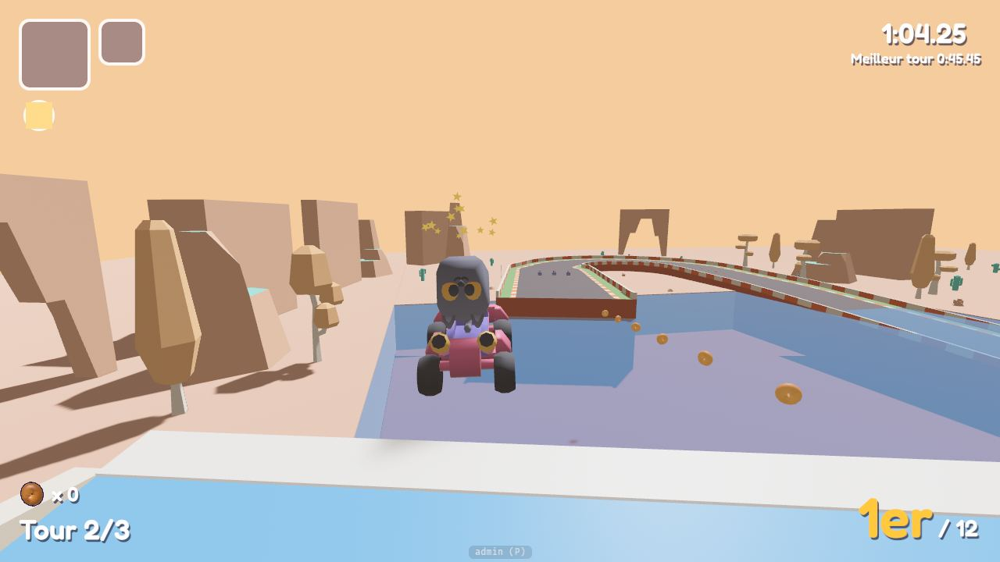

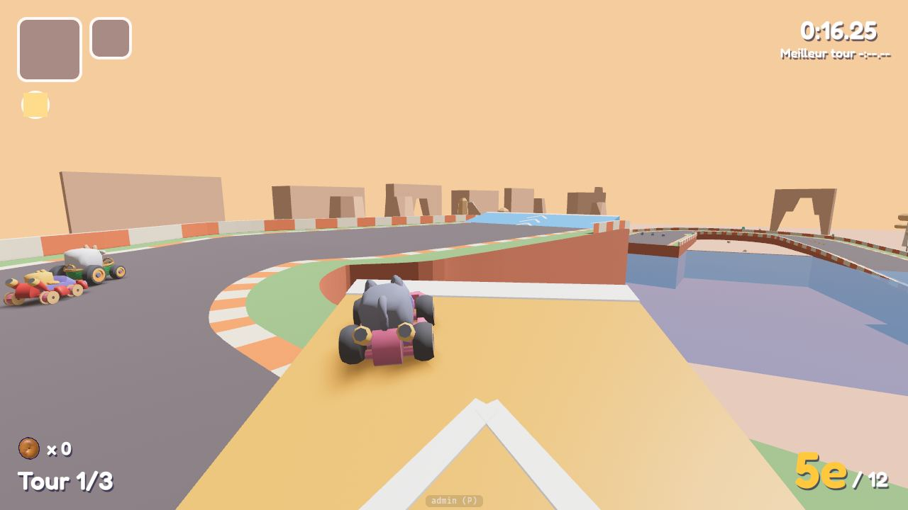

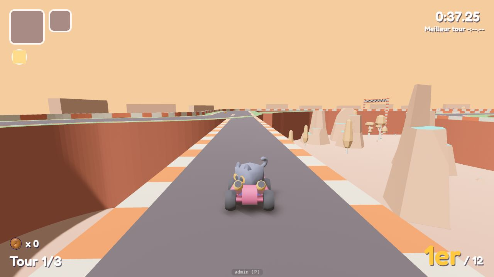

### Notre implémentation (#144, étape 2)

- **Dans le fichier du circuit** (`TrackData`, comme `open_edges` et `shortcuts`), nulle part ailleurs :
  - `obstacles: [(kind, at, offset, size, yaw, sweep, period)]` : **fixes**, `Rock` (un rocher de 2,2 m sur 1,6 m), `Trunk` (un tronc couché de 5,9 m, tourné de `yaw` degrés), `Pillar` (un pilier de roche de 1,6 m sur 6 m) : des colliders simples (boîte, capsule, cylindre), un mur pour les karts (ils rebondissent, sans culbute) ; **mobiles**, `RollingLog` (un rondin couché le long de la route, qui roule d'un bord à l'autre de `offset - sweep` à `offset + sweep`) et `SwingingStone` (une pierre pendue à une potence au-delà du bord, qui balance au-dessus de la route sur la même largeur) : sans collider, ils **renversent** le kart qu'ils touchent ;
  - `npcs: [(kind, at, offset, sweep, period, size)]` : **les PNJ**, des créatures originales. Le premier : **le bison** (`Bison`), gros, rond et laineux, une crinière sombre, de petites cornes, le nez rose : il fait les cent pas en travers d'un côté de la route, s'arrête 30 % du temps aux deux bouts en regardant venir les karts, et **renverse** celui qu'il touche ;
  - `breakables: [(kind, at, offsets)]` : **les objets à traverser**, en rangées comme les boîtes : `HayBale` (une botte de foin), `Balloon` (un ballon sur sa ficelle), `Crate` (une caisse) ;
  - `offset` et `sweep` en demi-largeurs de route (comme les autres `offset`), `period` en secondes (un aller-retour, 6 s par défaut), `size` l'échelle (1 par défaut) ; le miroir les passe de l'autre côté. Le fichier est refusé s'ils sont dans un vide ou une zone d'anti-gravité, trop grands, ou si un mobile balaie les deux côtés de la route.
- **Déterministes** : la position d'un obstacle mobile ou d'un PNJ ne dépend que de l'horloge de course (le tick de la course, celui de la room en ligne ; en roulage libre, l'horloge commune de la room, ou celle du jeu en solo) et de sa phase, tirée de `RaceGrid::seed` et de son numéro dans le fichier : le même endroit au même tick chez tous les pairs, une autre phase à chaque graine.
- **Renversé** (un mobile ou un PNJ) : une **culbute** d'1,4 s (`KartState::Hit`, comme la pelote, § 8 : le drift et le boost perdus, le pilote qui ballotte, le mini-ragdoll de § 14, son cri), le kart garde 30 % de sa vitesse et part à 4 m/s à l'écart de ce qui l'a touché, perd **2 croquettes**, puis son invincibilité (sa stat). Immunisés comme pour les objets : un kart déjà touché, invincible, avec le pélican ou arrivé ; un kart en l'air passe au-dessus (le contact compte la hauteur). **La victime décide**, en ligne aussi.
- **Traversé** (un objet) : il éclate (des brins de paille, des bouts de ballon, des éclats de bois, un « pof »), le kart perd **8 % de sa vitesse** pour une botte de foin, **4 %** pour une caisse, **rien** pour un ballon ; il réapparaît **5 s** après (il « pope »).
- **Les bots les évitent** : leur voie se tient à 1,6 m de ce qu'un obstacle ou un PNJ peut couvrir (tout son mouvement), de 8 m avant à 18 m après (ils visent 13 à 15 m devant eux : la voie reste libre jusqu'à ce que le kart soit passé), du côté où il y a le plus de place, comme du tremplin d'un saut ; ils traversent les objets.
- **Réglages** (panneau d'admin) : `RaceTuning::hazards` (`knock_seconds` 1,4, `knock_speed_kept` 0,3, `knock_push` 4 m/s, `contact_margin` 0, `respawn_seconds` 5, `hay_slowdown` 0,08, `crate_slowdown` 0,04, `balloon_slowdown` 0) ; `CroquetteTuning::knock_loss` (2) ; `BotTuning::hazard_margin` (1,6 m), `hazard_before` (8 m), `hazard_after` (18 m).
- **Fluidité** : un maillage par sorte (des primitives, partagées par toutes les instances, un seul matériau), des colliders simples pour les fixes, aucun pour les autres (un test de capsules par kart et par tick), rien d'alloué par image. **Rien de nouveau sur un circuit qui n'en déclare pas** : ni entité, ni composant, ni Resource, ni système (leurs systèmes ne sont ajoutés qu'avec le premier circuit qui en a).
- **La Corniche Cannelle** les reçoit : **le bison qui garde le gué**, à gauche avant l'eau (les karts passent à droite, où le premier lacet, à gauche, les veut) ; **une pierre qui balance** au-dessus de la droite de la grande ligne droite (pendue à une potence au-delà du muret ; les karts sont à gauche pour l'épingle) ; **un rondin qui roule** sur la gauche du bord du canyon, avant la longue courbe à gauche (les karts sont à droite, à son extérieur) ; **un tronc tombé** sur le bas-côté de la ligne droite ; **un rocher et un pilier** aux bords de la réception au fond du canyon ; **des ballons** juste après la ligne de départ (le peloton les éclate au GO), **une botte de foin** à la sortie de l'épingle du fond, **des caisses** sur la remontée vers le bord.

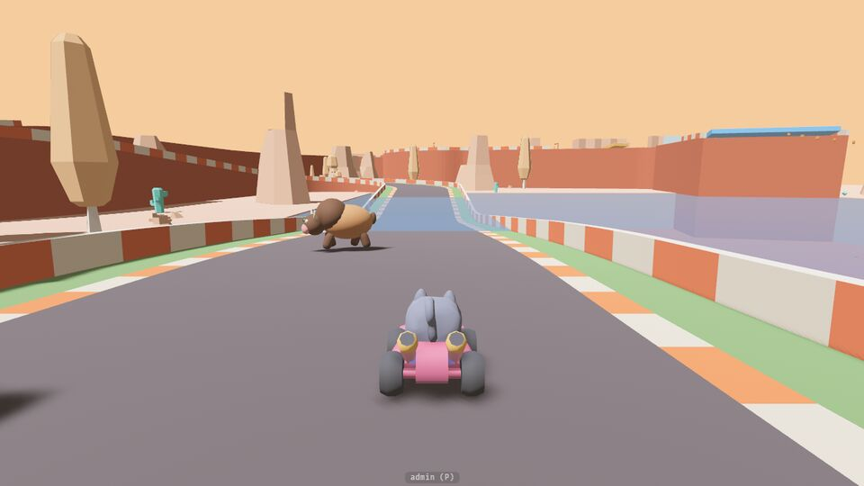

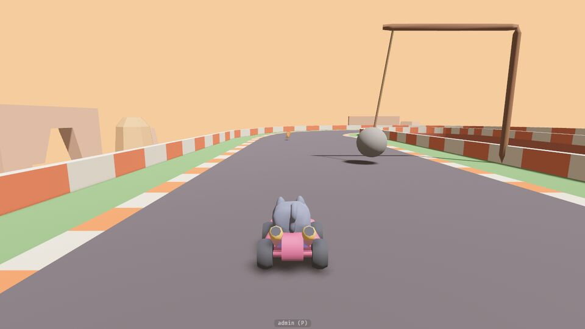

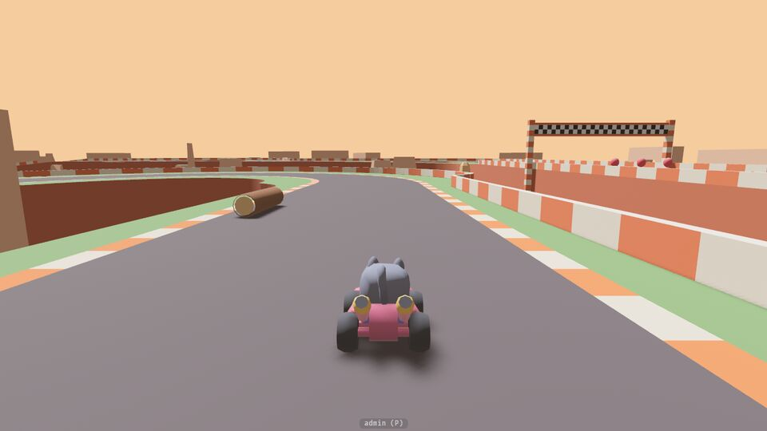

### Prairie Pompon refait (#108)

Le circuit d'ouverture, refait selon le guide : la même prairie (le biome « Prairie », plus grand : des chênes géants, de grands arbres), avec une butte. Environ **1 370 m le tour**, à droite, facile et roulant, mais à drifter :

- **la ligne droite du départ**, la seule longue (l'aspiration, les boîtes, un plot) ;
- **cinq épingles** de 22 m de rayon : à droite au bout de la ligne droite (du sable à l'intérieur), à gauche au pied de la butte, à droite au sommet, puis à droite et à gauche dans la prairie ; quatre d'entre elles finissent par un petit contre-virage, que le drift traverse. Chacune vient après assez de ligne droite pour que le mini-turbo de la précédente soit fini (sinon le drift d'un bot finit bleu) ;
- **la butte**, 6,5 m de haut : la montée (des ballons, **le bison** qui fait les cent pas sur la droite), l'épingle du sommet, un virage serré à gauche, puis **le virage du saut risqué** (à droite, 90°) : son intérieur est un vide de 6,5 m, qu'un tremplin traverse en diagonale ;
- **la réception**, élargie à 16 m, **un rocher** à son bord gauche ;
- **un renflement** (gauche 70°, droite 140°, gauche 70°), que **la route cachée** coupe tout droit, derrière une haie ;
- **la descente**, une botte de foin ;
- deux épingles dans la prairie, puis **le virage serré du bas** (à droite, 90°), que coupe **le chemin d'herbe** : plus lent sans boost, plus rapide avec le mini-turbo de l'épingle d'avant ;
- **la ligne droite du bas** : **le tremplin à figures** (sur sa moitié droite), une botte de foin ; **le dernier virage**.

Les bords sans muret : l'intérieur du virage du saut et le début de la réception (jusqu'où le vol passe au-dessus de la route) ; là où la route cachée quitte la route et la rejoint (seulement là où sa propre route couvre le vide) ; l'intérieur du virage serré du bas (le chemin d'herbe, au niveau du sol). Ailleurs, des murets.

**Les mesures** (bot Normal, 150cc, graines 0 à 3, et le miroir) : le tour le plus rapide en 43 à 45 s, le plus lent en 51 à 56 s ; 4,3 à 4,8 drifts et 3,3 à 3,8 mini-turbos orange par tour ; aucun pélican en conduite libre. **Les raccourcis**, pour un bot Difficile (`bots::shortcut_tests`) : le saut réussi fait gagner 0,3 à 0,55 s, raté (13 m/s au pied du tremplin) le kart tombe et le pélican le dépose avant ; l'herbe fait gagner 0,6 à 0,75 s avec un boost, et en fait perdre 0,75 à 0,9 sans ; la route cachée fait gagner 0,65 à 0,7 s.

- **L'ancien tracé** (#3) est devenu le circuit d'essai des tests unitaires (`src/track/test_circuit.track.ron`, hors du jeu) : les tests de la géométrie, des règles de course et de la ligne des bots gardent un circuit connu.
- **Le contre-la-montre** : les records et les fantômes de Prairie Pompon d'avant #108 sont laissés de côté (un fantôme traverserait les murs du nouveau tracé) : format 3 du texte des records, `modes::trial::REDRAWN_CIRCUITS` (depuis #157 : l'empreinte du circuit le fait pour tout changement, § 1).
- **Le fond du menu** roule sur ce circuit : ses karts ne prennent aucun raccourci (le peloton reste groupé pour la caméra).
- **Ce qu'il a appris**, pour les suivants :
  - un bord sans muret au-dessus d'un vide **seulement là où un chemin passe** : une route cachée qui quitte la route dans un virage n'ouvre le bord que là où sa propre route couvre le vide (sinon les karts tombent dans le « V » entre les deux routes) ;
  - un raccourci d'herbe ne paie que s'il coupe un virage lent ou un grand détour, par des courbes larges (30 à 40 m de rayon) : un virage de 90° pris à fond ne se coupe pas ;
  - sur une ligne droite entre deux virages du même côté, les karts la traversent en diagonale : un tremplin à figures au milieu les envoyait par-dessus le muret ;
  - un renflement peu profond ne fait pas une route cachée : la ligne des bots le coupe presque autant qu'elle.

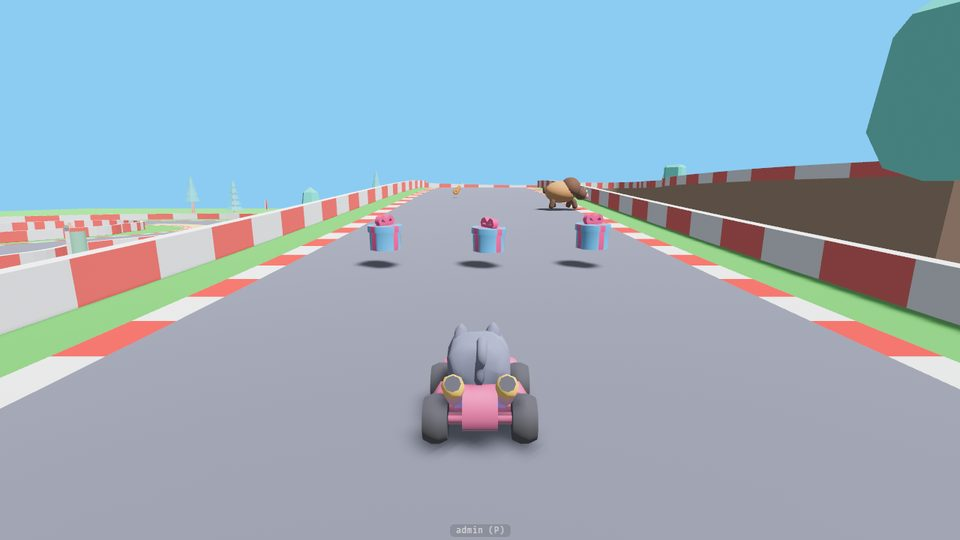

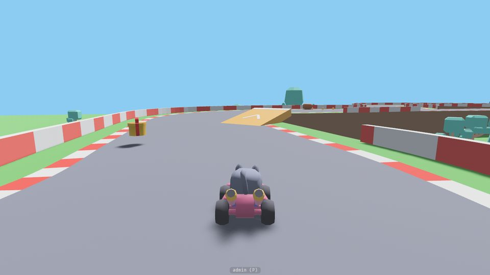

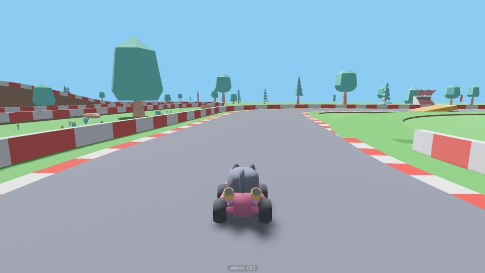

### Le Col des Moufles refait (#109)

Le col de montagne enneigé, refait selon le guide : le même biome « Neige », plus grand (des sapins géants de 14 à 20 m, des aiguilles de roche de 12 à 22 m), et une montagne à gravir. Environ **1 325 m le tour**, à gauche comme avant, technique et en hauteur :

- **la ligne droite du départ**, dans la vallée, la seule longue (l'aspiration, les boîtes, un plot ; **une pierre qui balance** au-dessus de sa gauche, pendue à sa potence au-delà du muret) ;
- **trois lacets** pour monter la face de la montagne jusqu'au col, 12 m plus haut : une épingle à gauche (de la neige profonde à son intérieur), une à droite, une à gauche, de 22 m de rayon, chacune après 70 m de montée ; **le bison** fait les cent pas sur la droite de la première montée, **un rondin roule** sur la gauche de la deuxième ;
- **sur le col, le virage du saut risqué** (à droite, 90°) : son intérieur est un vide de 12 m, qu'un tremplin traverse en diagonale ; la réception, élargie à 16 m, **un rocher** à son bord gauche ; le sommet et **un bonhomme de neige géant** ;
- un virage serré à gauche, puis **la descente** : **un renflement** (droite 70°, gauche 140°, droite 70°), 8 m au-dessus de la vallée, que **la route cachée** coupe tout droit derrière un talus de neige ; des caisses ;
- **deux lacets au pied de la montagne** (une épingle à gauche, une à droite ; entre elles, **le tremplin à figures** et une botte de foin) ;
- **le virage serré du bas** (à gauche, 90°), que coupe **le chemin de neige** (un hors-piste, comme l'herbe) : plus lent sans boost, plus rapide avec le mini-turbo du lacet d'avant ; puis **le dernier virage**.

Cinq épingles, quatre virages serrés, les S des lacets et du sommet : aucune longue courbe molle. **Les pièces des raccourcis** (le virage du saut et sa réception, le renflement et sa route cachée, le virage du chemin de neige) sont celles de Prairie Pompon (#108), tournées, et retournées en miroir là où le Col tourne de l'autre côté : leurs réglages ont fait leurs preuves ; le tracé autour d'elles est neuf. Les bords sans muret : l'intérieur du virage du saut et le début de la réception, les deux bouches de la route cachée (là où sa route couvre le vide), l'intérieur du virage du bas (au sol). Ailleurs, des murets : les lacets, le col et la descente sont au-dessus du vide.

**Les mesures** (bot Normal, graines 0 à 3, et le miroir) : le tour le plus rapide en 41,3 à 43,1 s, le plus lent en 50,4 à 54,0 s ; 4,7 à 5,2 drifts et 2,4 à 3,5 mini-turbos orange par tour ; aucun pélican en conduite libre ; le tour le plus rapide à 32,1 m/s de moyenne au plus (la vérification « pas plus vite que boosté tout le long » s'arrête à 33). **Les raccourcis**, pour un bot Difficile (`bots::shortcut_tests`) : le saut risqué réussi fait gagner 0,52 s (0,39 en miroir), raté (13 m/s au pied du tremplin) le kart tombe et le pélican le dépose avant ; le chemin de neige fait gagner 0,62 s (0,74) avec un boost, et en fait perdre 0,93 s (0,80) sans ; la route cachée fait gagner 0,70 s (0,80). Des bots Difficile (graines 0 à 3, et le miroir) : tous finissent, aucun pélican en conduite libre, 29 à 38 routes cachées et 18 à 27 sauts tentés par course, aucun raté.

- **Le contre-la-montre** : les records et les fantômes du Col d'avant #109 sont laissés de côté (format 4 du texte des records, `modes::trial::REDRAWN_CIRCUITS` ; depuis #157 : l'empreinte du circuit, § 1).
- **Ce qu'il a appris**, pour les suivants :
  - reprendre une pièce de raccourci déjà réglée (un virage et son raccourci, avec ses bords ouverts et ses obstacles) donne les mêmes gains et passe les mêmes tests : on dessine le reste autour ;
  - un circuit qui descend et où chaque épingle relance au mini-turbo va vite : avec un plot de boost de plus sur le col, le tour le plus rapide d'un bot frôlait la vérification « pas plus vite que boosté tout le long » (32,8 m/s pour 33) ; sans lui, 32,1 au plus ;
  - **le Ruban Réglisse ne tient pas dans le guide tel quel** : ses trois zones d'anti-gravité (le mur, le plafond, le virage relevé, que leurs tests de #78, #94 et #96 gardent) font 820 m à elles seules ; avec cinq épingles, il faut au moins 1,58 km (1,44 km en raccourcissant les zones jusqu'aux limites de leurs tests, la route qui s'y tord 25 % plus vite, et les épingles l'une contre l'autre), soit un tour lent d'environ une minute ou plus pour un bot Normal. Une décision de Max : voir #151 et `STATUS.md`, « Questions pour Max ».

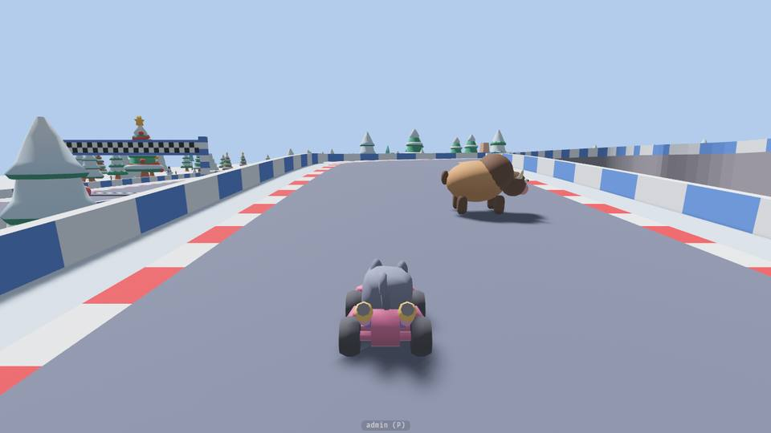

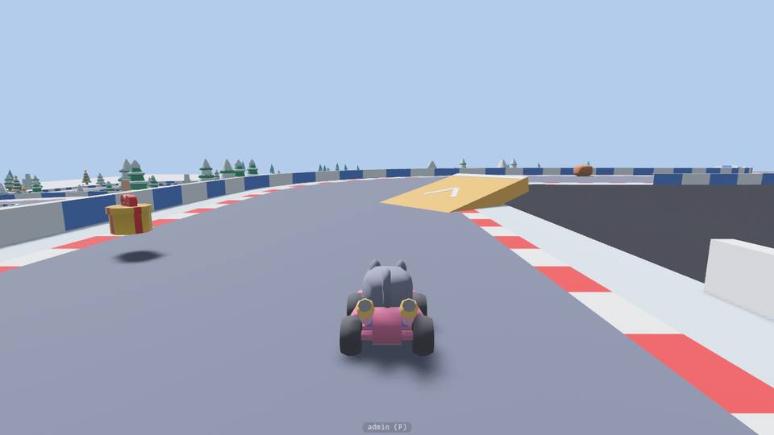

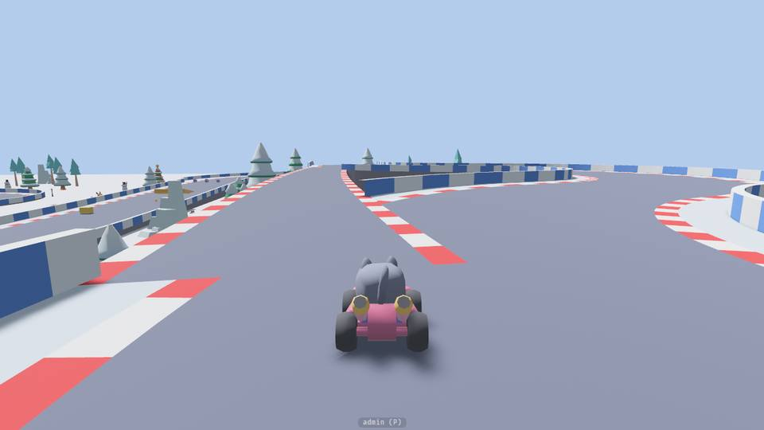

### La suite

- ~~**Étape 2** (#144)~~ : fait (voir plus haut). Reste à faire plus tard : d'autres PNJ (une créature qui traverse toute la route, en laissant une fenêtre ; les bots devraient alors attendre ou la contourner dans le temps, pas seulement dans l'espace) ; le ragdoll du salon (`characters::ragdoll`) pour un PNJ que l'on bouscule.
- Puis les six premiers circuits refaits selon ce guide (#108 : Prairie Pompon, fait ; Anneau Guimauve et Crique Câline : #148 ; #109 : le Col des Moufles, fait ; Lagon Duvet : #150 ; Ruban Réglisse : #151, qui attend une décision de Max sur la longueur de ses zones), et les nouveaux, jusqu'à 24.

## 17. Priorités

| Phase | Contenu |
|---|---|
| **1 – Conduite (solo)** | Conduite de base, caméra, circuit, drift et 3 paliers, départ fusée, figures, aspiration, panneaux, croquettes, dépanneur, course 3 tours avec classement, bots, statistiques et gabarits |
| **1b – Objets (solo)** | Boîtes, roulette, 2 emplacements, traîner, distribution par distance, objets de phase 1, réactions quand on est touché et invincibilité |
| **1c – Interactions (solo)** | Coup de patte et attrape entre karts (§ 15), effet du Poids, immunités, bots. Avant le réseau, pour que la synchronisation les prévoie dès le départ |
| **2 – En ligne** | Rooms P2P, synchronisation des karts, course synchronisée avec objets et croquettes, signalisation de prod. Plus les objets de phase 2. |
| **3 – Contenu** | Vrais modèles, personnages mous, Grand Prix et miroir, anti-gravité, planeur, eau, objets de phase 3 |
