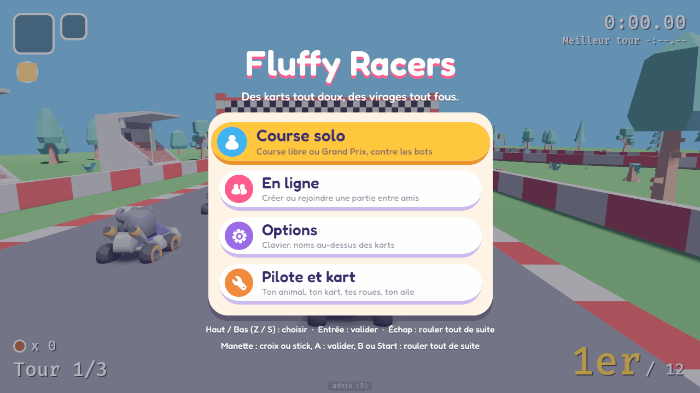
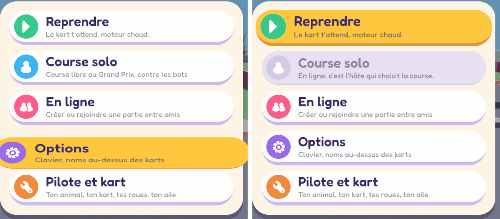

# Charte graphique des écrans

**Étape 1 de #56.** Cette charte décrit l'apparence et le comportement des écrans du jeu : menus, salon, choix du kart, pause, résultats. Le menu principal est le premier écran construit avec elle, pour la rendre concrète.

> **À valider par Max** avant de refaire les autres écrans. Ce sera l'étape 2, #89. Les questions sont à la fin.

Le code de la charte se trouve dans `src/menu/` : `style.rs` (palette, tailles, états des boutons), `anim.rs` (animations) et `nav.rs` (entrées et navigation). Le panneau de développement (P) et l'overlay de debug (F3) restent comme ils sont : ils ne suivent pas la charte.

## L'esprit

- **Rond et mou**, comme les animaux du jeu : coins arrondis partout, boutons en pilule, aucun angle sec.
- **Des couleurs de bonbon** sur un fond crème, et une seule encre foncée pour lire, la myrtille.
- **Ça rebondit, mais vite.** Un écran ne fait jamais attendre : chaque animation dure moins d'une demi-seconde.
- **Lisible d'abord** : gros textes, contrastes vérifiés par des tests, et une seule chose en évidence à la fois (le focus).
- **Le jeu reste visible** derrière un voile. On sait toujours où on est.

## Palette

| Nom | Couleur | Rôle |
|---|---|---|
| Myrtille | `#3A2C6E` | Encre : les textes sur fond clair, les ombres |
| Guimauve | `#FFF5E6` | Fond des panneaux (crème) |
| Coton | `#FFFFFF` | Bouton au repos |
| Lilas | `#CBBBEF` | Profondeur d'un bouton au repos |
| Mangue | `#FFC83D` | Bouton qui a le focus |
| Abricot | `#E9932B` | Profondeur du bouton qui a le focus |
| Fraise | `#FF5C8D` | Ombre du titre, pastille « En ligne » |
| Lagon | `#3FB4F0` | Pastille « Course solo » |
| Menthe | `#36C98B` | Pastille « Reprendre » (ce qui continue) |
| Prune | `#9B6BE8` | Pastille « Options » |
| Carotte | `#F08A3C` | Pastille « Pilote et kart » |
| Brume | `#E6E0F0` | Bouton désactivé (sa profondeur : `#D3CBE3`) |
| Cendre | `#8E86A8` | Textes d'un bouton désactivé |
| Neige | `#FFFFFF` | Textes sur le voile |
| Voile | Myrtille à 55 % | Par-dessus le jeu, derrière un écran |

**Contrastes**, vérifiés par `menu::style::tests` selon WCAG 2 :

- libellé d'un bouton utilisable : au moins 7:1 sur son fond ;
- petite ligne : au moins 4,5:1 ;
- bouton désactivé : environ 2,6:1. Il reste lisible, mais en retrait, ce qui est volontaire ;
- textes blancs sur le voile : au moins 3:1, avec une ombre ;
- icônes blanches sur leur pastille : de 2 à 3,7:1. Une icône est toujours accompagnée de son libellé, c'est lui qui porte le sens.

## Police

**Fredoka** (SIL Open Font License 1.1, licence dans `assets/ui/fonts/OFL.txt`).

- Ronde, épaisse, lisible de loin, avec un air de dessin animé.
- Elle a **toutes les lettres du français** : é è ê ë à â î ï ô û ù ü ÿ ç œ, les majuscules accentuées (É, À, Ç, Œ…), les guillemets « », les apostrophes ’, les points de suspension …, les tirets – et — et le point médian ·.
- Elle n'a pas de flèches. On écrit donc « Haut / Bas », ce qui est plus clair de toute façon.
- **Deux graisses** :
  - demi-gras (600) pour le titre, les libellés et les boutons ;
  - moyen (500) pour les petites lignes et les touches.

Pourquoi elle :

- **Kenney Future** (CC0, livrée avec l'UI Pack) est géométrique et futuriste, pas ronde.
- **Nunito** et **Baloo 2** sont plus sages.
- Le HUD garde pour l'instant la police par défaut de Bevy, sans accents. Il pourra passer à Fredoka à l'étape 2 : on aurait alors les accents partout, par exemple « Éloïse » au classement (voir les questions).

## Boutons

**Anatomie** :

- une pilule (rayon = la moitié de la hauteur) ;
- dessous, une **profondeur** plus foncée (son bord bas, 7 px) ;
- à gauche, une **pastille ronde** de la couleur de l'entrée, avec son icône blanche ;
- le **libellé** ;
- dessous, une **petite ligne** qui dit ce que fait le bouton, ou pourquoi il est grisé.

| État | Fond | Profondeur | Textes | Forme |
|---|---|---|---|---|
| Normal | Coton | Lilas, 7 px | Myrtille | taille normale |
| Focus (survol, touches ou manette) | Mangue | Abricot, 7 px | Myrtille | grossit à 105 % avec un petit rebond, puis « respire » (±1,2 %) |
| Appuyé (touche, A ou bouton de la souris tenus) | Mangue | Abricot, 2 px | Myrtille | descend de 5 px, s'écrase à 86 % de sa hauteur sur son bas et s'élargit |
| Désactivé | Brume | `#D3CBE3`, 2 px | Cendre, sa raison à la place de la petite ligne | pastille grise ; sauté par les touches |

**Règles** :

- **Un seul focus**, partagé par la souris, le clavier et la manette. Le survol déplace le focus.
- **L'action part au relâchement**, juste après l'étirement (0,12 s). Si le pointeur quitte le bouton avant de relâcher, ou relâche sur un autre bouton, il ne se passe rien.
- **Un bouton désactivé dit pourquoi**, par exemple : « En ligne, c'est l'hôte qui choisit la course. »

## Panneaux et fenêtres

- **Le voile** : la Myrtille à 55 % sur tout l'écran. Il apparaît en 0,18 s, et le jeu reste visible derrière.
- **Le panneau** :
  - fond Guimauve, coins de 36 px, marge intérieure de 20 px, 12 px entre deux boutons ;
  - une ombre portée nette : Myrtille à 45 %, décalée de 10 px vers le bas, sans flou ;
  - centré, 520 px de large.
- **Les écrans plus riches de l'étape 2** (salon, choix du kart) gardent le même panneau, en plus large : entre 720 et 900 px, à fixer avec eux.
- **Le titre** : blanc, avec une ombre Fraise décalée vers le bas. On dirait des lettres en guimauve. Dessous, une phrase en blanc.
- **Les touches** sont rappelées en bas de l'écran, en blanc sur le voile, avec les lettres du clavier choisi.
- Les fenêtres ne se superposent pas : un écran ouvert depuis le menu prend sa place.

## Icônes

Le pack **Game Icons** de Kenney (CC0, licence dans `assets/ui/icons/License.txt`) : des icônes blanches de 100 px, posées sur une pastille de 52 px et affichées à 40 px (le dessin occupe environ les deux tiers de l'image). Seules celles qui servent sont dans le dépôt.

| Entrée | Icône | Pastille |
|---|---|---|
| Reprendre | `right.png` (triangle « lecture ») | Menthe |
| Course solo | `singleplayer.png` | Lagon |
| En ligne | `multiplayer.png` | Fraise |
| Options | `gear.png` | Prune |
| Pilote et kart | `wrench.png` (le garage) | Carotte |

Pour l'étape 2, le même pack a d'autres icônes utiles :

- flèches ;
- son et musique (`audioOn`, `musicOn`…) ;
- `trophy`, `medal1`, `star` pour les résultats ;
- `buttonA`, `buttonB`, `buttonStart` pour les aides à la manette.

## Marges et tailles

Les tailles sont données pour une fenêtre de **720 px de haut** et dessinées en pourcentage de sa hauteur (`style::u`, `style::font`). Les proportions restent les mêmes du petit portable à la télévision. Les espacements suivent une grille de 4 et 8 px.

| Élément | Taille (px à 720 px de haut) |
|---|---|
| Titre | 64 |
| Phrase sous le titre | 21 |
| Libellé d'un bouton | 29 |
| Petite ligne, touches | 16 |
| Bouton | 74 de haut (profondeur comprise), rayon 37 |
| Pastille / icône | 52 / 40 |
| Panneau | 520 de large, marge de 20, rayon de 36, 12 entre deux boutons |

## Animations « molles »

Chaque animation est un **ressort amorti** qui part du repos : il dépasse sa cible puis revient, comme de la gelée. Les courbes sont des fonctions pures, testées (`menu::anim::tests`).

Elles tournent en **temps réel** : en solo, le jeu est en pause derrière l'écran. Ce sont des constantes d'animation, comme celles du HUD, et non des réglages de gameplay.

| Moment | Ce qui bouge | Durée |
|---|---|---|
| Apparition | Le voile se fond. La colonne (titre, panneau, touches) passe de 70 % à 100 % avec environ 6 % de dépassement, puis un petit creux. Les boutons suivent l'un après l'autre, à 45 ms d'écart, en partant de 50 %. | 0,45 s ; le 5ᵉ bouton est en place en 0,63 s |
| Focus | Le bouton grossit à 105 % avec un rebond, puis respire (±1,2 % sur 1,4 s). Celui qui perd le focus revient à 100 %. | 0,35 s |
| Appui (squash) | Le bouton s'écrase à 86 % de sa hauteur, posé sur son bas, et s'élargit de la moitié de ce qu'il perd. Sa profondeur passe de 7 à 2 px. | environ 0,1 s |
| Relâché (stretch) | Il remonte, s'étire d'environ 5 % en s'amincissant, puis revient. | 0,5 s ; l'action part à 0,12 s |
| Fermeture | Aucune animation : le jeu reprend tout de suite. | 0 s |

## Navigation

| | Clavier | Souris | Manette |
|---|---|---|---|
| Choisir | Haut / Bas, ou Z / S (AZERTY), W / S (QWERTY) | survol | croix, stick gauche (un pas par poussée) |
| Valider | Entrée, Espace | clic | A |
| Revenir | Échap | — | B, Start |
| Ouvrir le menu principal | Échap | — | Start |

- **Les touches sont des positions physiques.** Elles sont les mêmes sous les doigts en AZERTY et en QWERTY, et aucune ne demande Fn sur Mac. Échap, Entrée, Espace et les flèches ne demandent rien.
- **Échap revient en arrière partout.** Il n'ouvre le menu principal que si aucun autre écran n'est ouvert : sinon, il ferme d'abord cet écran-là. Sur l'écran des résultats, Start relance la course comme avant ; c'est Échap qui ouvre le menu.
- **Un écran ouvert depuis le menu y revient** quand on le ferme sans lancer de course. Par exemple, Échap dans les options ramène au menu, et « Course ! » lance la course.
- **La pause** : en solo, le jeu attend tant que le menu est ouvert. **En ligne, jamais** (décision de Max) : le kart roule sur son élan et seules ses commandes sont inactives.

## Ton des textes

- **Court.** Un libellé fait trois mots au plus, une petite ligne moins de 48 signes.
- **On tutoie**, avec des verbes simples.
- **Pas de jargon** : « salon » plutôt que *lobby*, « hôte » plutôt que *host*, « réglages » plutôt que *config*.
- **Un brin d'humour**, jamais aux dépens du joueur ni de ses erreurs.
- **Les touches en toutes lettres** (« Échap », « Entrée », « Haut / Bas »), avec les lettres du clavier choisi.

| Oui | Non |
|---|---|
| Des karts tout doux, des virages tout fous. | Bienvenue dans Fluffy Racers v0.1 |
| Le kart t'attend, moteur chaud. | Reprendre la partie en cours |
| Créer ou rejoindre une partie entre amis | Connexion P2P WebRTC |
| En ligne, c'est l'hôte qui choisit la course. | Action indisponible |
| Échap : rouler tout de suite | ESC = skip |

## Choix technique : `bevy_ui`

| Critère | `bevy_ui` (choisi) | egui stylé |
|---|---|---|
| Fidélité à la charte | Coins arrondis, bordures par côté (la profondeur), ombres portées (`BoxShadow`), dégradés, images en 9-slice (`NodeImageMode::Sliced`), n'importe quelle police TTF (Fredoka, avec ses accents) | Coins et couleurs, oui ; police personnalisée, oui ; pas de 9-slice ni d'ombre décalée sans dessin à la main ; l'allure d'un outil de développement est difficile à effacer |
| Animations | `UiTransform` (translation, échelle **non uniforme**, rotation), appliqué sans refaire la mise en page : squash & stretch, rebonds | `animate_value` pour un nombre ; l'échelle d'un calque est uniforme (`TSTransform`), donc pas de squash & stretch sans tout redessiner |
| Clavier et manette | Notre propre navigation, pure et testée (`nav.rs`) ; Bevy 0.20 a aussi `bevy_input_focus` | Focus clavier d'egui, qui se bat avec les touches du jeu (il a fallu `keep_focus_for_text_only`) ; rien pour la manette |
| Coût par frame | Arbre créé à l'ouverture, détruit à la fermeture : **rien quand c'est fermé**. Ouvert : une mise en page au départ, puis 6 transformations et quelques couleurs par frame | Contexte posé et retiré (rien fermé) ; ouvert, toute l'interface est refaite et tessellée à chaque frame |
| Maintenance | Plus verbeux : un petit kit (panneau, bouton) dans `src/menu/` le compense, et chaque écran se teste headless (l'arbre existe sans rendu) | Très court à écrire, mais il ne se teste qu'en partie sans rendu |
| Déjà là | Oui (HUD, étiquettes des pseudos) | Oui (panneau d'admin, fenêtres actuelles) |

**Décision : `bevy_ui`** pour les écrans de jeu. egui reste pour le panneau de développement (P). Pour le champ du pseudo, il reste en attendant l'étape 2, qui choisira entre `EditableText` de Bevy 0.20 (`bevy_ui_widgets::text_input`) et un petit champ egui.

**Pas de 9-slice pour l'instant.** Le UI Pack de Kenney (CC0) a des boutons prêts à découper, mais avec de petits coins et des couleurs figées. Les formes natives sont plus rondes, se recolorent avec la palette et restent nettes à toute taille, sans aucun fichier. Le 9-slice resservira si on veut une texture (papier, tissu).

**Aucune crate ajoutée.**

## Captures de référence

Elles ont été prises dans Chromium headless, sur un build trunk de debug avec WebGL logiciel, en 1280 × 720. Ce navigateur dessine environ une image par seconde.

Les animations ont été capturées avec une copie locale où l'horloge du menu va 60 fois moins vite. Cette copie n'a jamais été poussée.

Les captures sont dans le scratchpad de la session (`shots56/`). Deux d'entre elles, compressées, sont dans le dépôt :

| Capture | Fichier dans `shots56/` |
|---|---|
| Menu principal au lancement (focus sur « Course solo ») | `1-launch.png`, et `docs/img/menu-principal.png` |
| Focus à la souris | `2-states-hover-options.png` |
| Appuyé (écrasé, sans profondeur), puis le pointeur qui sort : rien ne se passe | `2-states-pressed-online.png`, `2-states-pressed.png`, `2-states-left.png` |
| Désactivé en ligne, puis sauté par Bas | `3-disabled.png`, `3-disabled-skipped.png`, et `docs/img/menu-etats.png` |
| L'apparition, 4 images (les boutons l'un après l'autre, le rebond du dernier) | `4-pop-0.png` à `4-pop-3.png` |
| Le rebond du relâchement (étiré, puis au repos) | `4-stretch-0.png` à `4-stretch-2.png` |
| Le menu ouvert par Échap en course (« Reprendre ») | `5-in-game.png` |
| Chaque entrée ouvre son écran, et Échap revient au menu | `6-options.png`, `6-back-from-options.png`, `7-race-menu.png`, `8-garage.png`, `9-lobby.png`, `9-back-from-lobby.png` |
| `?room=` : le salon et « Pilote et kart », sans le menu | `3-room-launch.png` |
| N en course (le menu de course, avec son contexte egui) | `11-n-in-race.png` |

## Questions pour Max

1. **La palette et le ton** te vont-ils ? Le crème et la myrtille, les pastilles colorées, le Mangue pour le focus.
2. **La police Fredoka** : la garde-t-on, et faut-il **la mettre aussi dans le HUD** ? On aurait alors les accents partout, mais le style du HUD changerait.
3. **Les animations** : trop molles, pas assez ? L'action part 0,12 s après le relâchement : est-ce assez vif ?
4. **Le menu en course** (Échap) : sert-il d'**écran de pause** (avec « Reprendre »), ou la pause aura-t-elle son propre écran à l'étape 2 ?
5. **« En ligne » depuis le menu** ouvre le salon actuel, qui ne met pas le jeu en pause en solo : la course démarre derrière. Faut-il attendre dans le salon tant qu'on n'est pas dans une partie ?
6. **Échap dans le salon** ne fait rien pour l'instant : le salon se ferme avec L ou son bouton. Faut-il qu'Échap le ferme, comme les autres écrans ?
