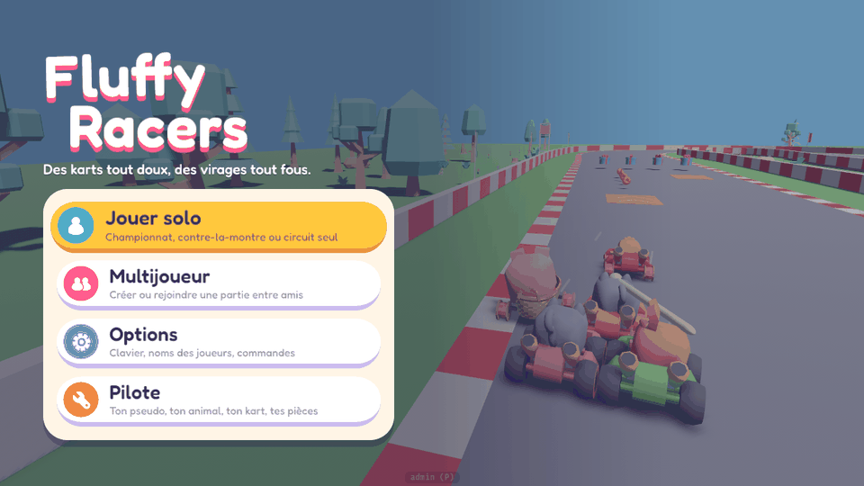
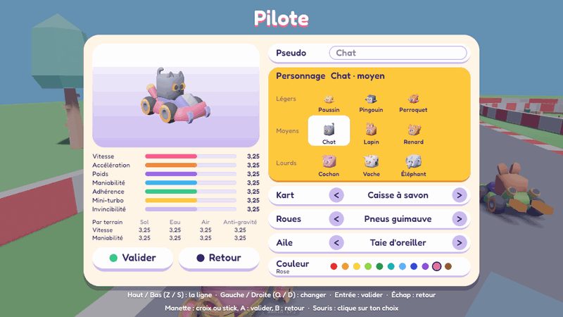
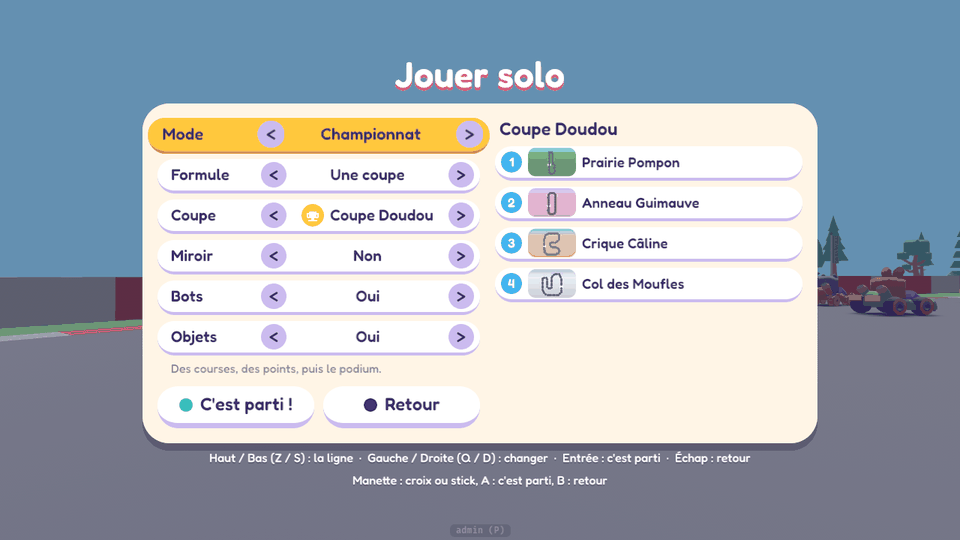

# Charte graphique des écrans

Cette charte décrit l'apparence et le comportement des écrans du jeu : accueil, menus, salon, choix du kart, pause, résultats. Elle est née avec #56 (étape 1 : la charte et un premier menu pour la rendre concrète).

> **Validée par Max le 2026-10-17** : la palette, le ton des textes et la police Fredoka. Étape 2 (#89) : **l'écran d'accueil** et son fond animé (plus bas). Puis **l'écran Pilote** (#98, plus bas) et **l'écran Jouer solo** (#99, plus bas). Étape 3 (#100) : **les options**, **la pause**, **le classement d'une course**, **le classement général et le podium** du championnat, et **le HUD en Fredoka** (plus bas). Reste le salon en 3D (#101).

Le code de la charte se trouve dans `src/menu/` : `style.rs` (palette, tailles, états des boutons), `anim.rs` (animations) et `nav.rs` (entrées et navigation) ; l'accueil ajoute `showcase.rs` (son fond) et `trailer.rs` (sa caméra) ; l'écran Pilote `pilot.rs` (ses lignes, ses textes, sa boucle molle), `pilot_screen.rs` (son arbre, la souris, la manette, le champ du pseudo) et `preview.rs` (sa 3D) ; l'écran Jouer solo `solo.rs` (ses textes, ses vignettes) et `solo_screen.rs` (son arbre, la souris, la manette) ; l'écran des options `options_screen.rs` (#100) ; les écrans dessinés avec le HUD (le classement d'une course dans `src/ui/`, le classement général et le podium dans `src/modes/screens.rs`) prennent leurs morceaux dans `kit.rs` (#100). Le panneau de développement (P) et l'overlay de debug (F3) restent comme ils sont : ils ne suivent pas la charte. Le salon (L) reste une fenêtre egui jusqu'à #101.

## L'esprit

- **Rond et mou**, comme les animaux du jeu : coins arrondis partout, boutons en pilule, aucun angle sec.
- **Des couleurs de bonbon** sur un fond crème, et une seule encre foncée pour lire, la myrtille.
- **Ça rebondit, mais vite.** Un écran ne fait jamais attendre : chaque animation dure moins d'une demi-seconde.
- **Lisible d'abord** : gros textes, contrastes vérifiés par des tests, et une seule chose en évidence à la fois (le focus).
- **Le jeu reste visible** derrière un voile. On sait toujours où on est. Sur l'accueil, le fond *est* le jeu : des karts qui roulent et se chamaillent.

## Palette

| Nom | Couleur | Rôle |
|---|---|---|
| Myrtille | `#3A2C6E` | Encre : les textes sur fond clair, les ombres |
| Guimauve | `#FFF5E6` | Fond des panneaux (crème) |
| Coton | `#FFFFFF` | Bouton au repos |
| Lilas | `#CBBBEF` | Profondeur d'un bouton au repos |
| Mangue | `#FFC83D` | Bouton qui a le focus ; la ligne du joueur dans un classement, la 1ʳᵉ place (l'or), le rang dans le HUD (#100) |
| Abricot | `#E9932B` | Profondeur du bouton qui a le focus |
| Fraise | `#FF5C8D` | Ombre du titre, pastille « Multijoueur » |
| Lagon | `#3FB4F0` | Pastille « Jouer solo », « Recommencer » (#100 : on rejoue) ; la place d'un coureur à partir de la 4ᵉ |
| Menthe | `#36C98B` | Pastille « Reprendre » (ce qui continue) |
| Prune | `#9B6BE8` | Pastille « Options » |
| Carotte | `#F08A3C` | Pastille « Pilote » ; la 3ᵉ place (le bronze, #100) |
| Brume | `#E6E0F0` | Bouton désactivé (sa profondeur : `#D3CBE3`, aussi la 2ᵉ place, l'argent, #100) |
| Cendre | `#8E86A8` | Textes d'un bouton désactivé |
| Neige | `#FFFFFF` | Textes sur le voile |
| Voile | Myrtille à 55 % | Par-dessus le jeu, derrière un écran ; sur l'accueil, il s'efface vers la droite |

**Contrastes**, vérifiés par `menu::style::tests` selon WCAG 2 :

- libellé d'un bouton utilisable : au moins 7:1 sur son fond ;
- petite ligne : au moins 4,5:1 ;
- bouton désactivé : environ 2,6:1. Il reste lisible, mais en retrait, ce qui est volontaire ;
- textes blancs sur le voile : au moins 3:1, avec une ombre ;
- icônes blanches sur leur pastille : de 2 à 3,7:1 (sur la Myrtille de « Quitter », bien plus). Une icône est toujours accompagnée de son libellé, c'est lui qui porte le sens.

## Police

**Fredoka** (SIL Open Font License 1.1, licence dans `assets/ui/fonts/OFL.txt`).

- Ronde, épaisse, lisible de loin, avec un air de dessin animé.
- Elle a **toutes les lettres du français** : é è ê ë à â î ï ô û ù ü ÿ ç œ, les majuscules accentuées (É, À, Ç, Œ…), les guillemets « », les apostrophes ’, les points de suspension …, les tirets – et — et le point médian ·.
- Elle n'a pas de flèches. On écrit donc « Haut / Bas », ce qui est plus clair de toute façon.
- **Deux graisses** :
  - demi-gras (600) pour le titre, les libellés et les boutons ;
  - moyen (500) pour les petites lignes et les touches.

Pourquoi elle :

- **Kenney Future** (CC0, livrée avec l'UI Pack) est géométrique et futuriste, pas ronde.
- **Nunito** et **Baloo 2** sont plus sages.
- **Le HUD aussi, depuis #100** : les accents sont partout, par exemple « Éloïse » au classement et au-dessus de son kart, « Entrée », « Temps estimé », « Crique Câline ». Voir « Le HUD » plus bas.
- **Ce qu'elle sait écrire** : le latin de base, le latin-1 (tout le français), quelques lettres du latin étendu (Œ, Š, Ž…), l'hébreu, les tirets, guillemets et points de suspension, « € ». Un test relit son `cmap` (`ui::format::writable`) ; un pseudo ne garde que ces caractères (un emoji serait une case vide).

## Boutons

**Anatomie** :

- une pilule (rayon = la moitié de la hauteur) ;
- dessous, une **profondeur** plus foncée (son bord bas, 7 px) ;
- à gauche, une **pastille ronde** de la couleur de l'entrée, avec son icône blanche ;
- le **libellé** ;
- dessous, une **petite ligne** qui dit ce que fait le bouton, ou pourquoi il est grisé.

| État | Fond | Profondeur | Textes | Forme |
|---|---|---|---|---|
| Normal | Coton | Lilas, 7 px | Myrtille | taille normale |
| Focus (survol, touches ou manette) | Mangue | Abricot, 7 px | Myrtille | grossit à 105 % avec un petit rebond, puis « respire » (±1,2 %) |
| Appuyé (touche, A ou bouton de la souris tenus) | Mangue | Abricot, 2 px | Myrtille | descend de 5 px, s'écrase à 86 % de sa hauteur sur son bas et s'élargit |
| Désactivé | Brume | `#D3CBE3`, 2 px | Cendre, sa raison à la place de la petite ligne | pastille grise ; sauté par les touches |

**Règles** :

- **Un seul focus**, partagé par la souris, le clavier et la manette. Le survol déplace le focus.
- **L'action part au relâchement**, juste après l'étirement (0,12 s). Si le pointeur quitte le bouton avant de relâcher, ou relâche sur un autre bouton, il ne se passe rien.
- **Un bouton désactivé dit pourquoi**, par exemple : « En ligne, c'est l'hôte qui choisit la course. »
- **Une petite ligne peut changer en ligne** : « Quitter » dit alors « Retour à l'accueil : tu quittes la partie. »

## Panneaux et fenêtres

- **Le voile** : la Myrtille à 55 % sur tout l'écran. Il apparaît en 0,18 s, et le jeu reste visible derrière.
- **Le panneau** :
  - fond Guimauve, coins de 36 px, marge intérieure de 20 px, 12 px entre deux boutons ;
  - une ombre portée nette : Myrtille à 45 %, décalée de 10 px vers le bas, sans flou ;
  - centré, 520 px de large.
- **Les écrans plus riches de l'étape 2** (salon, choix du kart) gardent le même panneau, en plus large : entre 720 et 900 px, à fixer avec eux. L'écran Pilote (#98) : 900 px.
- **Le titre** : blanc, avec une ombre Fraise décalée vers le bas. On dirait des lettres en guimauve. Sur l'accueil, il est en grand, avec dessous une phrase en blanc (voir « L'écran d'accueil »).
- **Les touches** sont rappelées en bas de l'écran, en blanc sur le voile, avec les lettres du clavier choisi.
- Les fenêtres ne se superposent pas : un écran ouvert depuis le menu prend sa place.

## Icônes

Le pack **Game Icons** de Kenney (CC0, licence dans `assets/ui/icons/License.txt`) : des icônes blanches de 100 px, posées sur une pastille de 52 px et affichées à 40 px (le dessin occupe environ les deux tiers de l'image). Seules celles qui servent sont dans le dépôt.

| Entrée | Icône | Pastille |
|---|---|---|
| Reprendre | `right.png` (triangle « lecture ») | Menthe |
| Jouer solo | `singleplayer.png` | Lagon |
| Multijoueur | `multiplayer.png` | Fraise |
| Options | `gear.png` | Prune |
| Pilote | `wrench.png` (le garage) | Carotte |
| Quitter (#89) | `home.png` (la maison : l'accueil) | Myrtille |
| Recommencer (#100) | `return.png` (une flèche qui fait le tour) | Lagon |
| Les coupes du championnat (#99) | `trophy.png`, `medal1.png`, `medal2.png`, `target.png`, `leaderboardsComplex.png` (le manifeste dit laquelle : `Trophy`, `Medal`, `Rosette`, `Target`, `Podium`) | Mangue |

Pour les écrans suivants, le même pack a d'autres icônes utiles :

- flèches ;
- son et musique (`audioOn`, `musicOn`…), pour les lignes des volumes des options (#103, #104) ;
- `trophy`, `medal1`, `star` pour les résultats ;
- `buttonA`, `buttonB`, `buttonStart` pour les aides à la manette.

## Marges et tailles

Les tailles sont données pour une fenêtre de **720 px de haut** et dessinées en pourcentage de sa hauteur (`style::u`, `style::font`). Les proportions restent les mêmes du petit portable à la télévision. Les espacements suivent une grille de 4 et 8 px.

| Élément | Taille (px à 720 px de haut) |
|---|---|
| Titre de la pause (#100 : « Pause ») | 64 |
| Titre de l'accueil | 88, sur deux lignes (« Fluffy », « Racers »), interligne de 0,9, la 2ᵉ décalée de 36 vers la droite |
| Phrase sous le titre | 21 |
| Libellé d'un bouton | 29 |
| Petite ligne, touches | 16 |
| Bouton | 74 de haut (profondeur comprise), rayon 37 |
| Pastille / icône | 52 / 40 |
| Panneau | 520 de large, marge de 20, rayon de 36, 12 entre deux boutons |
| Colonne de l'accueil | à 64 du bord gauche ; voile plein jusqu'à 640, effacé à 1 000 |
| Écran Pilote (#98) | panneau de 900 (deux colonnes, 380 et 460, 20 entre elles), titre de 48 ; aperçu 380 × 236, rayon 28 ; une ligne 46 de haut (profondeur 5, libellé 21, 8 entre deux) ; portrait 52, son nom 14, case de 96 ; pastille de couleur 22 ; une stat 20 de haut (texte 15, barre 10) ; boutons 56 |
| Écran Jouer solo (#99) | panneau de 900 (deux colonnes, 430 et 410, 20 entre elles), titre de 48 ; les lignes de l'écran Pilote (46, libellé 21) ; la petite ligne d'aide 16 ; l'en-tête des courses 24 ; une course 46 de haut (son numéro sur une pastille de 28, sa vignette 64 × 38, rayon 10, son nom 19) ; la grande vignette 400 × 226, rayon 24 ; la pastille d'une coupe 30, son icône 24 ; boutons 56 |
| Écran des options (#100) | le panneau de Jouer solo (900, colonnes de 430 et de 410), titre de 48 ; les lignes de l'écran Pilote (46, libellé 21 sur 190 de large) ; l'aide 16 ; « Retour » 56 ; les commandes : en-tête 22, textes 15, touches sur 200, 3 entre deux lignes ; la place pour six lignes d'options |
| Classement, classement général, podium (#100) | titre de 44 au-dessus du panneau ; panneau de 720 (le classement), 600 (le classement général), 470 (le podium) ; une ligne 34 de haut (profondeur 4 comprise), 5 entre deux, 14 entre deux cases ; la place sur une pastille de 28 (texte 14), le nom et le temps 19, les détails 16 ; colonnes du classement : 180 (nom), 120 (temps), 260 (détails) ; du classement général : 220 (nom), 90 (points de la course), 120 (total) |

## Animations « molles »

Chaque animation est un **ressort amorti** qui part du repos : il dépasse sa cible puis revient, comme de la gelée. Les courbes sont des fonctions pures, testées (`menu::anim::tests`).

Elles tournent en **temps réel** : en solo, le jeu est en pause derrière l'écran. Ce sont des constantes d'animation, comme celles du HUD, et non des réglages de gameplay. **Elles restent ainsi** (#100) : Max n'a pas demandé de les changer (la question 3 de #56 : trop molles, pas assez, l'action 0,12 s après le relâchement).

| Moment | Ce qui bouge | Durée |
|---|---|---|
| Apparition | Le voile se fond. La colonne (titre, panneau, touches) passe de 70 % à 100 % avec environ 6 % de dépassement, puis un petit creux. Les boutons suivent l'un après l'autre, à 45 ms d'écart, en partant de 50 %. | 0,45 s ; le 5ᵉ bouton est en place en 0,63 s |
| Focus | Le bouton grossit à 105 % avec un rebond, puis respire (±1,2 % sur 1,4 s). Celui qui perd le focus revient à 100 %. | 0,35 s |
| Appui (squash) | Le bouton s'écrase à 86 % de sa hauteur, posé sur son bas, et s'élargit de la moitié de ce qu'il perd. Sa profondeur passe de 7 à 2 px. | environ 0,1 s |
| Relâché (stretch) | Il remonte, s'étire d'environ 5 % en s'amincissant, puis revient. | 0,5 s ; l'action part à 0,12 s |
| Titre de l'accueil (#89) | Chaque mot penche de son côté (« Fluffy » vers le haut à droite, « Racers » un peu vers le bas), monte et descend de 4 px et oscille de ±0,03 rad, lentement, le 2ᵉ en décalé d'une demi-période : de la guimauve sur de la gelée. | en boucle, 2,8 s |
| Pilote de l'aperçu (#98) | Il saute sur son siège (7 cm pour un moyen), s'écrase de 16 % en retombant, s'étire de 7 % en l'air (son volume gardé) et se dandine d'un côté puis de l'autre (0,13 rad) ; le kart se balance (±0,12 rad) ; sur la ligne de l'aile, elle s'ouvre (0,3 s) et la caméra recule | en boucle : 0,9 s un saut, 5 s le balancement |
| Fermeture | Aucune animation : le jeu reprend tout de suite. | 0 s |

## Navigation

| | Clavier | Souris | Manette |
|---|---|---|---|
| Choisir | Haut / Bas, ou Z / S (AZERTY), W / S (QWERTY) | survol | croix, stick gauche (un pas par poussée) |
| Valider | Entrée, Espace | clic | A |
| Revenir | Échap | — | B, Start |
| Sur l'accueil : rouler tout de suite (#89) | Échap | — | B, Start |
| Ouvrir la pause (le menu en course) | Échap | — | Start |

- **Les touches sont des positions physiques.** Elles sont les mêmes sous les doigts en AZERTY et en QWERTY, et aucune ne demande Fn sur Mac. Échap, Entrée, Espace et les flèches ne demandent rien.
- **Échap revient en arrière partout.** En course, il n'ouvre le menu que si aucun autre écran n'est ouvert : sinon, il ferme d'abord cet écran-là. Sur l'écran des résultats, Start relance la course comme avant ; c'est Échap qui ouvre le menu. **Sur l'accueil**, il n'y a pas d'arrière : Échap lance tout de suite une course sur le circuit du fond, comme le faisait le menu au lancement avant l'accueil.
- **Un écran ouvert depuis un menu y revient** quand on le ferme sans lancer de course. Par exemple, Échap dans les options ramène à l'accueil (ou à la pause), et « Course ! » lance la course.
- **Échap dans le salon le ferme** (#100), comme les autres écrans : on revient à l'accueil s'il l'a ouvert, au jeu sinon. L (ou « Fermer ») le ferme toujours.
- **La pause** : en solo, le jeu attend tant que la pause (le menu en course) est ouverte. **En ligne, jamais** (décision de Max) : le kart roule sur son élan et seules ses commandes sont inactives. **L'accueil ne met jamais en pause**, ni les écrans qu'il ouvre : son fond continue.

## L'écran d'accueil (#89)

On y arrive au lancement du jeu (avec `?room=…`, directement dans le salon, comme avant), quand on quitte une course (« Quitter » dans la pause) et quand on quitte un salon.

- **La colonne à gauche**, à 64 px du bord : le titre en grand, la phrase « Des karts tout doux, des virages tout fous. », le panneau et les touches (alignées à gauche, sur quatre lignes). **Le fond se voit à droite.**
- **Quatre boutons, dans cet ordre** : Jouer solo (Lagon), Multijoueur (Fraise), Options (Prune), Pilote (Carotte). Jouer solo ouvre son écran (#99, N) ; Pilote ouvre l'écran Pilote (#98, G), Multijoueur le salon (L), Options les options (O).
- **Le titre** : « Fluffy » et « Racers » sur deux lignes, en Fredoka demi-gras de 88 px, blanc à l'ombre Fraise (7 px), vivant (voir « Animations molles »).
- **Le voile** : la Myrtille à 55 % derrière la colonne, jusqu'à 640 px du bord gauche, puis il s'efface jusqu'à 1 000 px. Les textes blancs gardent leur contraste ; les karts, à droite, se voient tels quels. Pas de flou : il coûterait une passe de rendu.
- **Le fond, c'est le jeu** : une vraie course de bots sur le circuit du moment (Prairie Pompon au lancement), sans écran de course (ni HUD, ni son de course). Ses réglages sont dans le panneau d'admin (`HomeTuning`) :
  - **peu de karts** (5) : des animaux, des pièces et des couleurs variés, celui du joueur parmi eux ;
  - **des pattes qui volent** : les karts conduisent comme les bots Difficiles, mais frappent dans 90 % des occasions et attrapent dans 80 % (60 et 70 % en course), et ne tiennent un lien qu'à partir de 0,9 s (on voit les bras élastiques) ; avec le mini-ragdoll et les « pof » ;
  - **ils restent groupés** : un kart en avance du milieu du peloton perd jusqu'à 25 % de sa vitesse max, un kart en retard en gagne autant (pleinement à 12 m) ;
  - **une course sans fin**, partie de GO ;
  - **une caméra de bande-annonce** : un plan toutes les 6 s (de derrière, au ras des roues, de côté, de face, en tournant autour, du ciel ; en miroir une boucle sur deux), chacun en léger mouvement, et 2 s pour passer au suivant en tournant autour des karts. **Jamais de coupe.** Elle suit les deux karts les plus proches l'un de l'autre (là où les pattes volent) et ceux qui les entourent, et les montre à droite de l'écran (à 38 % de la moitié droite) ; un muret ou une colline entre eux et elle la font passer devant.
- **Rien n'en reste** quand une course démarre : le fond est un niveau, la course en construit un autre.

## L'écran Pilote (#98)

« Dans pilote on peut choisir son pseudo, son kart, ses pièces et son personnage. On voit le kart en 3/4 face avec les stats à côté et le personnage dedans. » (Max, 2026-10-17). Il s'ouvre depuis l'accueil (« Pilote ») et avec G (en course aussi, par-dessus la pause ; #100 : il n'est plus dans la pause) ; il revient à l'écran qui l'a ouvert.

- **Le panneau** : 900 px de large, au milieu, sur le voile ; au-dessus, le titre « Pilote » (48 px : le panneau est haut), dessous, les touches sur deux lignes.
- **À gauche, l'aperçu** : le kart du choix vu de 3/4 face, en 3D, dans un cadre arrondi (Coton en haut, Lilas en bas : le kart y pose). Il se balance doucement (±0,12 rad en 5 s). **Le personnage est dedans et fait une boucle molle** : il saute sur son siège (7 cm pour un moyen), s'écrase de 16 % en retombant, s'étire de 7 % en l'air, son volume gardé, et se dandine d'un côté puis de l'autre (0,13 rad, un côté par saut de 0,9 s). Sur la ligne de l'aile, l'aile s'ouvre et la caméra recule pour la montrer. Ce sont des constantes d'animation (`pilot.rs`), comme les autres.
- **Sous l'aperçu, les stats** : les sept barres `(niveau + 3) / 4` (GD § 9), chacune de sa couleur de la palette (Vitesse Fraise, Accélération Carotte, Poids Prune, Maniabilité Lagon, Adhérence Menthe, Mini-turbo Mangue, Invincibilité Lilas) sur un rail Brume, la valeur écrite à la française (« 3,25 ») ; puis la Vitesse et la Maniabilité sur chaque terrain (Sol, Eau, Air, Anti-gravité). **Tout suit le choix à l'instant où il change.** Enfin « Valider » et « Retour ».
- **À droite, les lignes**, de haut en bas : **Pseudo** (le champ), **Personnage** (la grille), **Kart**, **Roues**, **Aile** (« < », le nom, « > »), **Couleur** (son nom sous l'étiquette, les 12 pastilles, un anneau Myrtille autour de la sienne). Chaque ligne est une pilule avec sa profondeur, comme un bouton : **la ligne qui a le focus est Mangue**, et grossit de 5 % avec le rebond du focus (la grille, haute, prend seulement la couleur). On en fait le tour : au-dessus du personnage, le pseudo.
- **La grille des personnages** : une ligne par gabarit (Légers, Moyens, Lourds), trois animaux chacune, chacun avec **son portrait de 3/4 face** (52 px) et son nom ; le choisi se détache sur une case Coton. Gauche / Droite passent d'un animal au suivant, d'une ligne de la grille à l'autre ; Haut / Bas quittent la grille (on ne change pas d'animal en la traversant).
- **Le champ du pseudo** : un puits Coton bordé de Lilas dans sa pilule, le texte en Fredoka demi-gras, et vide, le nom de l'animal en Cendre. Entrée sur sa ligne ou un clic dedans : on écrit (le curseur clignote) ; Entrée, Échap ou un clic ailleurs : c'est bon. Les touches le disent : « Tape ton pseudo (12 lettres au plus) · Entrée ou Échap : c'est bon ».
- **Navigation** :

| | Clavier | Souris | Manette |
|---|---|---|---|
| La ligne | Haut / Bas, ou Z / S (AZERTY), W / S (QWERTY) | survol | croix, stick (un pas par poussée) |
| Changer | Gauche / Droite, ou Q / D (AZERTY), A / D (QWERTY) | « < », « > », un portrait, une pastille | croix, stick |
| Garder le choix | Entrée (sur le pseudo : écrire) | « Valider » | A |
| Revenir sans rien changer | Échap, G | « Retour » | B, Start |

- **Garder le choix** : depuis le jeu en solo, la course repart avec lui ; depuis l'accueil, on y revient (son fond roule toujours) ; en ligne, il part chez les autres et sert à la course suivante. **Pas de pause** sur l'accueil ni en ligne (le kart roule sur son élan, seules ses commandes sont inactives) ; en solo depuis le jeu, le jeu attend.
- **Avec `?room=…`**, l'écran s'ouvre au lancement ; le salon et son bandeau (egui, dessinés par-dessus `bevy_ui`) s'effacent tant qu'il est ouvert : un écran à la fois.

**Choix technique de l'aperçu** : une caméra rend la scène dans une image que l'arbre montre (`ViewportNode` de Bevy 0.20 : l'image suit la taille du cadre). La scène est **le vrai kart du jeu** (`kart::spawn_kart_visual_with_driver`, habillé par les mêmes systèmes : le modèle, ses pièces, sa couleur, l'animal et son idle), sur un corps à lui, sans physique. Elle est à 3 km sous les circuits, sur un calque de rendu à elle (`RenderLayers`), avec sa lumière sans ombre et sa lumière ambiante : la caméra du jeu ne la voit pas, la sienne ne voit pas le jeu, et le soleil du jeu ne calcule aucune ombre pour elle. **Fermé, il n'en reste rien** : caméra, lumière, kart et image partent avec l'écran.

**Choix technique des portraits** : les neuf animaux debout dans une petite scène (une grille de 3 × 3, à côté de celle de l'aperçu, sur son calque), filmés par une caméra orthographique dans **une seule image** (384 × 384 px, 128 par portrait), **rendue une fois** (8 images, la première fois que l'écran s'ouvre, une fois les animaux chargés), puis la scène et sa caméra s'en vont ; l'image reste (chaque case en montre sa part, `ImageNode::rect`). Ouvert de nouveau, l'écran ne rend rien. Un animal sans modèle : une boule de sa couleur.

**Choix technique du champ du pseudo : `EditableText` de Bevy 0.20** (`bevy_ui_widgets::TextInput`), plutôt qu'un petit champ egui :

| Critère | `EditableText` (choisi) | Champ egui |
|---|---|---|
| Fidélité à la charte | Un nœud de l'arbre : Fredoka, palette, coins ronds ; il apparaît et rebondit avec le panneau | Dessiné par-dessus `bevy_ui`, dans sa police ; il ne suivrait pas les animations du panneau |
| Coût | Aucun contexte egui pour l'écran | Un contexte egui (et sa passe à chaque image) tant que l'écran est ouvert |
| Saisie | Curseur, sélection, copier-coller, méthodes de saisie ; filtre (`EditableTextFilter` : les caractères du HUD) et 12 caractères (`max_characters`) | Les mêmes, éprouvés depuis #80 |
| Focus | Celui de Bevy (`InputFocus`), accordé à la ligne de l'écran ; `admin::KeyboardCapture` tant qu'il a le clavier | Celui d'egui, à accorder à l'écran |
| Tests | Headless (le texte, le focus et les touches de Bevy, sans fenêtre : la saisie, le filtre, la longueur, Entrée, Échap) | Dans egui lui-même, à part de l'écran |

**Aucune crate ajoutée.**

## L'écran Jouer solo (#99)

« Dans solo on a le choix de championnat, contre la montre, circuit seul. Le championnat peut être une coupe déjà définie ou un championnat custom avec un certain nombre de circuits définis ou aléatoire. » (Max, 2026-10-17). Il s'ouvre depuis l'accueil (« Jouer solo ») et avec N (en course aussi, par-dessus la pause ; #100 : il n'est plus dans la pause) ; il revient à l'écran qui l'a ouvert. Il remplace le menu de course de #19 (une fenêtre egui).

- **Le panneau** : 900 px de large, au milieu, sur le voile ; au-dessus, le titre « Jouer solo » (48 px), dessous, les touches sur deux lignes.
- **À gauche, les lignes du choix**, de haut en bas : **Mode** (Championnat, Contre-la-montre, Circuit seul) ; pour un championnat, **Formule** (Une coupe, Personnalisé), puis **Coupe** (son icône sur une pastille Mangue, son nom), ou **Courses** (de 2 au nombre de circuits) et **Circuits** (Au hasard, Au choix) ; sinon **Circuit** ; puis **Miroir**, **Bots** et **Objets** (Oui, Non ; pas pour le contre-la-montre). Chaque ligne est une pilule avec sa profondeur, son libellé, « < », sa valeur au milieu, « > » : **la ligne qui a le focus est Mangue** et grossit de 5 % avec le rebond du focus. Dessous, **une petite ligne dit à quoi sert la ligne qui a le focus** (« Toi seul sur la piste. », « Aucune boîte ; les croquettes restent. »…), puis « C'est parti ! » (pastille Menthe) et « Retour » (pastille Myrtille).
- **À droite, les courses** : un en-tête (le nom de la coupe, « Tes 5 courses, tirées au sort », « Tes 4 courses », ou le nom du circuit), puis chaque course sur une pilule : **son numéro** sur une pastille Lagon, **sa vignette** et son nom. Au choix, ces pilules sont des lignes (« < », le circuit, « > ») : on y arrive en descendant après « Objets ». Pour un circuit seul ou un contre-la-montre, **la vignette en grand**, et pour le contre-la-montre le record du circuit (« Ton record : 0:40.00 », ou « Pas encore de record : à toi de jouer ! »).
- **La vignette d'un circuit** : le ciel puis le sol de son biome (un dégradé), et **la route vue de dessus** : des points ronds de la couleur de son asphalte le long de sa ligne centrale (le point de départ, blanc), centrée et à l'échelle de la vignette ; en miroir, retournée gauche-droite. Les fichiers des circuits sont lus à la première ouverture de l'écran : avant qu'ils arrivent, la vignette n'a que ses couleurs (celles d'un circuit sans biome).
- **Navigation** :

| | Clavier | Souris | Manette |
|---|---|---|---|
| La ligne | Haut / Bas, ou Z / S (AZERTY), W / S (QWERTY) | survol | croix, stick (un pas par poussée) |
| Changer | Gauche / Droite, ou Q / D (AZERTY), A / D (QWERTY) ; Espace | « < », « > » | croix, stick |
| C'est parti | Entrée | « C'est parti ! » | A |
| Revenir sans rien lancer | Échap, N | « Retour » | B, Start |

- **Il ouvre sur ce qui est couru** (le mode, le circuit, le miroir, les bots et les objets du moment) ; la coupe et le championnat personnalisé restent comme on les a laissés. Le jeu est en pause tant qu'il est ouvert depuis le jeu en solo ; sur l'accueil, jamais (son fond roule derrière). En ligne, il ne s'ouvre pas : l'hôte choisit dans le salon (N ne fait rien en ligne).
- **Choix technique** : l'état et les touches sont ceux de `modes::RaceMenu` (headless, testés), la vue est dans `SoloPlugin` (avec un rendu seulement). L'arbre est reconstruit quand ses lignes ou ses courses changent (un autre mode, une autre formule, un autre circuit, le miroir : la vignette se retourne), sinon ses textes changent en place ; **fermé, il n'en reste rien**. Aucune crate ajoutée.

## La pause (#100)

Le menu en course est devenu **l'écran de pause** : Échap (ou Start) en course, quand aucun autre écran n'est ouvert. C'est le choix fait pour la question 4 de #56, sans retour de Max : un écran à part, comme dans les jeux de karting de référence.

- **Le titre** : « Pause » ; en ligne, « Pas de pause ! » (le jeu continue derrière, décision de Max, #9).
- **Quatre boutons, dans cet ordre** : **Reprendre** (Menthe : « Le kart t'attend, moteur chaud. » ; en ligne, « Ton kart roule tout seul : file ! »), **Recommencer** (Lagon : « Retour sur la grille, chrono à zéro. » ; en ligne, grisé : « En ligne, c'est l'hôte qui lance la course. »), **Options** (Prune), **Quitter** (Myrtille : « Retour à l'accueil » ; en ligne, « Retour à l'accueil : tu quittes la partie. »).
- **« Quitter » plutôt que « Quitter vers l'accueil »** (écart avec l'issue) : un libellé fait au plus 16 signes, comme « Quitter » de #89 ; sa petite ligne dit où l'on va.
- **« Recommencer »** relance la course depuis sa grille : le niveau est reconstruit, comme avec « Relancer » du panneau d'admin. Dans un championnat, la course repart et ses points sont repris (GD § 1) ; en contre-la-montre, la course repart contre le fantôme.
- **Jouer solo, Multijoueur et Pilote** ne sont plus dans la pause : leurs raccourcis (N, L, G) les ouvrent toujours par-dessus, et l'accueil (« Quitter ») les a tous.

## L'écran des options (#100)

Il s'ouvre depuis l'accueil (« Options »), la pause et avec O, même par-dessus l'écran Pilote ; il revient à l'écran qui l'a ouvert. Il remplace la fenêtre egui de #17.

- **Le panneau** : celui de Jouer solo (900 px), au milieu, sur le voile ; au-dessus, le titre « Options » (48 px), dessous, les touches sur deux lignes.
- **À gauche, une ligne par option**, comme une ligne de l'écran Jouer solo : son libellé, « < », sa valeur au milieu, « > ». **La ligne qui a le focus est Mangue** et grossit de 5 % avec le rebond du focus. Aujourd'hui : **Clavier** (AZERTY, QWERTY) et **Noms des joueurs** (Oui, Non : en ligne, le pseudo des autres au-dessus de leur kart). Dessous, **une petite ligne dit ce que fait la ligne qui a le focus**, puis « Retour » (pastille Myrtille).
- **La place pour d'autres lignes** : les volumes du son et de la musique (#103, #104) seront des lignes comme les autres (« Son », « 80 % », de 10 en 10 %), avec l'icône `audioOn` ou `musicOn` du même pack s'il le faut. Le panneau en tient six dans une fenêtre de 720 px (un test le vérifie).
- **À droite, les commandes** du jeu, avec les lettres du clavier choisi : l'action à gauche, la touche à droite, en Myrtille. Elles changent dès qu'on change de clavier.
- **Navigation** :

| | Clavier | Souris | Manette |
|---|---|---|---|
| La ligne | Haut / Bas, ou Z / S (AZERTY), W / S (QWERTY) | survol | croix, stick (un pas par poussée) |
| Changer | Gauche / Droite, ou Q / D (AZERTY), A / D (QWERTY) ; Entrée, Espace | « < », « > », un clic sur la valeur | croix, stick ; A |
| Revenir | Échap, O | « Retour » | B, Start |

- **Un changement vaut tout de suite** et il est gardé dans le navigateur. Le jeu attend tant que l'écran est ouvert depuis le jeu en solo ; sur l'accueil et en ligne, jamais.
- **Choix technique** : l'état et les touches sont ceux de `options::OptionsMenu` (headless, testés) ; la vue est dans `options_screen.rs`. **Elle n'a aucun système à elle** : ses étapes sont des paramètres des systèmes de l'écran Jouer solo. Un système de plus change l'ordre des systèmes du jeu, et le fond de l'accueil avec lui (voir `docs/ARCHITECTURE.md`, « Écrans de jeu »). Fermé, il n'en reste rien. Aucune crate ajoutée.

## Le classement, le classement général et le podium (#100)

- **Le classement d'une course** (#70) : sur le voile, le titre « Classement » (44 px, blanc à l'ombre Fraise), un panneau Guimauve de 720 px, une ligne par coureur, les touches dessous en blanc (« Espace ou Entrée (manette : A) : on rejoue », « … : classement général » dans un championnat, « Course suivante : l'hôte la lance depuis le salon (L) » en ligne).
- **Une ligne** : une pilule Coton avec sa profondeur Lilas ; **celle du joueur est Mangue** (sa profondeur Abricot), où qu'elle aille quand le classement change en direct. À gauche, **la place sur une pastille ronde** : l'or (Mangue), l'argent (`#D3CBE3`), le bronze (Carotte), puis le Lagon ; le texte en Myrtille sur toutes (au moins 4,5:1, vérifié). Puis le nom (« Toi », « Kart 3 », le pseudo d'un autre joueur avec ses accents), le temps, et le détail (« Meilleur tour 0:20.12 », « Tour 2/3 », « Temps estimé »).
- **Le classement général** du championnat : le même voile et les mêmes lignes, un panneau de 600 px ; au-dessus, le nom du championnat, la course et son circuit (« Coupe Doudou 2/4 · Anneau Guimauve », « Championnat 3/5 · Crique Câline ») ; en tête du panneau, « Classement général » ; par ligne, la place, le nom, les points de la course (« +15 ») et le total (« 42 pts ») ; dessous, « Espace ou Entrée (manette : A) : course suivante (Crique Câline) », ou « … : le podium ».
- **Le podium** : pas de voile (le podium en 3D se voit) ; en haut, un petit panneau Guimauve de 470 px : « Podium » (en Myrtille, à l'ombre Fraise légère), les trois premiers (la place, le nom, le total) et « Entrée : on recommence · N : changer de mode ».

## Le HUD (#100)

- **En Fredoka demi-gras**, aux mêmes tailles qu'avant (le rang 72 px, le chrono et le tour 36, la bannière 110…), en blanc ; le rang et ce qui « pope » (le tour, les croquettes au maximum, la roulette) en Mangue ; les cases des objets sur la Myrtille à 60 %.
- **Lisible en course** : chaque texte a une ombre Myrtille à 85 %, décalée de 2 px à droite et 3 px vers le bas, lisible sur un ciel clair comme sur la route (Bevy 0.20 n'a pas de contour de texte ; l'ombre en tient lieu).
- **Le chrono** est écrit depuis la gauche d'une boîte de largeur fixe (128 px, alignée à droite de l'écran) : les chiffres de Fredoka n'ont pas tous la même largeur (le « 1 » est plus étroit), et aligné à droite tout le chrono tremblerait à chaque centième ; ainsi un nouveau centième ne bouge que les chiffres après lui.
- **Les étiquettes au-dessus des karts** (#80) et le HUD du contre-la-montre aussi (« LE FANTÔME DU RECORD COURT AVEC TOI »). Les bannières restent en capitales (« GO ! », « DERNIER TOUR ! », « FINI ! »).
- L'overlay de debug (F3) garde la police par défaut : il ne suit pas la charte.

## Ton des textes

- **Court.** Un libellé fait trois mots au plus, une petite ligne moins de 48 signes.
- **On tutoie**, avec des verbes simples.
- **Pas de jargon** : « salon » plutôt que *lobby*, « hôte » plutôt que *host*, « réglages » plutôt que *config*.
- **Un brin d'humour**, jamais aux dépens du joueur ni de ses erreurs.
- **Les touches en toutes lettres** (« Échap », « Entrée », « Haut / Bas »), avec les lettres du clavier choisi.

| Oui | Non |
|---|---|
| Des karts tout doux, des virages tout fous. | Bienvenue dans Fluffy Racers v0.1 |
| Le kart t'attend, moteur chaud. | Reprendre la partie en cours |
| Créer ou rejoindre une partie entre amis | Connexion P2P WebRTC |
| En ligne, c'est l'hôte qui choisit la course. | Action indisponible |
| Échap : rouler tout de suite | ESC = skip |

## Choix technique : `bevy_ui`

| Critère | `bevy_ui` (choisi) | egui stylé |
|---|---|---|
| Fidélité à la charte | Coins arrondis, bordures par côté (la profondeur), ombres portées (`BoxShadow`), dégradés, images en 9-slice (`NodeImageMode::Sliced`), n'importe quelle police TTF (Fredoka, avec ses accents) | Coins et couleurs, oui ; police personnalisée, oui ; pas de 9-slice ni d'ombre décalée sans dessin à la main ; l'allure d'un outil de développement est difficile à effacer |
| Animations | `UiTransform` (translation, échelle **non uniforme**, rotation), appliqué sans refaire la mise en page : squash & stretch, rebonds | `animate_value` pour un nombre ; l'échelle d'un calque est uniforme (`TSTransform`), donc pas de squash & stretch sans tout redessiner |
| Clavier et manette | Notre propre navigation, pure et testée (`nav.rs`) ; Bevy 0.20 a aussi `bevy_input_focus` | Focus clavier d'egui, qui se bat avec les touches du jeu (il a fallu `keep_focus_for_text_only`) ; rien pour la manette |
| Coût par frame | Arbre créé à l'ouverture, détruit à la fermeture : **rien quand c'est fermé**. Ouvert : une mise en page au départ, puis 6 transformations et quelques couleurs par frame | Contexte posé et retiré (rien fermé) ; ouvert, toute l'interface est refaite et tessellée à chaque frame |
| Maintenance | Plus verbeux : un petit kit (panneau, bouton) dans `src/menu/` le compense, et chaque écran se teste headless (l'arbre existe sans rendu) | Très court à écrire, mais il ne se teste qu'en partie sans rendu |
| Déjà là | Oui (HUD, étiquettes des pseudos) | Oui (panneau d'admin, fenêtres actuelles) |

**Décision : `bevy_ui`** pour les écrans de jeu. egui reste pour le panneau de développement (P) et, en attendant son écran (#101), le salon (L) ; le menu de course (N) est devenu l'écran Jouer solo (#99), la fenêtre des options (O) l'écran des options (#100). Le champ du pseudo : `EditableText` de Bevy 0.20 (#98, voir « L'écran Pilote »).

**Pas de 9-slice pour l'instant.** Le UI Pack de Kenney (CC0) a des boutons prêts à découper, mais avec de petits coins et des couleurs figées. Les formes natives sont plus rondes, se recolorent avec la palette et restent nettes à toute taille, sans aucun fichier. Le 9-slice resservira si on veut une texture (papier, tissu).

**Aucune crate ajoutée.**

## Captures de référence

Elles ont été prises dans Chromium headless, sur un build trunk de debug avec WebGL logiciel, en 1280 × 720. Ce navigateur dessine environ une image par seconde.

**Les écrans de #100** : captures dans le scratchpad de la session (`shots100/`), quatre d'entre elles dans le dépôt : `docs/img/options.png` (l'écran des options), `docs/img/pause.png` (la pause en solo), `docs/img/classement.png` (le classement d'une course, la ligne du joueur en Mangue) et `docs/img/hud.png` (le HUD en course, en Fredoka).

**L'écran Jouer solo (#99)** : captures dans le scratchpad de la session (`shots99/`), deux d'entre elles dans le dépôt (`docs/img/jouer-solo.png` : la coupe, ses quatre circuits et leurs vignettes ; `docs/img/jouer-solo-perso.png` : un championnat personnalisé au choix).

**L'écran Pilote (#98)** : captures dans le scratchpad de la session (`shots98/`, `shots98b/`, `shots98c/`), l'une d'elles dans le dépôt (`docs/img/pilote.png` : l'écran ouvert depuis l'accueil, le choix par défaut). Elles montrent l'aperçu de 3/4 face (le chat dans la caisse à savon ; le cochon dans la baignoire, l'aile ouverte sur sa ligne ; le chat dans le panier en osier sur ses bobines de fil ; le lapin rouge), la grille des portraits, les stats et les terrains, le focus au clavier et à la souris, le champ du pseudo pendant la saisie (« Loéa », le « é » envoyé comme un clavier AZERTY, puis Retour arrière), et l'écran ouvert par G en course, le jeu en pause derrière.

**L'accueil (#89)** : captures dans le scratchpad de la session (`shots89/`), deux d'entre elles dans le dépôt (`docs/img/accueil.png`, et `docs/img/accueil-focus.png` avec « Options » en focus). Les captures du menu de #56 qui suivent montrent l'ancien menu au lancement et ses anciens libellés (« Course solo », « En ligne », « Pilote et kart ») ; les états des boutons n'ont pas changé.

Les animations ont été capturées avec une copie locale où l'horloge du menu va 60 fois moins vite. Cette copie n'a jamais été poussée.

Les captures sont dans le scratchpad de la session (`shots56/`). Deux d'entre elles, compressées, sont dans le dépôt :

| Capture | Fichier dans `shots56/` |
|---|---|
| Menu principal au lancement (focus sur « Course solo »), remplacé par l'accueil (#89) | `1-launch.png` |
| Focus à la souris | `2-states-hover-options.png` |
| Appuyé (écrasé, sans profondeur), puis le pointeur qui sort : rien ne se passe | `2-states-pressed-online.png`, `2-states-pressed.png`, `2-states-left.png` |
| Désactivé en ligne, puis sauté par Bas | `3-disabled.png`, `3-disabled-skipped.png`, et `docs/img/menu-etats.png` |
| L'apparition, 4 images (les boutons l'un après l'autre, le rebond du dernier) | `4-pop-0.png` à `4-pop-3.png` |
| Le rebond du relâchement (étiré, puis au repos) | `4-stretch-0.png` à `4-stretch-2.png` |
| Le menu ouvert par Échap en course (« Reprendre ») | `5-in-game.png` |
| Chaque entrée ouvre son écran, et Échap revient au menu | `6-options.png`, `6-back-from-options.png`, `7-race-menu.png`, `8-garage.png`, `9-lobby.png`, `9-back-from-lobby.png` |
| `?room=` : le salon et « Pilote et kart », sans le menu | `3-room-launch.png` |
| N en course (le menu de course, avec son contexte egui) | `11-n-in-race.png` |

## Questions pour Max

Les questions 1 et 2 de #56 (la palette et le ton, la police) sont tranchées : Max a validé la charte le 2026-10-17. Avec #100 : les animations restent comme elles sont (la question 3, sans retour), la pause est un écran à part (la question 4, voir « La pause »), Échap ferme le salon (la question 6). Reste :

- **« Multijoueur » ouvre le salon actuel**, qui ne met pas le jeu en pause : depuis l'accueil, c'est son fond qui roule derrière, plus une course ; le salon en 3D vient avec #101.
